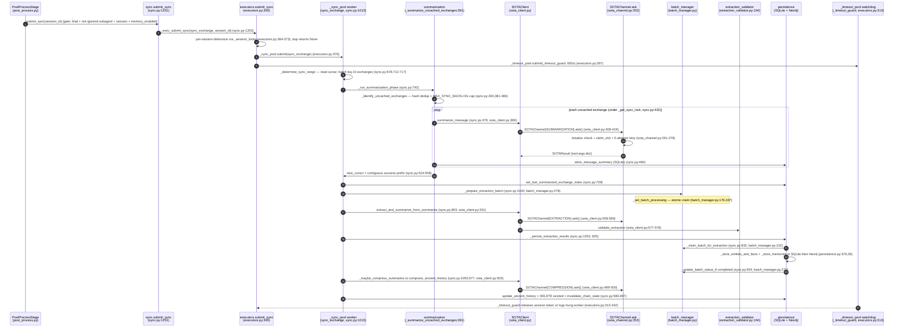

# Deep-Dive 01 — The SOTA Sync Pipeline

> **Topic 1 of 10** (per [`docs/_analysis/ARCHITECTURE_DECOMPOSITION.md`](../ARCHITECTURE_DECOMPOSITION.md) §7).
> Scope: `memory/sync.py` (1,404 LOC) + `sota_channel.py` (431) + `sota_client.py` (593) +
> `executors.py` (432) + `batch_manager.py` (392) + `extraction_validator.py` (201).
> All `file:line` references are grep-verified against HEAD. Documentation-only — no source modified.

---

## 1. Overview

The SOTA ("state-of-the-art") sync pipeline is ChoriProx's **background memory-extraction
system**. After every finalized chat turn, `PostProcessStage` fire-and-forgets a
`submit_sync(session_id)` call (`src/proxy/pipeline/post_process.py:171`). That call hands the
session to a bounded 4-worker thread pool, where `sync_exchange` (`src/memory/sync.py:1013`)
runs a four-phase pipeline entirely off the request path: **(1) exchange identification** —
group raw `messages` rows into user↔assistant exchanges and dedup by content hash against
`message_summaries`; **(2) summarization** — one SOTA LLM call per uncached exchange via
`SOTAClient.summarize_message`; **(3) entity/fact extraction** — a second SOTA call distills the
summaries into entities + relationships, validated by `extraction_validator`, then persisted to
SQLite (source of truth) and Neo4j (best-effort graph); **(4) ancient compression** — when the
rich-summary budget is exceeded, the oldest summaries are compressed into a single "ancient
history" timeline via a third SOTA call. Every SOTA call funnels through `SOTAChannel.ask`
(`src/memory/sota_channel.py:252`), which owns the circuit breaker, the 3-calls/sec slot
scheduler, and the 5-attempt retry loop. The pipeline is deliberately lossy and non-blocking:
any phase can fail, log, and leave the cursor where it was so the next cycle retries.

---

## 2. Sequence Diagram

*The `_summary_pool` (4 workers) carries a **second**, independent ancient-compress stream —
`submit_ancient_compress` (`sync.py:1256`) dispatched from Context V2 (`proxy/context_v2.py:739`)
— which shares the per-session `_get_ancient_lock` with step 27 but is not drawn above to keep
the diagram under the node budget. See §4.*

---

## 3. Step-by-Step Walkthrough

Numbers correspond to the `autonumber` arrows in the diagram.

1. **PostProcessStage fires sync.** After the 8 post-process sub-methods, the stage imports
   `submit_sync` (`post_process.py:154`) and gates on four conditions:
   `is_final_response` (`finish_reason in ("stop","length","content_filter")`, `post_process.py:162`),
   not an ignored subagent, a non-empty `session_id`, and `memory_enabled`
   (`post_process.py:169-171`). Failures are swallowed — sync is non-fatal (`post_process.py:184-191`).
2. **`sync.submit_sync` delegates to the executor.** `sync.py:1251-1253` is a one-liner:
   `return _exec_submit_sync(sync_exchange, session_id)`. `_exec_submit_sync` is
   `memory.executors.submit_sync` imported at `sync.py:620`.
3. **Per-session debounce.** `executors.submit_sync` (`executors.py:345`) extracts `session_id`
   from `args[0]` and, under `_session_locks_lock`, checks `_session_locks`
   (`executors.py:364-373`). If a token already exists for the session, it logs "Sync debounced"
   and returns `None` — PostProcessStage then logs "Sync deferred (debounced)"
   (`post_process.py:178-183`). Otherwise it stores a fresh `object()` token. The token is
   released only through the identity-checked `_release_session_token` (`executors.py:288-299`).
4. **Hand off to `_sync_pool`.** `future = _get_sync_pool().submit(fn, ...)` (`executors.py:376`).
   `_get_sync_pool` lazily creates a `ThreadPoolExecutor(max_workers=4, thread_name_prefix="mem-sync")`
   (`executors.py:59`) and rejects submission if shutdown has begun (`_check_shutdown_locked`,
   `executors.py:41-50`). Two done-callbacks are attached: `_check_future_error` (logs uncaught
   exceptions) and `_on_done_cb` (releases the token + clears hung-tracking) (`executors.py:390-391`).
5. **Arm the watchdog.** A `_timeout_guard_cb` closure is submitted to `_timeout_pool`
   (`executors.py:397`). If the watchdog itself cannot be submitted, the code tries to cancel the
   sync future and release the token (`executors.py:398-414`).
6. **`sync_exchange` determines the work range.** `_determine_sync_range` (`sync.py:678`) reads the
   summarization cursor via `_get_summarization_cursor` (`sync.py:712`, →
   `db_summaries.get_last_summarized_exchange_index:264`), defaults `None → -1`, reads
   `get_max_exchange_index` (`sync.py:715`), and windows
   `end_exchange = min(max_exchange, start_exchange + SYNC_BATCH_SIZE_EXCHANGES - 1)`
   (`sync.py:717`, `SYNC_BATCH_SIZE_EXCHANGES = 10` at `sync.py:675`). Returns `None` (no work) if
   `start_exchange > max_exchange` (`sync.py:719-720`). A separate recovery path
   (`_recovery_start/_end`) converts message indices to exchange indices (`sync.py:690-708`).
7. **Summarization phase entry.** `_run_summarization_phase` (`sync.py:742`) calls
   `_summarize_uncached_exchanges(session_id, _get_sota(), start_exchange, end_exchange)`
   (`sync.py:749`). `_get_sota()` (`sync.py:626`) lazily builds the module singleton `SOTAClient`
   (`sync.py:618`, env at `sync.py:604-608`).
8. **Exchange identification + dedup.** `_identify_uncached_exchanges` (`sync.py:260`) snapshots the
   message range (`ORDER BY message_index`, `sync.py:273-279`), groups rows by `exchange_index`,
   skips exchanges whose first user message is `< 20` chars (`sync.py:310-315`), computes/lookup a
   16-char `content_hash` (`sync.py:317-320`), and drops any exchange already present in
   `message_summaries` by `(session_id, exchange_index, content_hash)` (`sync.py:334-368`). The
   backlog cap is applied at `sync.py:381-386` (see **Drift A** below).
9. **Per-exchange summarization loop.** For each uncached exchange, under the per-session
   `_get_sync_lock(session_id)` (`sync.py:432`, acquired per-iteration at `sync.py:438`), the worker
   renders the exchange to text: user/assistant lines plus `tool` lines truncated to 300 chars with
   filesystem paths sanitized to `[path]` (`sync.py:465-470`). It builds a `[Previous Context]`
   block via `_build_previous_context(all_rows, ..., max_chars=20000)` (`sync.py:475`, def at
   `sync.py:195`), which also **pops** any cached reasoning for assistant messages
   (`_pop_reasoning`, `sync.py:240`, def at `sync.py:155`).
10. **Summarization SOTA call.** `sota_client.summarize_message(...)` (`sync.py:478` →
    `sota_client.py:369`) builds a user prompt (history block + instructions + target message
    capped at 8000 chars, `sota_client.py:390-405`) and constructs a
    `SOTAChannel(mode=SOTAMode.SUMMARIZATION, tools=[__SOTA_SUMMARIZE_MESSAGE_TOOL__], temperature=0.1, ...)`
    (`sota_client.py:408-418`), forcing the model to call the `submit_summary` tool.
11. **Channel mechanics.** `SOTAChannel.ask` (`sota_channel.py:252`) validates input
    (`_validate_input:183`), checks `_sota_breaker.can_execute()` and raises `CircuitBreakerOpen`
    if open (`sota_channel.py:261-265`), then enters `with _claim_slot():` (the 3-calls/sec slot
    scheduler, `sota_channel.py:277`, `_sota_rate_limiter.py:12-32`) and a `for attempt in range(5)`
    loop (`sota_channel.py:278`).
12. **Result returned.** On success the channel calls `_sota_breaker.on_success()`
    (`sota_channel.py:353`) and returns a `SOTAResult` (`sota_channel.py:425-432`). In tool-call
    mode the parsed payload is always a dict (the tool arguments) or a raised `SOTAParseError`
    (`sota_channel.py:311-340`). `summarize_message` hard-caps the summary at ~512 tokens
    (`sota_client.py:446-453`).
13. **Summary persisted.** `_db().store_message_summary(session_id, exchange_idx, "user", summary,
    tool_summary, content_hash, model_used=..., token_estimate=..., end_message_index=...)`
    (`sync.py:484-492`). SOTA errors (`SOTATimeoutError`/`SOTAAPIError`/`SOTAParseError`) mark
    `success_flags[i] = False` and `continue` — the exchange stays uncached for the next cycle
    (`sync.py:498-522`).
14. **Contiguous-cursor computation.** After the loop, `_summarize_uncached_exchanges` computes
    `new_cursor` as the **longest all-success prefix** of `success_flags` (`sync.py:524-558`). If
    nothing stored, `new_cursor = start_exchange` (no progress). This is the M5-4 fix: the cursor
    never jumps over a failed exchange.
15. **Cursor advance.** `_run_summarization_phase` writes the cursor via
    `_db().set_last_summarized_exchange_index(session_id, new_cursor)` (`sync.py:759`, →
    `db_summaries.set_last_summarized_exchange_index:234`) only when `new_cursor > current_cursor`.
16. **Batch preparation.** `_prepare_extraction_batch` (`sync.py:1040-1046` →
    `batch_manager.py:278`) finds or creates an `extraction_batches` row. A `completed` batch is
    skipped (`batch_manager.py:286-289`); a batch older than `EXTRACTION_TTL_SECONDS = 600`
    (`batch_manager.py:291`) is reset to `pending` and re-extracted; a `skipped` batch whose
    messages were purged is marked `dead` (`batch_manager.py:302-321`).
17. **Atomic batch claim.** `_set_batch_processing` (`batch_manager.py:176`, called at
    `batch_manager.py:337`) does a conditional `UPDATE ... WHERE status IN ('pending','failed','extracted')`
    and returns `(claimed, was_previously_failed)`; when a concurrent worker wins the race it returns
    `(False, False)` and `_prepare_extraction_batch` bails with `None` (`batch_manager.py:338-340`),
    which `sync_exchange` treats as "stop here" (`sync.py:1047-1048`).
18. **Extraction phase.** `_run_extraction_phase` (`sync.py:778`) pulls the latest rich summaries
    (`_db().get_rich_summaries`, trimmed to the last 10, `sync.py:781-786`), requires
    `MIN_SUMMARIES_FOR_EXTRACTION = 3` meaningful ones or it marks the batch `skipped`
    (`sync.py:791-798`), then calls `_get_sota().extract_and_summarize_from_summaries(session_id, summary_batch)`
    (`sync.py:803`).
19. **Extraction SOTA call.** `extract_and_summarize_from_summaries` (`sota_client.py:531`) builds a
    summaries-text prompt and runs its **own** retry loop `for attempt in range(max_retries + 1)`
    with `max_retries = 2` (`sota_client.py:554-555`), each iteration constructing a fresh
    `SOTAChannel(mode=SOTAMode.EXTRACTION, tools=[__SOTA_SUBMIT_SYNC_TOOL__], temperature=0.2, ...)`
    (`sota_client.py:558-568`). Validation errors are fed back into the next prompt
    (`sota_client.py:583-587`).
20. **Schema validation.** `validate_extraction(args)` (`sota_client.py:577-578` →
    `extraction_validator.py:104`) normalizes entity types to the 10 canonical types
    (`extraction_validator.py:5-6,50-56`), normalizes/inverts relationship types
    (`extraction_validator.py:59-81`), enforces referential integrity
    (`validate_entity_references:84`) and no self-loops (`validate_no_self_loops:96`), and truncates
    over-long fields. After 3 failed attempts the loop raises `SOTAParseError` (`sota_client.py:588-592`).
21. **Persist entry.** `_persist_extraction_results` (`sync.py:1053` → `sync.py:825`) first runs the
    M5-3a Window-2 claim `_claim_batch_for_extraction(batch_id)` (`sync.py:832` →
    `batch_manager.py:132`), a conditional `UPDATE ... SET status='extracted' WHERE status IN ('pending','processing')`.
    The WHERE clause deliberately **excludes** `'extracted'` so exactly one racer wins
    (`batch_manager.py:144-157`). A late worker returns `False` and no-ops.
22. **Entity/fact persistence.** `_store_entities_and_facts(session_id, extraction)`
    (`sync.py:855` → `persistence.py:376`) writes entities then facts in a single SQLite transaction
    (`persistence.py:407-410`), resolving fact source/target IDs against the just-inserted entities
    plus a DB fallback (`_resolve_fact_entity_ids`, `persistence.py:170-298`). **SQLite is the source
    of truth**: if the SQLite transaction fails, Neo4j writes are skipped entirely
    (`persistence.py:416-419`); otherwise `_store_entities_neo4j` writes batches best-effort
    (`persistence.py:421-425`, MATCH on the `(name, entity_type)` composite key to avoid fan-out).
23. **Memory persistence.** `_store_memories(session_id, events=..., instructions=..., tasks=...)`
    (`sync.py:861-866` → `persistence.py:26`) stores event/instruction/task memories in Neo4j
    (`store_with_supersession` / `store_memory`) and mirrors them into the SQLite `memory_log` table
    (`persistence.py:105-135`). If memories were requested but none stored, `neo4j_failed` is appended
    to persist errors (`sync.py:873-878`).
24. **Terminal batch claim.** `_update_batch_status_if(batch_id, from_status=("extracted","processing"),
    to_status="completed")` (`sync.py:924-928` → `batch_manager.py:210`) is the second atomic gate;
    `rowcount == 0` means another worker completed first and persist returns `False` (`sync.py:929-934`).
    Before this, the M5-3b guard caps the extraction cursor at the summarization cursor so extraction
    cannot advance past a summarization gap (`sync.py:892-904`).
25. **Compression check.** `_maybe_compress_summaries(session_id, safe_context_tokens)`
    (`sync.py:1055` → `sync.py:938`) computes `RICH_SUMMARY_BUDGET = 25%` of safe context and
    `RICH_SUMMARY_THRESHOLD = 75%` of that (`sync.py:953-954`). If total rendered summary tokens
    exceed the threshold **or** there are `> 50` summaries (`sync.py:962`), it evicts
    `max(10, len//5)` oldest summaries (`sync.py:966`).
26. **Compression SOTA call.** Under `_get_ancient_lock(session_id)` (`sync.py:969-970`), it calls
    `_get_sota().compress_ancient_history(session_id, existing_ancient, summaries_to_evict)`
    (`sync.py:977` → `sota_client.py:503`), which calls `_call_compressor` (`sota_client.py:461`,
    `SOTAChannel(mode=SOTAMode.COMPRESSION, tools=None, ...)` at `sota_client.py:489-500`) and then
    verifies the output is non-trivial (≥200 chars) and shares ≥`min(3, 50%)` keywords with the
    evicted summaries, else raises `CompressionError` (`sota_client.py:514-527`).
27. **Ancient write + invalidation.** In one DB transaction the worker writes
    `update_ancient_history`, `DELETE`s the evicted `message_summaries` rows (`sync.py:983-994`),
    then calls `proxy.state.invalidate_chain_state_for_session(session_id)` (`sync.py:996-997`) to
    drop the Context-V2 chain-state cache so the next request rebuilds from the compressed history.
    `CompressionError` keeps the existing summaries intact (`sync.py:1005-1006`).
28. **Watchdog release.** Independently, `_timeout_guard` (`executors.py:313`) blocks on
    `f.result(timeout=600)`. On normal completion or timeout it **always** releases the session token
    in `finally` (`executors.py:341-342`). If the 600s deadline passes, it records the future in
    `_hung_futures` (`executors.py:37-38,327-329`), logs a WARNING with the hung count, and an ERROR
    when all 4 workers are presumed hung (`executors.py:335-340`). Python threads cannot be killed —
    the remedy is visibility + bounding, not thread murder.

---

## 4. Thread Pool Architecture

All four pools live in `src/memory/executors.py` as lazily-created `ThreadPoolExecutor`s guarded by
`_pool_lock` (`executors.py:22`). Total = **14 workers**. Each getter calls
`_check_shutdown_locked()` (`executors.py:41-50`) so no pool is created and no work is submitted
once `_shutdown_requested`/`_shutdown_complete` is set (`executors.py:23-24`).

| Pool | Workers | Thread prefix | Feeder(s) | Runs |
|---|---|---|---|---|
| `_sync_pool` | 4 | `mem-sync` (`executors.py:59`) | `executors.submit_sync` (`executors.py:345`) ← `sync.submit_sync` (`sync.py:1251`) ← `PostProcessStage` (`post_process.py:171`) | `sync_exchange` (the whole 4-phase pipeline) |
| `_query_pool` | 2 | `mem-query` (`executors.py:75`) | **none** — see note | (reserved, currently dormant) |
| `_summary_pool` | 4 | `mem-summary` (`executors.py:88`) | `executors.submit_summary` (`executors.py:422`) ← `sync.submit_ancient_compress` (`sync.py:1317`) ← `proxy/context_v2.py:739` | `_ancient_compress_worker` (`sync.py:1330`) |
| `_timeout_pool` | 4 | `timeout-guard` (`executors.py:101`) | only the watchdog arm inside `submit_sync` (`executors.py:397`) | `_timeout_guard` (600s watchdog per sync future) |

**`_query_pool` note (verified):** `_get_query_pool` (`executors.py:69`) has **no callers** anywhere
in `src/`; the pool is only ever referenced by name in the shutdown list (`executors.py:154`). It is
created lazily and therefore never instantiated at runtime. `memory/AGENTS.md:183` labels it "Memory
queries," but no production code feeds it. Treat it as reserved/dormant.

**Two ancient-compress paths, one lock.** Ancient compression reaches SOTA two ways:
- *Synchronous*, inside `sync_exchange` on a `_sync_pool` worker: `_maybe_compress_summaries`
  (`sync.py:938`) calls `compress_ancient_history` directly under `_get_ancient_lock` (`sync.py:969-970`).
- *Asynchronous*, from Context V2's budget trim: `submit_ancient_compress` (`sync.py:1256`) routes
  through `_exec_submit_summary` (`sync.py:1317`) onto `_summary_pool`, running
  `_ancient_compress_worker` (`sync.py:1330`), which also takes `_get_ancient_lock` (`sync.py:1339-1340`).

Both serialize per-session read→SOTA→write on the same `_get_ancient_lock(session_id)`
(`sync.py:101-117`), so the two pools never interleave a compress for the same session. The async
path is bounded by `_ANCIENT_COMPRESS_MAX_PENDING = 100` (`sync.py:44`): excess dispatches are
dropped (`sync.py:1297-1306`) and the truncated summaries stay in the DB for the next eviction.

**Shutdown semantics.**
- `atexit.register(_graceful_db_shutdown)` (`executors.py:276`) is the live exit path. It splits a
  10s budget — 70% to thread-pool drain, 30% to `db_pool._shutdown_global_pool`
  (`executors.py:248-273`) — and runs LIFO after `db_pool`'s terminal fallback (registered earlier,
  `executors.py:232-237`).
- `_shutdown_thread_pool(timeout=30)` (`executors.py:118`) uses a **bounded wait**: each pool's
  `shutdown(wait=True)` runs in a daemon thread joined via `Event.wait(timeout)`; on timeout it logs
  a WARNING and returns control rather than hanging the interpreter (`executors.py:177-214`). It is
  idempotent and clears `_hung_futures` under the pool lock (`executors.py:162-163`).
- `_signal_handler` (`executors.py:219-229`) only sets `_shutdown_requested = True` and re-raises
  with the default handler — it **never** calls `pool.shutdown()` from signal context (re-entrant
  lock hazard). Real cleanup happens via atexit. SIGTERM/SIGINT are registered only in the main
  thread (`executors.py:280-285`).

---

## 5. Key Invariants

1. **`MAX_SYNC_BACKLOG = 100`** (`sync.py:77`). When more than 100 exchanges are uncached, the
   pipeline processes only the first 100 of the ascending-order list — i.e. the **oldest** 100
   (`sync.py:381-386`, log at `sync.py:383` says "processing oldest"). See **Drift A**.
2. **Per-session debounce.** At most one `sync_exchange` job is queued/running per `session_id`;
   a concurrent `submit_sync` returns `None` (`executors.py:364-373`). Ownership is released only
   via the identity-checked `_release_session_token` (`executors.py:288-299`), so a stale completion
   can never delete a newer submit's token.
3. **Contiguous cursor advance (M5-4).** The summarization cursor advances only over the longest
   all-success prefix; the first failed exchange blocks the cursor and stays in the window for the
   next cycle (`sync.py:524-558`). Extraction is likewise capped at the summarization cursor (M5-3b,
   `sync.py:892-904`).
4. **Two atomic batch gates.** `_set_batch_processing` (`batch_manager.py:176`) and
   `_claim_batch_for_extraction` (`batch_manager.py:132`) are conditional `UPDATE`s; exactly one
   racer sees `rowcount > 0`. The claim's WHERE clause must **not** include `'extracted'`
   (`batch_manager.py:144-157`).
5. **SQLite is the source of truth; Neo4j is best-effort.** If the SQLite entity/fact transaction
   fails, Neo4j writes are skipped (`persistence.py:416-419`). Neo4j failures are logged and
   surfaced as `persist_errors` but never crash the pipeline.
6. **SOTA circuit breaker.** `_sota_breaker = CircuitBreaker(failure_threshold=5,
   recovery_timeout_seconds=120, name="sota")` (`sota_channel.py:214`). When open, `ask` raises
   `CircuitBreakerOpen` (`sota_channel.py:261-265`), and `submit_ancient_compress` skips dispatch
   entirely (`sync.py:1287-1293`). The proxy continues with truncated summaries (non-fatal).
   See **Drift B** — this is **5 / 120s**, not the "3 failures" claimed in AGENTS.md.
7. **5-attempt channel retry with a 3-calls/sec slot scheduler.** Every SOTA call claims a slot
   (`_SOTA_MIN_INTERVAL = 1/3`, `_sota_rate_limiter.py:12`) and retries up to 5 times
   (`sota_channel.py:278`). Backoff is **mixed**, not uniformly fixed — see **Drift C**.
8. **Reasoning cache is bounded + TTL'd.** `_cache_reasoning` (`sync.py:126`) caps at
   `_MAX_REASONING_ENTRIES = 500` (`sync.py:123`) with `_REASONING_TTL_SECONDS = 600`
   (`sync.py:124`); entries are *popped* (consumed) when `_build_previous_context` reads them
   (`sync.py:240`).
9. **`_ANCIENT_COMPRESS_MAX_PENDING = 100`** (`sync.py:44`) bounds the async compress queue; it is
   in-process only — a restart drops it (AGENTS.md:270).
10. **Sync locks are outside the global hierarchy.** `_sync_locks` (`sync.py:86`) and
    `_ancient_locks` (`sync.py:97`) are module-local and deliberately excluded from the `state.py`
    #0–#14 lock ordering (`sync.py:102-113`). The **one** global lock a sync worker touches is
    `_chain_state_lock` (#10), via `invalidate_chain_state_for_session` (`sync.py:996-997,1355-1356`).

---

## 6. Landmines

- **Debounce returns `None`, not an error.** A `None` from `submit_sync` means "already running,"
  not failure. PostProcessStage logs it as "Sync deferred (debounced)" (`post_process.py:178-183`).
  Don't "fix" it by removing the per-session token — that re-enables concurrent same-session syncs
  and the cursor races they cause (AGENTS.md:268).
- **Concurrency tests need `threading.Barrier`.** The `_set_batch_processing` /
  `_claim_batch_for_extraction` races cannot be exercised with sequential "two calls in a row"
  tests. Use `tests/concurrency_harness.py`; see `tests/integration/test_sync_batch_toctou.py`
  (AGENTS.md:267).
- **Don't call `pool.shutdown()` from a signal handler.** `_signal_handler` only sets a flag and
  re-raises (`executors.py:219-229`); cleanup is via atexit. Calling shutdown in signal context
  risks re-entrant lock acquisition mid-submit (AGENTS.md:269).
- **`_ANCIENT_COMPRESS_MAX_PENDING` is in-process.** Restart drops the pending queue; truncated
  summaries remain in the DB and re-dispatch on the next eviction (AGENTS.md:270, `sync.py:44`).
- **Circuit-breaker-open is a silent skip.** When `_sota_breaker` is open, `submit_ancient_compress`
  returns `None` without dispatching (`sync.py:1287-1293`); tests must reset it
  (`reset_sota_circuit_breaker` autouse fixture) or failures cascade across tests.
- **429s count toward the breaker.** A steady 429 stream calls `_sota_breaker.on_failure()` on every
  attempt (`sota_channel.py:381-389`); without this a persistent rate-limit would burn
  `5 × Retry-After` sleeps before the breaker ever opened. Retry-After is capped by
  `PROXY_SOTA_RETRY_AFTER_CAP` (default 60s, clamped `[1,300]`, `sota_channel.py:31-44,153-180`) so
  a malicious upstream cannot pin a `_sync_pool` worker for days.
- **`_query_pool` looks wired but isn't.** It has no feeder (§4). Don't assume memory queries run on
  a dedicated pool — they currently run inline on the caller.
- **Two compression paths share `_get_ancient_lock`.** If you add a third compress trigger, route it
  through `_get_ancient_lock(session_id)` (`sync.py:101`) or you will interleave read→SOTA→write for
  the same session and corrupt `ancient_history`.
- **Extraction must not outrun summarization.** The M5-3b cap (`sync.py:892-904`) is load-bearing:
  removing it lets extraction jump the cursor past unsummarized exchanges, permanently dropping them
  from `_identify_uncached_exchanges` output.

### ⚠️ Drift A — backlog cap processes OLDEST, not newest

`sync.py:77` comment ("only process newest N") and `memory/AGENTS.md:158` ("caps processing to
newest N") both say **newest**, but the code takes `uncached = uncached[:MAX_SYNC_BACKLOG]`
(`sync.py:386`) on an ascending-order list and logs "processing **oldest** %d" (`sync.py:383`).
The actual behavior (oldest-first) is the correct one — it keeps the contiguous-cursor advance
consistent. The comments are stale.

### ⚠️ Drift B — SOTA breaker is 5 failures / 120s, not 3

`memory/AGENTS.md:175-176` states the channel "circuit breaker opens after 3 consecutive failures."
The actual SOTA breaker is `CircuitBreaker(failure_threshold=5, recovery_timeout_seconds=120,
name="sota")` (`sota_channel.py:214`). The "3 / 30s" figures are the **class defaults**
(`circuit_breaker.py:35-37`) used by the *Neo4j* breaker (`proxy.state.neo4j_circuit_breaker`,
documented correctly at `memory/AGENTS.md:214-217`) — the AGENTS.md "Channel retry" section
conflates the two.

### ⚠️ Drift C — retry is NOT uniformly "fixed 2.5s, no exponential"

`memory/AGENTS.md:175` claims "Fixed 2.5s delay (no exponential backoff)." The channel actually
uses **mixed** backoff (`_SOTA_RETRY_DELAY = 2.5`, `_sota_rate_limiter.py:13`):
- **Parse errors** — exponential + jitter: `2.5 * (2 ** attempt) + random.uniform(0,1)` (`sota_channel.py:367`).
- **5xx (502/503/504)** — exponential + jitter (`sota_channel.py:393`).
- **Timeout** — fixed 2.5s (`sota_channel.py:412`).
- **General API error** — fixed 2.5s (`sota_channel.py:423`).
- **429** — server `Retry-After`, capped (`sota_channel.py:389`).

### ⚠️ Drift D — minor: dead `SOTA_MAX_INPUT_CHARS` in sync.py + lock-range wording

`sync.py:614` defines `SOTA_MAX_INPUT_CHARS = SOTA_MAX_INPUT_TOKENS * 4` (= 512,000) with a comment
saying "~409,600 chars" — the comment arithmetic is wrong **and** the constant is unused. The
effective input cap is `_sota_rate_limiter.py:8` (`256000 * 0.60 * 4` = 614,400), imported by
`sota_client.py:19` and `sota_channel.py:186`. Separately, `sync.py:106-107` describes the global
lock hierarchy as "#0–#13 (14 positions)" and `memory/AGENTS.md:160` as "#0-#12", whereas the root
and `src/proxy/AGENTS.md` define **#0–#14 (15 positions**, #14 = `dedup_lock`). Both sync-side
references predate the addition of position #14.

---

## 7. Cross-References

- **Topic 3 — Tool Result Handling.** Tool results are the *input* this pipeline summarizes. The
  live re-query loop (`memory/tool_loop.py`, `run_memory_tool_loop`) executes tools and persists the
  resulting `role="tool"` messages to SQLite; `_summarize_uncached_exchanges` later reads them,
  truncating tool content to 300 chars and sanitizing paths to `[path]` (`sync.py:465-470`).
  Reasoning emitted during tool interception is stashed via `_cache_reasoning`
  (`proxy/pipeline/tool_interception.py:63-67`) and from PostProcessStage's MiniMax reasoning extract
  (`post_process.py:238-242`), then consumed by `_pop_reasoning` during summarization
  (`sync.py:155,240`). Without tool-result persistence there is nothing for sync to extract.
- **Topic 10 — Lock Hierarchy / State Management.** Executor shutdown is a state interaction:
  `_shutdown_requested`/`_shutdown_complete` (`executors.py:23-24`) gate every pool getter and
  submit, and `_graceful_db_shutdown` (`executors.py:248`) coordinates the atexit drain with
  `db_pool`'s terminal shutdown under a single bounded deadline. The sync module's per-session locks
  (`_sync_locks` `sync.py:86`, `_ancient_locks` `sync.py:97`) are deliberately **outside** the
  `state.py` #0–#14 hierarchy (`sync.py:102-113`) — *except* that background workers acquire global
  lock **#10 `_chain_state_lock`** through `invalidate_chain_state_for_session`
  (`sync.py:996-997,1355-1356`; `proxy/state.py:499`). That is the single point where the background
  pipeline touches the global lock ordering, and it runs off the request path so it cannot deadlock
  with request-path locks held in ascending order.
- **Companion docs.** [`docs/_analysis/ARCHITECTURE_DECOMPOSITION.md`](../ARCHITECTURE_DECOMPOSITION.md)
  §6 (memory & persistence subsystem), [`docs/_analysis/PIPELINE_MAP.md`](../PIPELINE_MAP.md)
  (PostProcessStage), and the unified `sync_exchange` spec (see internal
  documentation). Module operating context: [`src/memory/AGENTS.md`](../../../src/memory/AGENTS.md)
  §"SOTA Background Sync" (lines 151-192) — noting Drift B/C above.
