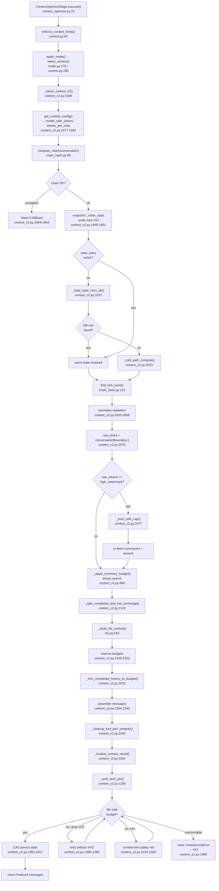
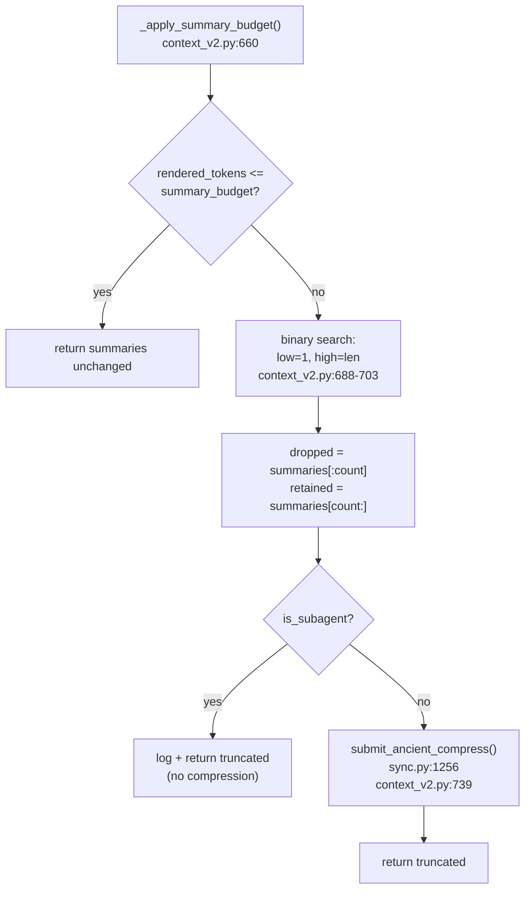
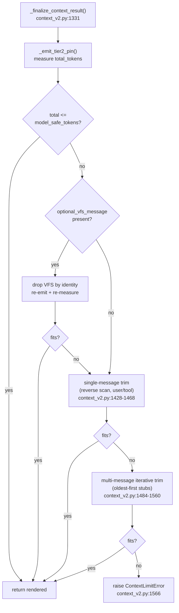

# Deep Dive 02 — Context V2 Internals

## Overview

Context V2 is the chain-hash context assembly pipeline that decides which
messages reach the upstream LLM on every `POST /v1/chat/completions`. It
replaced the monolithic V1 summarizer entirely (`src/proxy/context.py:296-310`
delegates unconditionally to `_select_context_v2`). The pipeline computes a
cumulative SHA-256 hash chain over the non-system conversation, compares it
against the previous turn's chain to detect forks (edits), and assembles a
budget-constrained prompt from three zones: a **system zone** (primary system
prompt + Tier-2 pin), a **summary zone** (SOTA-produced per-exchange summaries
+ ancient compressed history), and a **live zone** (retained raw messages
split into completed history + the current user-led exchange, with VFS
inserted at the boundary). Every return path terminates at a universal
finalizer that guarantees `message_tokens + tool_schema_tokens <=
model_safe_tokens` or raises `ContextLimitError` (HTTP 413). State is keyed
on `(session_id, model_name)` in a 100-entry LRU OrderedDict guarded by lock
#10, with CAS versioning to survive concurrent requests and restart recovery
from SQLite.

---

## Architecture Diagram

### Diagram A — Main-Agent Happy Path



### Diagram B — Summary Budget Binary Search + Ancient Compression



### Diagram C — Finalizer Recovery Ladder



---

## Step-by-Step Walkthrough

### 1. Entry: ContextOptimizeStage (pipeline stage 5)

`ContextOptimizeStage.execute()` (`context_optimize.py:23`) first calls
`enforce_context_limits(ctx.body, model_cfg)` (`context.py:62`) — a pre-trim
guard that rejects requests whose **un-trimmable** portion (tool schemas +
system prompt) alone exceeds the model's raw context limit. On `ValueError`,
it raises `StageAbort(413)` immediately without burning an upstream call
(`context_optimize.py:50-52`).

### 2. apply_mode → select_context

After mode resolution and system-prompt merge, `apply_mode()` calls
`select_context(session_id, body["messages"], model_name, model_cfg,
is_subagent, ctx, tools)` at `mode.py:276-284`. The V1 path is deleted;
`select_context` (`context.py:296-310`) unconditionally delegates to
`_select_context_v2`.

### 3. Budget resolution

`_select_context_v2` (`context_v2.py:1569`) calls `get_context_config()`
(`context_v2.py:1577`) which resolves `model_safe_tokens` and
`tokens_per_char` (always 0.25). Tool schema tokens are computed from the
JSON-serialized `tools[]` array (`context_v2.py:1583-1590`).

### 4. Chain computation

The system message is split off (`context_v2.py:1663`), then
`compute_chain(conversation)` (`chain_hash.py:89-119`) produces a cumulative
hash chain over non-system messages. Each hash is
`sha256(f"{prev}:{msg_hash}")[:16]`. A parallel `chain_to_position` dict
enables O(1) boundary validation. On exception, the Wave 6 fallback
(`context_v2.py:1669-1843`) attempts a best-effort cleaned + VFS-assembled
response without chain state.

### 5. State snapshot (lock #10)

Under `_chain_state_lock` (position #10, `state.py:109`), the pipeline reads
`_chain_state[(session_id, model_name)]` and bumps LRU recency via
`move_to_end` (`context_v2.py:1848-1851`). Fields are copied to locals; the
lock is released for I/O.

### 6. Restart recovery / cold path

If no in-memory entry exists, `_load_state_from_db()`
(`context_v2.py:777-924`) attempts restart recovery from SQLite
(`conversation_summaries.raw_start_message_index` + per-message `chain_hash`
columns). If the DB has no row, or chain_hash gaps are detected, the cold
path fires: `_cold_path_compute()` (`context_v2.py:927-1046`) re-trims from
the end of the conversation to `low_watermark`, computes a fresh
`boundary_chain`, and fetches summaries + ancient from the DB.

### 7. Fork detection

`find_fork_point(new_chain, snap_last_chain)` (`chain_hash.py:122-136`)
returns the first index where the chains diverge. A fork means the client
edited or deleted messages since the last turn.

### 8. Boundary validation

The boundary validation block (`context_v2.py:2020-2069`) decides whether
the cached `boundary_idx` / `boundary_chain` remain valid:

- **Cold (snap_version is None):** use `_cold_path_compute` results.
- **Warm, boundary at 0:** accept as-is.
- **Warm, positional match:** `new_chain[boundary_idx - 1] ==
  snap_boundary_chain` → accept.
- **Warm, hash found at different position:** if `fork_idx < pos + 1` (fork
  precedes boundary), cold recompute; otherwise accept the repositioned
  boundary.
- **Warm, hash absent:** cold recompute.

### 9. Raw block + eviction

`raw_block = conversation[boundary_idx:]` (`context_v2.py:2072`). If
`raw_tokens >= high_watermark` (default 95% of safe budget),
`_evict_with_cap()` (`context_v2.py:1058-1191`) drops oldest units until
under `low_watermark` (default 65%), capped at the last-summarized exchange
boundary. Summaries and ancient are re-fetched post-eviction.

### 10. Summary budget (binary search)

`_apply_summary_budget()` (`context_v2.py:660-774`) caps the rendered summary
block at `V2_SUMMARY_BUDGET_RATIO` (default 15%) of `model_safe_tokens`. When
over budget, a binary search (`context_v2.py:688-703`) finds the minimum
number of oldest rows to drop (the fit predicate is monotonic). Dropped rows
are dispatched to `submit_ancient_compress()` (`sync.py:1256`) for async
re-compression into the ancient tier.

### 11. Tier-2 capture (pre-trim)

`_capture_tier2_instructions()` (`context_v2.py:1194-1253`) scans `raw_block`
tool results for sub-AGENTS.md instruction suffixes and records them into
`state.instruction_files_by_workspace` (`state.py:358`). Runs pre-trim so
every tool result is complete or wholly evicted, never partial.

### 12. Live-tail split

`_split_completed_and_live_exchange(raw_block)` (`context_v2.py:64-108`)
deep-copies the raw block, locates the most recent user unit, walks backward
over any consecutive-user run, and returns `(completed_history,
live_exchange)`. The live exchange is atomic — it always contains the full
`user → assistant(tool_calls) → tool*` unit.

### 13. VFS placement

`_build_vfs_context(session_id, ctx, vfs_budget, tokens_per_char)`
(`vfs.py:543`) builds the VFS block (5% of safe budget). Per the cache-safe
tail spec, VFS is inserted **after** completed history and **before** the
live exchange (`context_v2.py:2269-2339`). If `non_vfs_total + vfs_tokens >
model_safe_tokens`, VFS is omitted rather than splitting the live exchange.

### 14. Trim budget + completed history trim

The trim budget (`context_v2.py:2195-2203`) is:
```
model_safe_tokens - system_prompt - tool_schema - summary - ancient - vfs - tier2
```
`_trim_completed_history_to_budget()` (`context_v2.py:246-292`) drops the
largest completed units first until the discretionary portion fits.
`_sub_agent_return` messages are extracted as mandatory (never trimmed) at
`context_v2.py:2205-2214`.

### 15. Assembly

Messages are assembled in canonical order (`context_v2.py:2254-2340`):
```
sys_msg → summary_block → ancient_block → completed_history →
mandatory_history → VFS → live_exchange
```

### 16. Tool-pair cleanup

`_cleanup_tool_pair_integrity()` (`context_v2.py:111-191`) performs three
repairs: (a) drops barrier messages wedged between tool_call and result,
(b) drops orphan tool results whose parent assistant was pruned, (c) injects
synthetic `[Result pruned...]` tool results for assistant tool_calls whose
results were evicted.

### 17. Finalizer safety net

`_finalize_context_result()` (`context_v2.py:1331-1566`) is the universal
terminal boundary. It emits Tier-2, measures, and if over budget: drops VFS
→ single-message content-trim → multi-message iterative trim → raises
`ContextLimitError`. See Diagram C.

### 18. Tier-2 pin emission

`_emit_tier2_pin()` (`context_v2.py:1256-1328`) strips Tier-2 suffixes from
tool-result messages and inserts a `role="system"` pin immediately after the
first system message. Non-mutating: returns a new list. Paired gate: empty
instruction map → no strip, no pin.

### 19. CAS persist

Only after finalization succeeds, the pipeline persists state under lock #10
(`context_v2.py:2362-2417`). A version-based CAS prevents a stale thread from
overwriting a concurrent update. On CAS failure, `ctx.v2_boundary_idx` and
`ctx.v2_boundary_chain` are set to None (next turn takes the cold path).

---

## The Three-Zone Budget Engine

### Zone definitions

| Zone | Contents | Budget source |
|---|---|---|
| **System zone** | Primary system prompt + Tier-2 instruction pin | Un-trimmable; counted first |
| **Summary zone** | `[PAST CONTEXT]` summaries + `[TIMELINE]` ancient | `V2_SUMMARY_BUDGET_RATIO` (15%) + `V2_ANCIENT_MAX_RATIO` (10%) of safe |
| **Live zone** | Completed history + mandatory sentinels + VFS + live exchange | Residual after system + summary reservations |

### How `CONTEXT_BUDGET_RATIO` and `USABLE_CONTEXT_RATIO` interact

`CONTEXT_BUDGET_RATIO` (`state.py:421`, default **0.75**, env
`PROXY_CONTEXT_BUDGET_RATIO`, clamped to `[0.1, 0.95]`) is the master
discount applied to the model's raw `context_limit` to produce
`safe_context_tokens`:

```python
# model_registry.py:198
"safe_context_tokens": int(cfg.context_limit * ratio)
```

A per-model `budget_ratio` on `ModelConfig` overrides the global default but
is clamped to the same `[0.1, 0.95]` range (`model_registry.py:183`).

`USABLE_CONTEXT_RATIO` (`tool_loop.py:284`) is a **consumer** of the same
value — it reads `CONTEXT_BUDGET_RATIO` at import time and uses it to cap
the tool-loop working set at `CONTEXT_TOKEN_LIMIT * 0.75 = 19500` tokens
(`tool_loop.py:1231`). The two ratios are the same number; the tool loop
simply applies it to a fixed 26000-token ceiling rather than the per-model
window.

### How `resolve_effective_context_limit` clamps

`resolve_effective_context_limit(model_cfg, override)` (`context.py:47-59`)
implements the `^^context` command's reduce-only override:

```python
real = model_cfg.context_limit   # e.g. 128000
if override is None: return real
if not real:       return override
return min(override, real)       # never exceeds the real window
```

The override is stored on `Agent.context_limit_override` and threaded through
`get_context_config(..., context_limit_override=...)` at
`context_v2.py:1577-1579`. The override path returns a **fresh, un-cached**
config dict (`model_registry.py:184-195`) to prevent cross-session leak.

### Watermarks

Within the safe budget, two watermarks govern eviction:

| Constant | Default | Env | Role |
|---|---|---|---|
| `V2_LOW_WATERMARK_RATIO` | 0.65 | `V2_LOW_WATERMARK_RATIO` | Eviction target — drop until under |
| `V2_HIGH_WATERMARK_RATIO` | 0.95 | `V2_HIGH_WATERMARK_RATIO` | Eviction trigger — raw_tokens above this fires eviction |

Both are clamped at import time (`context_v2.py:52-55`); high is forced >=
low.

### Summary + ancient sub-budgets

| Constant | Default | Applied to |
|---|---|---|
| `V2_SUMMARY_BUDGET_RATIO` | 0.15 | Max rendered summary block as fraction of safe |
| `V2_ANCIENT_MAX_RATIO` | 0.10 | Max ancient payload as fraction of safe |

These are **not** additive reservations against the live zone — they cap
their respective tiers independently. The live zone's trim budget
(`context_v2.py:2195-2203`) subtracts the **actual rendered** summary and
ancient costs (which may be less than the cap).

---

## Chain-Hash Fork Detection

### The chain structure

`compute_chain()` (`chain_hash.py:89-119`) produces:

- `chain_list[i]` = `sha256(f"{chain_list[i-1]}:{msg_hash[i]}")[:16]`
  (cumulative; `chain_list[0]` = first message's own hash).
- `chain_to_position` = `{chain_hash: index}` for O(1) lookup.

System messages are **skipped** (`chain_hash.py:109`) because the system
prompt changes every turn (mode injection, Tier-2, etc.).

The canonicalizer (`chain_hash.py:23-81`) normalizes: role lowercased,
content None→"" / list→joined text, tool_calls restricted to
`{id, type, function.{name, arguments}}`, `tool_call_id` dropped. This
mirrors `memory.db._normalize_content` exactly so DB-stored `chain_hash`
values (written at message persist time) are byte-identical to runtime
values — enabling restart recovery.

### The `_chain_state` store

```python
# state.py:470
_chain_state: OrderedDict = OrderedDict()   # max 100 entries (state.py:472)
```

Keyed on `(session_id, model_name)`. Each entry (`state.py:487-496`):

```python
{
    "last_chain": [...],        # full chain from last turn
    "boundary_idx": int,        # conversation position of summary/live split
    "boundary_chain": str|None, # chain hash at boundary_idx - 1
    "summaries": [...],         # cached summary rows
    "ancient": str,             # cached ancient text
    "version": int,             # CAS version counter
}
```

LRU eviction at 100 entries (`context_v2.py:1992-1998`,
`context_v2.py:2407-2413`). Lock #10 (`state.py:109`) guards all access.
The canonical access pattern (documented at `state.py:451-469`) is:
snapshot under lock → release for I/O → re-acquire for CAS write.

### What happens on fork

`find_fork_point()` (`chain_hash.py:122-136`) returns the first divergent
index. Fork detection drives boundary validation
(`context_v2.py:2036-2069`):

1. If the fork index precedes the cached boundary (`fork_idx < pos + 1`),
   the cached summaries may reference messages the client edited →
   **full cold recompute** (`_cold_path_compute`).
2. If the fork is after the boundary, the boundary remains valid — the
   pipeline reuses cached summaries and ancient, and only the live zone
   grows.
3. If the boundary hash is absent from the new chain entirely (message
   deleted), cold recompute.

`invalidate_chain_state_for_session(session_id)` (`state.py:499-507`) drops
all entries for a session (multi-model safe). The next request takes the
cold path with a fresh DB read.

---

## Key Invariants

1. **Sentinel preservation (H1/H2).** `_sub_agent_return` messages are
   extracted as mandatory history (`context_v2.py:2205-2209`) and are never
   trimmed by `_trim_completed_history_to_budget`. In the tool loop,
   sentinels are always kept regardless of budget
   (`tool_loop.py:116-118`, H2) and appended last so they survive the hard
   count cap (`tool_loop.py:148`, H1). The finalizer's content-trim
   explicitly skips `_sub_agent_return=True` messages
   (`context_v2.py:1432-1433`, `context_v2.py:1495-1496`).

2. **VFS never bleeds into the live user zone.** VFS is inserted between
   `completed_history + mandatory_history` and `live_exchange`
   (`context_v2.py:2269-2340`). The splitter guarantees the live exchange
   starts at the most recent user run and includes all subsequent
   assistant/tool messages atomically (`context_v2.py:64-108`). VFS is
   omitted entirely when no user-led exchange exists
   (`context_v2.py:2131`).

3. **Tool-pair integrity.** No synthetic message (VFS, barrier, Tier-2 pin)
   may appear between an `assistant(tool_calls)` message and its matching
   `role=tool` results. `_cleanup_tool_pair_integrity()`
   (`context_v2.py:111-191`) is the belt-and-suspenders enforcer: it drops
   wedged barriers, removes orphan results, and injects synthetic results
   for pruned tool_calls.

4. **Finalizer guarantee.** Every return path from `_select_context_v2` and
   `_build_subagent_context` passes through `_finalize_context_result`
   (`context_v2.py:1331`). The returned list always satisfies
   `message_tokens + tool_schema_tokens <= model_safe_tokens` OR the
   function raises `ContextLimitError`. There is no silent overrun.

5. **CAS before persist.** Chain state is mutated only after finalization
   succeeds (`context_v2.py:2344-2346` comment). A rejected candidate
   (ContextLimitError) leaves session state untouched — the next turn
   retries with the same boundary.

6. **Deep copies at split boundaries.** `_split_completed_and_live_exchange`
   deep-copies its input (`context_v2.py:78`). `_trim_completed_history_to_budget`
   deep-copies before grouping (`context_v2.py:255`). The finalizer's
   content-trim deep-copies before mutation (`context_v2.py:1443`,
   `context_v2.py:1486`). No aliasing between the returned messages and the
   caller's `body["messages"]`.

7. **Chain-hash determinism.** `_canonical()` (`chain_hash.py:23-81`) mirrors
   `memory.db._normalize_content` exactly. DB-stored `chain_hash` values and
   runtime `compute_chain()` values are byte-identical for the same logical
   message, enabling restart recovery without chain recomputation.

---

## Landmines

### 1. Shallow copies alias nested tool_calls

The splitter, trimmer, and finalizer all use `copy.deepcopy()`. If any future
code path uses `list(messages)` instead, nested `tool_calls` dicts are shared
between the returned candidate and the caller's body. A downstream mutation
(e.g., provider compat rewriting arguments) corrupts the chain-state's cached
view. The root AGENTS.md explicitly mandates: "Always use `copy.deepcopy()`,
never `list()`, when duplicating message lists in pipeline stages."

### 2. Chain-state leak across sessions via cached config

`get_context_config()` caches by model name (`model_registry.py:223-229`).
The `context_limit_override` path returns a **fresh dict** specifically to
prevent one session's `^^context` override from polluting another session's
budget via the LRU cache (`model_registry.py:184-195`). If a future refactor
caches the override path, cross-session budget corruption follows.

### 3. Budget overrun without sentinel preservation

If `_sub_agent_return` messages were included in the discretionary trim
budget, a large sub-agent return could be silently dropped. The pipeline
extracts them as mandatory (`context_v2.py:2205-2214`) and subtracts their
token cost from the trim budget (`context_v2.py:2231-2238`). The finalizer
additionally refuses to trim them (`context_v2.py:1432-1433`). Removing
either guard loses sub-agent state on budget pressure.

### 4. Eviction past the last-summarized boundary

`_evict_with_cap()` (`context_v2.py:1058`) caps eviction at
`max_evictable_boundary` (the position just past the last-summarized
exchange). Evicting further would create a coverage gap: messages gone from
both raw context AND summaries. The only override is the critical safety
valve at `context_v2.py:1125-1132`: if `raw_tokens > high_watermark * 1.10`,
force-evict past the cap (logged at CRITICAL). This is a last resort to
prevent an unrecoverable 413 loop.

### 5. `_chain_state` OrderedDict unbounded growth

The LRU cap is 100 entries (`state.py:472`, env
`PROXY_V2_CHAIN_STATE_MAX_ENTRIES`). The eviction loop
(`context_v2.py:1992-1998`) runs on every insert. If the cap is raised
without considering memory (each entry holds the full chain list + summaries
+ ancient text), a long-running proxy can OOM. Each entry can hold
megabytes for long conversations.

### 6. Restart recovery with chain_hash gaps

`_load_state_from_db()` (`context_v2.py:853-864`) explicitly checks
`total_with_chain != total_non_system` and forces the cold path on any gap.
If this check were removed, a partially-migrated database (e.g., after a
crash mid-persist) would produce a chain that diverges from the runtime
chain at the gap, causing silent boundary corruption.

### 7. Tier-2 pin size underestimation

The trim budget reserves `_reserved_tier2` via a dry-run
(`context_v2.py:2182-2193`). If the actual instruction map grows between the
dry-run and the finalizer's `_emit_tier2_pin` call (concurrent
`_capture_tier2_instructions` from another request), the reservation
underestimates and the finalizer's content-trim fires. This is handled
gracefully but produces unexpected truncation under heavy concurrent tool
traffic.

### 8. `before_index` deprecation in `get_rich_summaries`

`context_v2.py` calls `get_rich_summaries(session_id,
before_index=sql_boundary_idx)` (e.g., `context_v2.py:890`,
`context_v2.py:1001`). The function's docstring (`db_summaries.py:412`)
marks `before_index` as deprecated in favor of `before_exchange_index`. A
future removal of the deprecated parameter would break all V2 summary
fetches silently (the function catches exceptions and returns `[]`).

> **Drift**
>
> `context.py:79-81` states: "ContextLimitError (this module) exists as a
> distinct signal but is currently never raised anywhere in src/." This is
> **stale** — `ContextLimitError` is raised at `context_v2.py:1361`,
> `context_v2.py:1367`, and `context_v2.py:1566`, and is caught by
> `ContextOptimizeStage` to produce HTTP 413 (`context_optimize.py:324-333`).
> The docstring predates the finalizer's implementation.

> **Drift**
>
> `src/proxy/AGENTS.md` has no dedicated Context V2 section. The only
> mention is the file table entry at line 52: "`context.py` + `context_v2.py`
> | Context V2 chain-hash pipeline (V1 was deleted)". The lock hierarchy
> entry for #10 (`_chain_state_lock`) is correct, and the singleton table
> entry for `_chain_state` (`state.py:470`, max 100, env
> `PROXY_V2_CHAIN_STATE_MAX_ENTRIES`) is correct. No behavioral drift —
> just missing documentation depth.

---

## Cross-References

| Topic | Relationship | Key touchpoints |
|---|---|---|
| **Topic 1 — SOTA Sync** | SOTA produces the summaries consumed here. `submit_sync()` (`sync.py:1251`) runs in PostProcessStage after each final response; `submit_ancient_compress()` (`sync.py:1256`) is dispatched by `_apply_summary_budget()` when oldest rows are dropped. The summary rows in `message_summaries` (fetched via `get_rich_summaries`, `db_summaries.py:408`) are the direct input to the summary zone. | `context_v2.py:738-742`, `context_v2.py:984-1016` |
| **Topic 6 — VFS Placement** | The internal cache-safe tail spec governs VFS position. `_build_vfs_context()` (`vfs.py:543`) builds the block; `_split_completed_and_live_exchange()` (`context_v2.py:64`) provides the insertion boundary. VFS is optional in the finalizer (dropped first on overflow). | `context_v2.py:2130-2150`, `context_v2.py:2269-2339`, `context_v2.py:1380-1396` |
| **Topic 3 — Tool Loop** | Tool results feed back into context. `run_memory_tool_loop` (`tool_loop.py`) appends tool results to the conversation that becomes next turn's `full_messages`. The tool loop's own trim (`tool_loop.py:1231`) uses `USABLE_CONTEXT_RATIO` (same 0.75 ratio). `_capture_tier2_instructions()` (`context_v2.py:1194`) scans tool results for instruction blocks. `_cleanup_tool_pair_integrity()` heals tool pairs after pruning. | `context_v2.py:111-191`, `context_v2.py:1194-1253`, `tool_loop.py:281-286` |
| **Pipeline (PIPELINE_MAP.md)** | Context V2 runs inside stage 5 (ContextOptimizeStage). `ContextLimitError` propagates to `_raise_413_if_context_limit` (`context_optimize.py:324-333`). The finalized messages flow to MotivatorStage (stage 6) and ProviderCompatStage (stage 7). | `context_optimize.py:178`, `mode.py:276-284` |
| **Chain-hash deployment** | The internal chain-hash deployment runbook covers operational rollout. `invalidate_chain_state_for_session()` (`state.py:499`) is the manual escape hatch for stuck sessions. | `state.py:499-507` |
