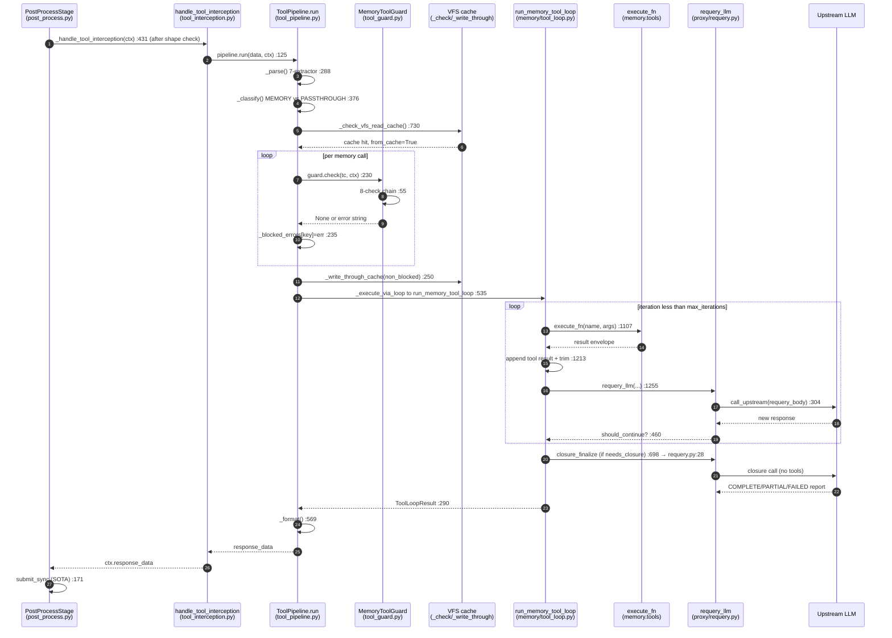

# Deep-Dive 03 — Tool Result Handling Pipeline

## 1. Overview

When an upstream LLM response contains tool calls, ChoriProx does not blindly
forward them to the client. Instead, the `PostProcessStage` (stage 9) diverts
the response into a self-contained sub-pipeline — `ToolPipeline.run()` — that
**parses** the tool calls out of the response, **classifies** them into
proxy-owned *memory* tools versus client-owned *passthrough* tools, **guards**
the memory calls through an 8-check security chain, **executes** the memory
tools locally inside a bounded re-query loop (`run_memory_tool_loop`, which
re-queries the LLM up to N iterations so the model can react to tool results),
and finally **formats** the resolved answer back into the OpenAI response shape.
The whole pipeline is a catch-all boundary: no exception escapes to the caller.
This document traces that flow end-to-end, with grep-verified `file:line`
references, the full guard chain, the re-query loop mechanics, the invariants
that keep it correct, and the landmines that have broken it repeatedly.

---

## 2. Sequence Diagram



*Under 40 nodes. Every arrow maps to a real call site cited in §3.*

---

## 3. Step-by-Step Walkthrough

Numbered to match the diagram arrows.

1. **PostProcessStage diverts the response.** Stage 9 runs an ordered list of
   sub-methods; `_handle_tool_interception` is the 7th
   (`src/proxy/pipeline/post_process.py:131`). It is gated on
   `model_cfg.memory_enabled` (`post_process.py:440-444`) and reads the live
    loop budget from `ProxyFeatures` (`post_process.py:446-448`). Three
    pre-method branches in `_sse_from_response_data` short-circuit before
    `ToolPipeline` is invoked: (1) `isinstance(data, FlaskResponse)` defensive
    unwrap (`app.py:767-777`) that yields a canonical error chunk + `[DONE]`
    on failure; (2) explicit upstream error envelope preservation
    (`app.py:780-787`) that passes dict-error bodies verbatim; (3)
    `chat_completion_shape_error(data)` shape validator (`app.py:793-801`)
    that replaces malformed completions with the canonical protocol error.

2. **`handle_tool_interception` builds the context.** It pre-parses native
   `tool_calls` or falls back to `parse_all_tools_from_content`
   (`src/proxy/pipeline/tool_interception.py:71-85`), collects
   `incoming_tool_names` for alias resolution (`tool_interception.py:93-99`),
   constructs `ToolContext` (`tool_interception.py:101-122`), then calls
   `ToolPipeline().run(data, ctx)` (`tool_interception.py:124-125`).

3. **`ToolPipeline.run()` entry.** The whole body is wrapped in
   `try/except/finally`; the `finally` resets `_cached_reads`
   (`src/proxy/tool_pipeline/tool_pipeline.py:95`, `:285-286`). First it builds
   `valid_params_by_tool` once from the client schema
   (`tool_pipeline.py:108`) — the single source of truth for argument
   normalization (see §6).

4. **`_parse` — the 7-extractor.** `_parse` (`tool_pipeline.py:288`) reads
   native `tool_calls` first (`:319-342`); if absent it parses the content
   (or `reasoning`, when DSML markers are present, `:347-352`) via
   `parse_all_tools_from_content` (`tool_pipeline.py:357`). Each call is
   canonicalized (`canonicalize_tool_name`) and normalized
   (`normalize_tool_arguments(..., valid_params=vpbt.get(name))`) at
   `:327-333` and `:362-364`. Embedded-content extraction runs YAML → DSML →
   XML `<tools>` → `<function=name>` → Markdown ```json``` → bare JSON
   (`src/proxy/tool_parsing/parsers.py:131-220`); native `tool_calls` are
   handled first by `_parse` at `tool_pipeline.py:319-342`, not by the
   content parser. See `tool_parsing/AGENTS.md` for the parser contract.

5. **`_classify` — MEMORY vs PASSTHROUGH.** `_classify` (`tool_pipeline.py:376`)
   splits calls against `registry.get_memory_tool_names()`

   (`tool_pipeline.py:382`), which returns every tool in the `MEMORY` category
   (`src/proxy/tool_pipeline/tool_registry.py:56-58`).

6. **VFS read-cache check (two passes).** For each `read` call,
   `_check_vfs_read_cache` (`tool_pipeline.py:730`) may serve cached content;
   on hit the `ToolCall` is re-created with `from_cache=True`
   (`tool_pipeline.py:192`, `ToolCall.from_cache` at
   `src/proxy/tool_pipeline/tool_call.py:12`) and moved into `memory_calls`.
   The `question`-unattended short-circuit lives in the same loop
   (`tool_pipeline.py:160-171`).

7. **Guard pass (soft-error).** For every memory call,
   `self.guard.check(tc, ctx)` (`tool_pipeline.py:230`) runs the 8-check chain
   (§4). A rejection is **recorded**, not returned: the error is stored in
   `_blocked_errors` keyed by `_stable_args_key(name, args)`
   (`tool_pipeline.py:235`; key helper at `:29`). This is the soft-error path —
   the call still flows to execution where a wrapper converts it to an
   `{"error": ...}` tool result the LLM can see and recover from (§7).

8. **Filter + write-through.** Blocked calls are filtered out *before* the VFS
   write-through (`tool_pipeline.py:246-250`) — the M3-1 cache-poisoning fix.
   `_write_through_cache` (`tool_pipeline.py:659`) processes `bash`
   (invalidate-all) → `write` → `edit`.

9. **`_execute_via_loop` → `run_memory_tool_loop`.** `_execute_via_loop`
   (`tool_pipeline.py:394`) builds the assistant message with
   `make_tool_calls(..., valid_params_by_tool=vpbt)` (`:466`), wraps
   `execute_fn` to serve cached reads (`:489`) and to inject soft errors for
   blocked calls (`:516`), then delegates to `run_memory_tool_loop`
   (`tool_pipeline.py:535`, import at `:410`).

10. **The re-query loop.** `run_memory_tool_loop`
    (`src/memory/tool_loop.py:839`) executes memory tools and re-queries the
    LLM up to `max_iterations` (§5). Each iteration: split memory/passthrough
    (`tool_loop.py:953-958`), execute via `execute_fn` (`:1107`), append results
    (`:1213`), trim to token + count budget (`:1232`, `:1240`), then
    `requery_llm` (`:1255`).

11. **`requery_llm` round-trip.** `requery_llm` (`src/proxy/requery.py:195`)
    applies provider compat, drops empty assistant messages, merges consecutive
    user messages, calls upstream (`requery.py:304`), parses new tool calls,
    and sets `should_continue=True` when memory tools remain
    (`requery.py:448-460`).

12. **Closure.** If the loop ends without a clean model completion,
    `needs_closure=True` at candidate construction (`tool_loop.py:1383-1392`
    and `:1441-1450`) triggers `_resolve_closure`
    (`tool_loop.py:722`) → `closure_finalize` (`src/proxy/requery.py:28`), a
    tools-stripped LLM call that must return a report beginning
    `COMPLETE`/`PARTIAL`/`FAILED` (`requery.py:153`). On failure,
    `render_deterministic_fallback` (`tool_loop.py:576`) synthesizes a report.

13. **`_format`.** `_format` (`tool_pipeline.py:569`) writes `tool_calls` /
    `content` / `finish_reason` back into `response_data`, handles the
    emergency-closure fallback (`:573-586`), and syncs sanitized messages to
    chat history via `_sync_history` (`:613`, `:633`).

14. **Return + SOTA sync.** Control returns to `PostProcessStage`, which (for a
    final response) submits the SOTA background sync
    (`post_process.py:154-171`) — see §8, topic 1.

---

## 4. The 8-Check Guard Chain

`MemoryToolGuard.check` (`src/proxy/tool_pipeline/tool_guard.py:55`) runs the
checks in a **fixed order** and returns the first error string, or `None`.
Order matters: call limits run **last** so a call is only counted if every
other check passes (`tool_guard.py:96-99`).

| # | Check | Line | Rejects | Why |
|---|---|---|---|---|
| 1 | `_check_self_reference` | `:103` | Tool names whose prefix is `agent`/`task`/`ticket` (e.g. `agent:foo`) | Prevents an agent invoking itself / self-modifying its own state. Mirrors `ToolCallGuardException` in `tool_loop.py:40`. |
| 2 | `_check_mode_allowlist` | `:126` | Any tool not in the active mode's `allowed_tool_names` snapshot | Dual-authorization is materialized when the skill installs the mode; the guard reads the TOCTOU-safe `agent.snapshot_mode()` result. `None` mode = unrestricted, empty frozenset = deny-all (`:159`). |
| 3 | `_check_work_mode_actions` | `:452` | MAIN-orchestrator `proxy_ticket` write actions (work mode: only `list_tasks`/`get_task`/`append_review_note`; ticket mode: only `list_tasks`/`get_task`) | The MAIN orchestrator plans/delegates; it must not mutate tickets directly. Sub-agents bypass this check (`:472`) — their access is enforced by check 7. Delegates to the skill `CapabilityTable` when present (`:497-502`). |
| 4 | `_check_ticket_mode_orchestrator` | `:511` | `proxy_work` for MAIN in ticket mode (unconditional); `proxy_ticket`/`proxy_work` for *bare* sub-agents (no ticket canary) | Ticket mode is one-shot — only work-mode agents run work sessions. Bare-sub-agent block is the canary-cache defense (`:546-554`). |
| 5 | `_check_blocked_tools_for_subagent` | `:581` | Sub-agent calls to tools in the skill's `blocked_tools_for_subagent` (default `{"task","question"}`) | Sub-agents cannot spawn sub-sub-agents (no CLI nesting) and cannot `question` (deadlock). Hardcoded fallback at `:616`. |
| 6 | `_check_hash_provenance` | `:353` | MODIFY actions targeting a `short_hash` not seen via a prior `list_tasks` | Forces discovery-before-mutation. Ticket fields via `_TICKET_HASH_FIELDS` (`:44`); work actions via `WORK_HASH_ACTIONS` (`:27`). `_hash_is_known` (`:404`) checks the tracker, then `TaskGraph`, and **fails closed** on Neo4j infra error (`:428`). |
| 7 | `_check_hierarchy` | `:434` | Sub-agent `proxy_*` calls disallowed by the CAT-3 trust gate | Delegates to `proxy.skill_guard.check_sub_agent_proxy_access` (`:446-450`): only trusted builtin skills grant `proxy_*` to sub-agents, with per-skill access levels. |
| 8 | `_check_call_limits` | `:208` | Over-limit calls + sensitive grep paths | Per-session caps via `ToolCallTracker`. The **grep sandbox** (`_check_grep_sandbox`, `:300`) runs *inside* this check (`:218-223`). |

### Check 8 in detail

`_check_call_limits` (`tool_guard.py:208`) consults
`ToolCallTracker.get_instance(session_id)` (`:229`) and the active skill's
`call_limits`:

- **grep sandbox** (`:218-223` → `:300`): rejects `..` traversal, paths that
  `realpath`-resolve outside `cwd`, and sensitive segments
  (`.env`/`.pem`/`.git`, suffixes `.key`/`.token`/`.password`/`credentials`).
- **`proxy_ticket` count** (`:240-248`): skill `call_limits["proxy_ticket"]` or
  `MAX_PROXY_TICKET_CALLS=50`.
- **`proxy_work` count** (`:253-262`) + **`report_bug` sub-limit**
  (`:265-272`): `MAX_REPORT_BUG_CALLS=5`.
- **`read` blocklist + read-once** (`:275-285`): `extract_file_path()` +
  `tracker.try_read_file(file_path, from_cache=...)`. `from_cache=True`
  bypasses read-once but **not** the blocklist (M3-2).
- **`task` sub-agent spawn** (`:288-296`): `call_limits["task"]` or
  `MAX_SUBAGENTS=3`.

The limits themselves live in `src/proxy/tool_pipeline/tool_limits.py:32-36`
(`MAX_PROXY_TICKET_CALLS=50`, `MAX_PROXY_WORK_CALLS=50`, `MAX_FILE_READS=30`,
`MAX_SUBAGENTS=3`, `MAX_REPORT_BUG_CALLS=5`) with the file blocklist at
`:39-47`. `ToolLimits.try_read_file` (`tool_limits.py:257`) is the atomic
check-and-record; in the current guard path it enforces the blocklist and
per-file read-once rule, while `MAX_FILE_READS` is exposed in status and the
separate `record_file_read` warning path but is not itself a rejecting global
unique-file cap in `try_read_file`.
`SemanticRetryTracker` (`tool_limits.py:362`) bounds validation retries to 3
and infrastructure retries to 2 (`:369`).

---

## 5. The Re-Query Loop (`run_memory_tool_loop`)

`run_memory_tool_loop` (`src/memory/tool_loop.py:839`) is the LIVE re-query
path. Signature defaults (`:855-858`):

| Param | Signature default | Notes |
|---|---|---|
| `max_iterations` | `5` | loop bound (`:944`) |
| `max_total_time` | `900.0` | wall-clock budget; checked at top of each iteration (`:946`) |
| `max_result_size` | `16 * 1024` | per-result truncation |
| `max_calls_per_iteration` | `50` | slices `memory_calls` (`:955`) |

> ### ⚠️ Drift — live budget differs from signature defaults
> The values actually wired in production come from `ProxyFeatures`
> (`src/clients/orchestrator_config.py:35,37`): `max_tool_iterations=15` and
> `tool_loop_timeout=90`. `PostProcessStage._handle_tool_interception` reads
> these (`post_process.py:446-448`) and passes them down
> (`post_process.py:459-460`), and `handle_tool_interception` forwards them into
> `ToolContext` (`tool_interception.py:111-112`). So the **production** loop runs
> with `max_iterations=15`, `max_total_time=90.0` — not the `5` / `900.0`
> signature defaults. `src/memory/AGENTS.md` documents `max_iterations=5`,
> `max_total_time=900.0` (the function defaults / Phase-2C value); the
> `tool_pipeline/AGENTS.md` `ToolContext` block shows `max_total_time: 90.0`.
> All three are "correct" at different layers; the live request path is 15 / 90.

### Loop mechanics

- **Iteration guard.** `while iteration < max_iterations` (`tool_loop.py:944`);
  the time budget is checked first each pass and sets
  `TERMINATION_TIME_LIMIT` on overrun (`:946-948`). Hitting the iteration cap
  reclassifies termination to `TERMINATION_ITERATION_LIMIT` and records the
  unexecuted calls (`:1314-1351`).
- **Execute + record.** Each memory call runs through `execute_fn`
  (`:1107`); the raw return is normalized into a canonical execution record via
  `_record_canonical_envelope` (`:151`, called at `:1153`). Self-referential
  names raise `ToolCallGuardException` (`:1096-1099`).
- **Append results.** Tool results are appended as `role:"tool"` messages
  (`:1213-1214`), keyed by the original `tool_call_id` (a synthetic assistant
  message is fabricated when no ID matches, `:1191-1211`).
- **Token cap (26000).** When `working_messages > 10`, total tokens are
  computed against `CONTEXT_TOKEN_LIMIT = 26000` (`tool_loop.py:281`) scaled by
  `USABLE_CONTEXT_RATIO` (default `0.75`, `:284`, from
  `proxy.state.CONTEXT_BUDGET_RATIO`); over-budget triggers
  `_trim_working_messages_by_tokens` (`:85`, invoked at `:1232-1236`).
- **Message cap (69).** If still over 69 messages,
  `_enforce_working_messages_count_cap(max_messages=69)` (`:130`, invoked at
  `:1240-1244`) keeps a recent suffix.
- **Sentinel preservation (H1/H2).** Both trimmers protect sub-agent return
  sentinels: `_trim_working_messages_by_tokens` always keeps a
  `_sub_agent_return` message regardless of budget (`tool_loop.py:116-118`,
  the **H2** invariant — slight budget overrun accepted over lost sub-agent
  state), and `_enforce_working_messages_count_cap` reserves sentinel slots and
  appends them **last** (`:141-148`, the **H1** invariant — sentinels survive
  the hard cap).
- **Re-query.** `requery_llm` (`tool_loop.py:1255` → `requery.py:195`) calls
  upstream with the tools restored (`requery.py:217-223`), parses new tool
  calls, and returns `should_continue=True` when memory tools remain
  (`requery.py:459-460`). The loop continues (`tool_loop.py:1285-1288`) or
  breaks on passthrough-only / content-only responses (`:1290-1304`).
- **Closure.** A non-clean exit sets `needs_closure=True` and routes through
  `_resolve_closure` (`:722`) → `closure_finalize` (`requery.py:28`), a
  tools-stripped call demanding a `COMPLETE`/`PARTIAL`/`FAILED` report; the
  deterministic fallback (`tool_loop.py:576`) covers closure failure.

---

## 6. Key Invariants

These must always hold; each is grep-verified against the current tree.

1. **`_PROXY_ADMIN_TOOLS` never in default tools.** `_PROXY_ADMIN_TOOLS`
   (`src/proxy/tool_pipeline/tool_registry.py:136`) — `proxy_ticket`,
   `proxy_work`, and the 10 decomposed `proxy_ticket_*` tools — is excluded
   from `get_default_tools()` (`tool_registry.py:86`). Bare sub-agents must
   never see admin tools in their LLM-facing list; the guard blocks them at
   execution time as defense-in-depth.
2. **Guard order is fixed.** The 8 checks run in declaration order and call
   limits run **last** (`tool_guard.py:96-99`) so rejected calls are never
   counted.
3. **`extract_file_path()` over `.get("file_path")`.** Every path-sensitive
   site uses `extract_file_path` (`src/proxy/tool_parsing/normalize.py:80`),
   which tries `file_path` → `filePath` → `path`: the guard's read check
   (`tool_guard.py:276`), the VFS cache (`tool_pipeline.py:184`, `:749`), and
   write/edit tracking. A bare `.get("file_path")` silently breaks opencode's
   camelCase (see §7).
4. **`make_tool_calls(..., valid_params_by_tool=...)` for every client-facing
   response.** Built once at the top of `run()` (`tool_pipeline.py:108`) and
   threaded through `_parse` (`:109`), the passthrough rebuild (`:257`), the
   assistant message (`:466`), and the loop (`:548`). Hand-constructing the
   `tool_calls` array skips argument reconciliation.
5. **`valid_params_by_tool` is built once.** `build_valid_params_by_tool`
   (`normalize.py:56`) is the single source; it is constructed at
   `tool_pipeline.py:108` and passed down — never rebuilt per call.
6. **Soft-error, not early-return.** Guard rejections are stored in
   `_blocked_errors` (`tool_pipeline.py:235`) and surfaced as `{"error": ...}`
   tool results via the wrapped `execute_fn` (`:516-525`), so the LLM sees the
   rejection and can recover.
7. **Blocked writes never hit VFS.** The `non_blocked_calls` filter
   (`tool_pipeline.py:246-249`) runs before `_write_through_cache` (`:250`) —
   the M3-1 cache-poisoning invariant.
8. **`_stable_args_key` strips injected keys.** `session_id`/`client_hint`
   (`tool_pipeline.py:24`, `:29-37`) are removed before keying so guard-time
   and execution-time keys match even though the loop injects those args before
   calling `execute_fn`.
9. **No exception escapes `run()`.** The `try/except` at `tool_pipeline.py:106`
   / `:279-284` returns `response_data` unchanged on any unhandled error;
   `_cached_reads` is reset in `finally` (`:285-286`).
10. **Sentinels survive trimming (H1/H2).** `_sub_agent_return` messages are
    always kept (`tool_loop.py:116-118`) and appended last under the count cap
    (`:141-148`).

---

## 7. Landmines

- **Case-folding landmine (broken 5+ times).** `normalize.py` heals
  LLM-degraded names back to the client's real schema names. The recurring bug:
  adding a `.lower()` / case-insensitive fallback that bypasses `valid_params`,
  which rewrites opencode's `filePath` → `file_path` and makes the client reject
  the call with `SchemaError`. Resolver order is FIXED — exact schema match →
  fuzzy → synonym alias → passthrough (`tool_parsing/AGENTS.md` §INVARIANTS;
  `normalize_tool_arguments` at `normalize.py:148`). Alias targets are
  *intermediate* snake_case tokens, never the final casing. Regression tests:
  `tests/unit/test_argument_normalization_unit.py` (must stay green with
  `valid_params=None`) and `test_argument_normalization_schema.py`.
- **Patch-routing trap.** Patching `proxy.tool_pipeline.X` (or
  `proxy.pipeline.stages.X`) does not intercept the in-leaf call — patches
  resolve against the module where the function actually lives. Verify the leaf
  before patching (`tool_pipeline/AGENTS.md` §Landmines; `pipeline/AGENTS.md`
  §Patch-routing rule).
- **Soft-error vs hard-block.** A guard rejection must become a tool result the
  LLM sees (`tool_pipeline.py:235`, `:516`), **not** an early return that pops
  `tool_calls` and forces `finish_reason="stop"`. Returning early hides the
  rejection and prevents recovery.
- **Cache poisoning (M3-1).** A guard-blocked `write` must not update the VFS —
  the client never executes it, so caching its content poisons the next
  sub-agent that reads from cache. The `non_blocked_calls` filter
  (`tool_pipeline.py:246-250`) is the fix; do not move `_write_through_cache`
  ahead of it.
- **`.get("file_path")` on normalized args.** Every such site has broken
  opencode. Use `extract_file_path()` (invariant §6.3).
- **Fullwidth pipe in DSML.** kilocode's live DSML detector uses the Unicode
  `｜` (U+FF5C) form (`tool_pipeline.py:347-351`; parser handling at
  `parsers.py:134-160`), along with the separate chevron/Hermes forms. Do not
  describe ASCII `|` as an equivalent supported DSML marker unless the code
  changes.
- **Circular import via the package.** Inside `proxy/tool_pipeline/`, import
  from the leaf `proxy.tool_parsing.normalize`, not the `proxy.tool_parsing`
  package (`tool_parsing.__init__` → `prompts` → `tool_pipeline` → `tool_guard`
  cycle).

---

## 8. Cross-References

- **Topic 2 — Context V2.** Tool results feed the context pipeline. The
  re-query loop trims `working_messages` against the same
  `CONTEXT_BUDGET_RATIO` (`tool_loop.py:284`, `proxy/state.py:421`) that the
  Context V2 chain-hash pipeline uses, and `_sync_history`
  (`tool_pipeline.py:633`) persists sanitized tool/result pairs into
  `chat_histories` for the next request's context build.
- **Topic 1 — SOTA sync.** SOTA background extraction runs *after* tool
  handling: `PostProcessStage` calls `submit_sync(ctx.session_id)`
  (`post_process.py:154-171`) only once the tool sub-pipeline has resolved and
  the turn is final (`finish_reason in {"stop","length","content_filter"}`).
- **Topic 9 — Skill mode.** The active skill drives guard behavior. Checks 2–5
  and 7 read `agent.snapshot_mode()` and the skill's `allowed_tool_names`,
  `CapabilityTable`, `call_limits`, and `blocked_tools_for_subagent`
  (`tool_guard.py:126`, `:452`, `:511`, `:581`, `:434`). No active mode
  (`snapshot_mode() is None`) means the allowlist returns `None` (unrestricted)
  and the work/ticket orchestrator checks short-circuit.
