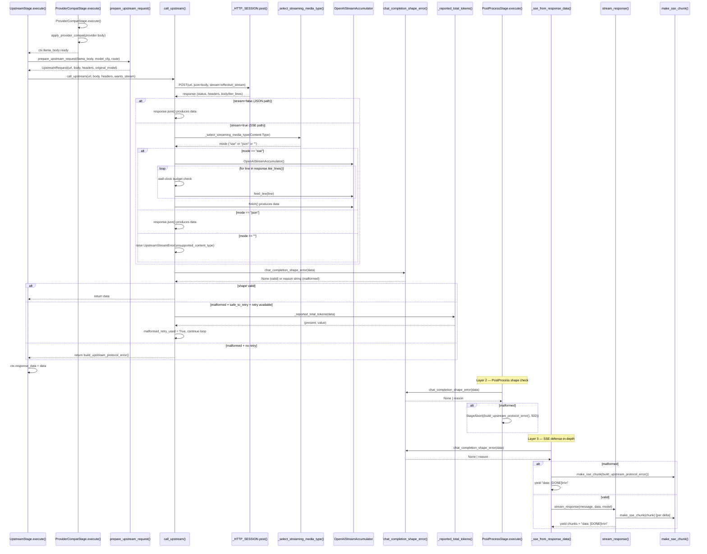

# 04 — SSE / Upstream Transport Layer

ChoriProx's upstream transport layer is the boundary between the 9-stage pipeline and the external LLM providers. It owns: (1) a unified HTTP call with configurable retry and malformed-response validation (`http_client.py`), (2) a streaming SSE reconstruction engine that converts incremental OpenAI-compatible deltas into a single complete `chat.completion` dict (`upstream_sse.py`), (3) a single-source shape validator shared across three defense layers (`openai_compat.py`), and (4) a client-facing SSE re-emission path that converts the in-memory completion back into `chat.completion.chunk` events (`streaming.py`). The design invariant is that a malformed upstream HTTP 200 must never cross the client boundary — enforced at three independent layers.

## Sequence Diagram



## Step-by-Step Walkthrough

### 1. UpstreamStage dispatches the call

`UpstreamStage.execute()` (`src/proxy/pipeline/stage_modules/upstream.py:56`) reads `ctx.model_route`, extracts `model_cfg`, and calls `prepare_upstream_request` (line 69). Non-auth preparation failures raise `StageAbort((error_dict, 502))` (lines 73-78); `AuthConfigError` is re-raised on its separate path (lines 71-72) for the auth-specific boundary.

### 2. prepare_upstream_request builds the wire request

`prepare_upstream_request` (`src/proxy/pipeline/stage_modules/upstream.py:14`) rewrites the model alias to `model_cfg.backend_model` (line 21), clamps MiniMax temperature to `[0.01, 1.0]` (line 31), builds the `Authorization: Bearer` header from `model_cfg.api_key_env` (line 34-36), and returns an `UpstreamRequest` dataclass value (line 45-47). Missing configured credentials raise `AuthConfigError` (lines 33-43).

Before this preparation, Stage 7's `ProviderCompatStage` sets the outbound `stream` field and applies the registered provider adapter (`src/proxy/pipeline/stage_modules/provider_compat_stage.py:19-34`). The live adapters are DeepSeek and MiMo reasoning-content injection on every assistant message, Kimi reasoning injection on tool-call messages plus temperature clamp `[0, 1]`, and MiniMax temperature clamp `[0.01, 1.0]`, system→user conversion, consecutive-user merging, and assistant-space barriers (`src/proxy/pipeline/provider_compat.py:178-366`). This Stage 7 → Stage 8 ordering is part of the wire path.

### 3. call_upstream enters the retry loop

`call_upstream` (`src/proxy/http_client.py:502`) resolves the timeout via `_resolve_upstream_timeout` (line 520), reads retry config (line 523), and enters a `for attempt in range(1, max_attempts+1)` loop (line 544). The shipped `config.DEFAULT_CONFIG` defaults are a 1,800-second read timeout, 2.0 large-prompt multiplier, 5 total attempts, 2.0-second base delay, and 30-second delay cap (`src/config.py:22-27`); explicit config/env values can override them, while the function's defensive fallback is 3 attempts (`http_client.py:106-113`). Each attempt acquires an optional endpoint semaphore (line 545-555), then issues `_HTTP_SESSION.post(...)` with `stream=effective_stream` (line 567-574). HTTP statuses `502`, `503`, `504`, `520`, and `524` are transport-retryable (`http_client.py:30-36`); `429` has its own `Retry-After` path capped at 60 seconds (lines 588-624).

### 4. Non-stream path: JSON parse

When `effective_stream` is False (line 628), the response body is parsed via `response.json()` (line 630). A `JSONDecodeError` raises `RuntimeError` (line 635).

### 5. Stream path: Content-Type mode selection

When `effective_stream` is True (line 636), `_select_streaming_media_type` (`src/proxy/http_client.py:414`) inspects the `Content-Type` header and returns `"sse"`, `"json"`, or `""`. An empty string raises `UpstreamStreamError(code="unsupported_content_type")` (line 640-644). A `"json"` mode falls back to `response.json()` (line 646-652).

### 6. SSE accumulation via OpenAIStreamAccumulator

For `mode == "sse"` (line 654), a fresh `OpenAIStreamAccumulator` is instantiated (line 655). Lines are consumed via `response.iter_lines(decode_unicode=False)` (line 675). A wall-clock budget equal to the effective read timeout bounds total consumption (lines 681-689): if `time.monotonic() - _stream_start > _stream_budget`, a non-retryable `UpstreamStreamError(code="stream_timeout")` is raised. Each line is fed via `accumulator.feed_line(line)` (line 690). After the iterator exhausts, `accumulator.finish()` (line 691) validates terminal completeness and returns the reconstructed dict.

### 7. Shape validation (Layer 1)

`chat_completion_shape_error(data)` (`src/proxy/openai_compat.py:8`) is called at `http_client.py:693`. If it returns `None`, the data is valid and returned immediately (line 694-695).

### 8. Malformed-response retry decision

If malformed, `_reported_total_tokens(data)` (`src/proxy/http_client.py:435`) checks `usage.total_tokens` (line 697). The retry is permitted only when `total_tokens` is absent or integer zero (lines 698-704). If `safe_to_retry and not malformed_retry_used and attempt < max_attempts` (line 717-721), the loop continues with exponential backoff. Otherwise, `build_upstream_protocol_error()` is returned (line 753).

The malformed-retry budget (1 attempt) and the transport-retry budget (`_RETRYABLE_STATUS = {502, 503, 504, 520, 524}` at `http_client.py:36` plus the separate 429-with-Retry-After path at `http_client.py:588-625`) are INDEPENDENT — they share `max_attempts` but have separate gates. A malformed-retry attempt consumes 1 unit of `max_attempts`; subsequent transport-level retries (e.g. a 429 or a 503 after the malformed retry) consume the remaining `max_attempts - 1` units under the separate transport gate. The `malformed_retry_used` flag at `http_client.py:719-722` blocks only further malformed-retry attempts; it does not block transport retries.

### 9. UpstreamStreamError is non-retryable on the normal transport path

`UpstreamStreamError` (and subclasses) are re-raised immediately on the normal path (line 754-755), bypassing transport-retry logic. Diagnostic capture is the explicit exception: parser failures are caught at lines 667-673 and downgraded to a canonical protocol error after the raw stream is saved. This remains intentional: a stream timeout or protocol violation after semantic output has started cannot be safely retried.

### 10. PostProcessStage shape check (Layer 2)

`PostProcessStage.execute()` (`src/proxy/pipeline/post_process.py:51`) calls `chat_completion_shape_error(data)` at line 95 BEFORE invoking any success-side-effect method. A malformed completion is replaced with `build_upstream_protocol_error()` and aborts via `StageAbort((ctx.response_data, 502))` (lines 105-106). A dict-valued provider error (error object + no choices) preserves the original body and aborts via `StageAbort((data, 502))` (lines 118-122).

### 11. SSE defense-in-depth (Layer 3)

`_sse_from_response_data` (`src/proxy/app.py:749`) is the final boundary. It preserves dict-error envelopes verbatim (lines 780-787), validates parsed completion objects through `chat_completion_shape_error` (line 793), and converts malformed parsed completions to the canonical protocol error as exactly one error data event + one `data: [DONE]\n\n` (lines 799-801). The separate Flask `Response`/non-JSON defensive branch emits a generic proxy error at lines 764-777. Valid completions are re-emitted via `stream_response` (line 807).

### 12. Client-facing SSE re-emission

`stream_response` (`src/proxy/streaming.py:14`) converts the in-memory `chat.completion` dict back into `chat.completion.chunk` SSE events. It emits a role chunk, optional reasoning_content chunk, content/tool_call chunks, a terminal chunk with `finish_reason`, and a final `data: [DONE]\n\n` (line 138). Each chunk is formatted by `make_sse_chunk` (`src/proxy/streaming.py:9`) as `data: {json}\n\n`.

## The 3-Layer Malformed-Completion Boundary

A malformed upstream HTTP 200 (e.g. `choices: null`, empty choices, non-object message) must never reach the client. Three independent layers enforce this:

### Layer 1 — HTTP Client (`src/proxy/http_client.py:693-753`)

**What it catches:** Any HTTP 200 whose parsed JSON (or SSE-reconstructed dict) fails `chat_completion_shape_error`. This includes non-dict responses, missing/empty/non-list `choices`, missing/non-dict `choices[0].message`.

**What it does:** Permits at most ONE retry, and only when `usage.total_tokens` is absent or integer zero (indicating the provider likely produced no real output). If the retry is exhausted or unsafe, returns the canonical `build_upstream_protocol_error()` envelope.

**Why it's needed:** This is the earliest interception point. It prevents malformed data from entering `ctx.response_data` in the first place, and the retry gives transient provider glitches a chance to self-heal without surfacing an error to the client.

### Layer 2 — PostProcessStage (`src/proxy/pipeline/post_process.py:95-106`)

**What it catches:** Any malformed completion that somehow survived Layer 1 (e.g. a code path that sets `ctx.response_data` without going through `call_upstream`, or a future regression in the HTTP client).

**What it does:** Replaces the malformed data with `build_upstream_protocol_error()` and raises `StageAbort((body, 502))`. This aborts the pipeline BEFORE any side effects run (no persistence, no history sync, no VFS mutation, no tool interception, no SOTA sync). The `finally` block still finalizes the skill lifecycle (classifies the turn as FAILED, clears the active mode).

**Why it's needed:** PostProcess is the lifecycle and side-effect boundary. Without this check, a malformed completion could trigger tool interception on garbage data, persist corrupt messages to SQLite, or sync broken state to chat history.

### Layer 3 — SSE Emission (`src/proxy/app.py:749-801`)

**What it catches:** Any malformed completion object that survived both Layer 1 and Layer 2 (e.g. a `StageAbort` payload from a different stage that carries a broken shape, or a code path that bypasses PostProcess). The Flask `Response`/non-JSON guard is a separate generic-error path.

**What it does:** For malformed completion objects, it emits exactly one `make_sse_chunk(build_upstream_protocol_error())` event followed by one `data: [DONE]\n\n` terminator. There is no raw malformed-object SSE fallback.

**Why it's needed:** This is the last line of defense before bytes hit the wire. It guarantees that even if all upstream logic fails, the client never receives a structurally invalid SSE stream. The "one error event + one [DONE]" contract ensures clients can cleanly terminate their SSE parsers.

### Why all 3 are needed

Each layer protects against a different failure mode:
- Layer 1 protects against **transient provider glitches** (with retry).
- Layer 2 protects against **internal pipeline regressions** (side-effect isolation).
- Layer 3 protects against **novel code paths** that bypass the pipeline (defense-in-depth).

Removing any single layer creates a gap: without Layer 1, every malformed 200 becomes a user-visible 502 (no retry). Without Layer 2, malformed data could trigger tool execution or persistence. Without Layer 3, a new code path that sets `ctx.response_data` directly could emit garbage to the client.

## Stream Accumulation

### OpenAIStreamAccumulator (`src/proxy/upstream_sse.py:193`)

The accumulator is a request-local, single-use state machine that converts a byte-line SSE stream into one complete `chat.completion` dict. It is instantiated fresh per parse (line 199) and shares no state across instances.

### Delta accumulation

Each physical SSE line is ingested via `feed_line(line: bytes)` (line 243). The accumulator:
1. Validates line encoding (bytes only, no embedded NUL, BOM only at stream start) — lines 245-259.
2. Strips trailing `\r`, dispatches on empty line (event boundary) — lines 261-265.
3. Ignores SSE comments (`:` prefix) and non-data fields (`event:`, `id:`, `retry:`) — lines 268-284.
4. Accumulates `data:` field values into `_pending_data` with per-event byte limits — lines 271-280.

On event dispatch (`_dispatch_event`, line 316), the assembled bytes are UTF-8 decoded, JSON-parsed, and ingested through a **staged snapshot** (`_StagedEvent`, line 112). All mutations for one JSON event are applied to a deep copy of the accumulator state. If anything raises during staging, the parent is unchanged (atomic discard). Only semantic events (those that mark `staged._event_semantic`) are committed via `_commit_staged_event` (line 385).

Delta fields accumulated:
- `content` → `_content_parts` list, joined at build time (line 719)
- `reasoning_content` / `reasoning` → `_reasoning_content_parts` / `_reasoning_parts` (lines 723-728)
- `tool_calls` → per-index `_ToolCall` dataclass with `name_parts` and `argument_parts` (lines 730-742)
- `role`, `finish_reason` → scalar fields with conflict detection
- `usage` → deep-copied dict, conflict-checked (line 453-467)
- Top-level metadata (`id`, `created`, `model`, `system_fingerprint`) → first-seen-wins with conflict detection (line 419-451)

### Wall-clock budget

The wall-clock budget is enforced in `call_upstream` (http_client.py:681-689), not inside the accumulator. The budget equals the effective per-attempt read timeout (`_stream_budget = timeout`). This bounds total SSE consumption time even for a slow-but-alive stream that never triggers the per-chunk socket timeout. Exceeding the budget raises `UpstreamStreamError(code="stream_timeout", semantic_started=accumulator.semantic_started)` — a non-retryable error.

### Error hierarchy

```
UpstreamStreamError (upstream_sse.py:36)
├── UpstreamStreamProtocolError (upstream_sse.py:53)
│   codes: invalid_line, invalid_utf8, invalid_unicode, malformed_event,
│          malformed_json, malformed_chunk, conflicting_metadata,
│          unsupported_choice, post_terminal_delta, incomplete_response,
│          incomplete_tool_call
└── UpstreamStreamLimitError (upstream_sse.py:59)
    code: limit_exceeded
```

All parser errors carry `code` (sanitized machine-readable, validated by regex at line 65) and `semantic_started` (whether output had begun at raise time). The accumulator's `_raise` method (line 307) selects the exception class based on code: `"limit_exceeded"` → `UpstreamStreamLimitError`, everything else raised by the accumulator → `UpstreamStreamProtocolError`. The transport layer constructs `unsupported_content_type` and `stream_timeout` directly as the base `UpstreamStreamError` (`http_client.py:640-644`, `:685-689`), so those two codes are not subclasses of `UpstreamStreamProtocolError`.

### UpstreamStreamLimits (`src/proxy/upstream_sse.py:69`)

Frozen dataclass with construction-time invariant checks (positive integers, `line <= event`, `content/reasoning/tool_argument <= response`):

| Limit | Default | Purpose |
|---|---|---|
| `max_line_bytes` | 1 MiB | Single physical line |
| `max_event_bytes` | 2 MiB | Assembled multi-line event |
| `max_response_bytes` | 64 MiB | Total semantic response |
| `max_content_bytes` | 32 MiB | Accumulated content |
| `max_reasoning_bytes` | 32 MiB | Accumulated reasoning |
| `max_tool_argument_bytes` | 16 MiB | Accumulated tool arguments |
| `max_tool_calls` | 128 | Distinct tool call indices |

### reconstruct_openai_sse (`src/proxy/upstream_sse.py:754`)

A convenience wrapper that instantiates a fresh accumulator, feeds all lines, and calls `finish()`. It is used by unit tests; no production caller uses it. The production path in `call_upstream` uses the accumulator directly (to interleave wall-clock budget checks between lines).

### Output shape (`_build`, upstream_sse.py:699)

`finish()` (line 286) validates terminal completeness (semantic output started, choice present, finish_reason set, all tool calls have id/type/name/arguments) then calls `_build()` which emits:

```json
{
  "id": "...", "created": ..., "model": "...", "system_fingerprint": "...",
  "object": "chat.completion",
  "usage": {...},
  "choices": [{
    "index": 0,
    "message": {
      "role": "assistant",
      "content": "...",
      "reasoning_content": "...",
      "tool_calls": [{"id": "...", "type": "function", "function": {"name": "...", "arguments": "..."}}]
    },
    "finish_reason": "stop"
  }]
}
```

The output is always a completed response (`object="chat.completion"`, `message` not `delta`), never a raw upstream delta.

## Key Invariants

1. **Malformed 200 never crosses the client boundary.** Three independent layers (http_client → PostProcess → SSE emission) each validate through the single-source `chat_completion_shape_error`.

2. **Retry only when `usage.total_tokens` is absent or integer zero.** Nonzero, negative, boolean, null, string, or float token values skip the retry and return the canonical protocol error immediately (http_client.py:698-704).

3. **Stream failure = one error event + one `[DONE]`.** `_sse_from_response_data` emits exactly `make_sse_chunk(build_upstream_protocol_error())` + `"data: [DONE]\n\n"` for any malformed response (app.py:799-801). No raw malformed-object SSE fallback exists.

4. **`UpstreamStreamError` is non-retryable.** Stream protocol violations and timeouts bypass the transport-retry logic entirely (http_client.py:754-755). A stream timeout after semantic output has started cannot be safely retried (the provider may have already produced partial output).

5. **Transport retry is NOT attempted after semantic start.** If `accumulator.semantic_started` is True and a `_RETRYABLE` transport error occurs, the error is re-raised immediately (http_client.py:759-764).

6. **The accumulator is single-use and request-local.** No state is shared across instances. One accumulator per logical parse (upstream_sse.py:193-197).

7. **Staged event commit is atomic.** All mutations for one JSON event are applied to a deep-copied snapshot. If anything raises during staging, the parent accumulator is unchanged (upstream_sse.py:112-184, 366-380).

8. **Provider error envelopes preserve the original body.** A dict-valued `error` field with no `choices` passes `chat_completion_shape_error` (returns None) and is preserved verbatim through PostProcess (`StageAbort((data, 502))`, post_process.py:118-122) and SSE emission (app.py:780-787).

9. **`stream_response` emits the real `finish_reason` from the in-memory dict.** The terminal chunk's `finish_reason` is read from `original_data["choices"][0]["finish_reason"]` (streaming.py:32), not hardcoded — except it falls back to `"stop"` or `"tool_calls"` unless the reason is in `TRUNCATION_REASONS` (streaming.py:92, 134).

10. **No Response, iterator, or generator escapes `call_upstream`.** The function's docstring (http_client.py:513) and `finally` block (line 865-883) guarantee `response.close()` is always called, even on exception.

## Landmines

### Don't add a feature flag to `apply_provider_compat`

`ProviderCompatStage.execute()` calls `apply_provider_compat` unconditionally (per `src/proxy/pipeline/AGENTS.md` §"apply_provider_compat has no feature flag"). Adding a feature flag re-introduces the dead-fallback pattern. If you need to disable provider compat temporarily, do it at the call site with a comment.

### Stream timeout is non-retryable

`UpstreamStreamError(code="stream_timeout")` is raised at http_client.py:685-689 and re-raised at line 754-755 on the normal path. Do NOT add stream timeout to `_RETRYABLE` or `_RETRYABLE_STATUS`. A slow-but-alive stream that exceeds the budget has likely already consumed provider resources; retrying would double-charge and potentially produce duplicate output. Diagnostic capture remains the documented exception because it converts parser errors to a canonical protocol envelope after saving the bytes.

### Provider error object preserves original body

When the upstream returns `{"error": {...}, "choices": absent}`, `chat_completion_shape_error` returns `None` (openai_compat.py:18-19). This is intentional: the error envelope is a valid "response" that should be preserved verbatim for the client. Do NOT "fix" this by making the validator reject error envelopes — that would replace the provider's actual error message with the generic `upstream_protocol_error`.

### The malformed retry is ONE-SHOT

`malformed_retry_used` (http_client.py:525) is a boolean flag. Once set to True (line 722), no further malformed retries are permitted regardless of remaining attempts. This prevents infinite retry loops against a provider that consistently returns malformed completions with zero usage.

### `effective_stream` vs `wants_stream`

`call_upstream` accepts `wants_stream` but computes `effective_stream = wants_stream or capture_sse` (line 531). The diagnostic `PROXY_CAPTURE_UPSTREAM_SSE=1` env var forces SSE mode even when the caller requested non-streaming. Under capture, a parse failure is downgraded to a canonical protocol error (line 667-673) instead of propagating — so a single diagnostic call yields the raw bytes even when reconstruction fails.

### The wall-clock budget is NOT the per-chunk read timeout

The per-chunk read timeout (the `timeout` tuple's second element, line 570) bounds the gap between individual TCP reads. The wall-clock budget (line 682) bounds the TOTAL stream consumption time. A stream that sends data more frequently than the configured read timeout can remain socket-alive indefinitely, but it still eventually exceeds the total wall-clock budget. Both limits are needed; the shipped read-timeout default is 1,800 seconds unless configuration or a tool-loop `timeout_cap` lowers it.

### `reconstruct_openai_sse` is NOT the production path

The convenience function (upstream_sse.py:754) is used by unit tests, not the live production path. `call_upstream` uses the accumulator directly because it needs to interleave wall-clock budget checks between lines (http_client.py:683-690). Don't refactor `call_upstream` to use `reconstruct_openai_sse` — you'd lose the budget enforcement.

### `created` field conflict is tolerated

The accumulator's `_ingest_top_field_to_staged` (upstream_sse.py:443-445) special-cases `created`: some upstreams (e.g. GLM via ollama.com) re-emit `created` with a fresh Unix timestamp per chunk. Strict equality would falsely flag a valid completion as `conflicting_metadata` → 502. First-seen value wins. Other canonical fields (`id`, `model`, `system_fingerprint`) still raise on conflict — that guard is the spliced-completion detector.

## Cross-References

- **Topic 3 (Tool Result Handling):** Tool interception (`PostProcessStage._handle_tool_interception`, post_process.py:131) happens AFTER the upstream returns and AFTER the Layer 2 shape check passes. The tool pipeline receives only validated completions. See `03-tool-result-handling.md`.

- **Topic 7 (Dedup / Completion Coordinator):** The dedup gate (`completion_coordinator.admit()`) runs BEFORE the pipeline — it determines whether the upstream call happens at all. A REPLAY admission serves the cached artifact with zero upstream calls. A FOLLOWER attaches to an existing owner's completion. See `src/proxy/AGENTS.md` §"Transparent Request Deduplication (CP4)".

- **Topic 10 (Lock #14 — dedup_lock interaction):** Lock #14 (`state.dedup_lock`) is a leaf lock that protects the DedupStore. It is NEVER held while waiting on `completion_event`, running pipeline stages (including the upstream call), or yielding SSE. The upstream transport layer runs entirely outside lock #14's scope. See `src/proxy/AGENTS.md` §"Lock Hierarchy" position #14.
