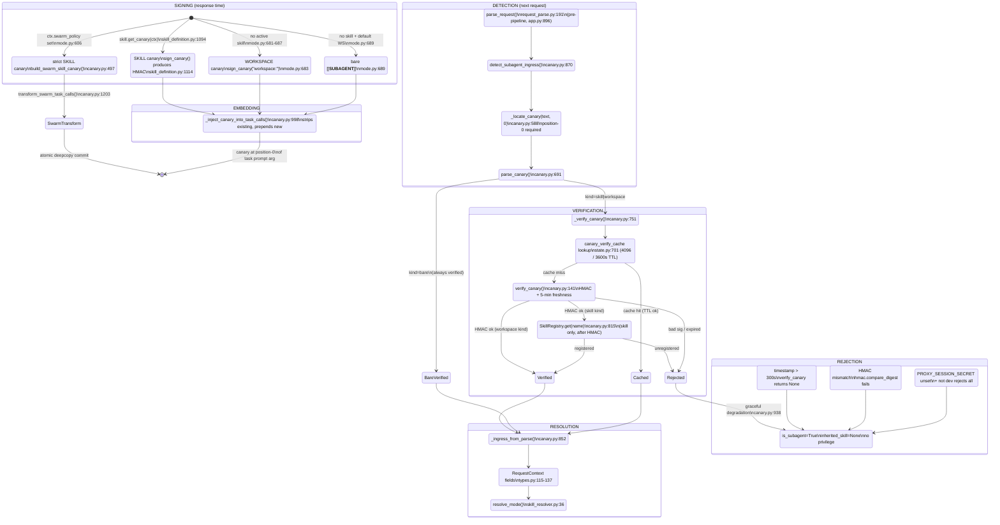

# Deep-Dive 05 — Canary / Sub-Agent Ingress

> **Topic 5 of 10** (per [`docs/_analysis/ARCHITECTURE_DECOMPOSITION.md`](../ARCHITECTURE_DECOMPOSITION.md) §7).
> Scope: `src/proxy/canary.py` (1,435 LOC) + `src/proxy/session_tokens.py` (78 LOC) +
> canary-related fields in `src/proxy/types.py` + detection call site in
> `src/proxy/pipeline/stage_modules/request_parse.py` + injection in
> `src/proxy/mode.py:inject_task_canaries`.

---

## 1. Overview

The canary system is ChoriProx's mechanism for propagating skill mode and
workspace context from a parent agent to its spawned sub-agents. When a
parent's LLM response contains `task` tool calls, the proxy injects an
HMAC-signed canary marker at position 0 of each sub-agent prompt. When the
sub-agent CLI forks and sends its first request back through the proxy, the
pre-pipeline `parse_request` detects the canary at position 0 of the first
user message, verifies the HMAC signature (with a 5-minute freshness window),
and resolves the inherited mode (skill name, workspace, task hash) into the
`RequestContext`. The system has three canary kinds — SKILL (carries
`inherited_skill` + optional JSON state), WORKSPACE (carries `workspace_name`
only, `inherited_skill=None`), and bare `[[__SUBAGENT__]]` (marks sub-agent
status with no privilege inheritance). A parallel strict signer
(`build_swarm_skill_canary`) serves swarm-capable custom skills with
fail-closed semantics and a 256-byte state cap. All parsing flows through a
single position-based parser (`_locate_canary` → `parse_canary` →
`_ingress_from_parse`); inline parsing is forbidden.

---

## 2. Lifecycle Diagram



---

## 3. Step-by-Step Walkthrough

### Phase A — Signing (parent response time)

1. **PostProcessStage invokes injection.** `PostProcessStage._inject_task_canaries`
   (`post_process.py:494`) calls `proxy.mode.inject_task_canaries(ctx, agent,
   response_data, mode)` (`mode.py:539`).

2. **Path selection.** `inject_task_canaries` selects one of three paths:
   - **Path A** (`mode.py:574`): if `ctx.is_subagent` and response has `task`
     calls → `StageAbort(403)` (universal no-nesting, §14).
   - **Path B** (`mode.py:586`): if `ctx.swarm_policy` is a valid
     `SubagentPolicy` → strict swarm canary via `build_swarm_skill_canary`
     (`canary.py:497`) + atomic `transform_swarm_task_calls` (`canary.py:1203`).
   - **Path C** (`mode.py:654`): legacy MAIN — resolve canary from active
     skill or workspace.

3. **Skill canary construction (Path C).** `skill.get_canary(skill_ctx)`
   delegates to `BaseSkill.build_skill_canary` (`skill_definition.py:1094`):
   - Calls `self.get_inheritance_state(ctx)` to get the state dict.
   - Serializes state: `f"|{json.dumps(state, sort_keys=True)}"` (line 1111).
   - Signs: `sign_canary(self.name, state_str=state_str)` (`canary.py:110`).
   - Returns `f"[[__SUBAGENT__:SKILL:{name}:{sig}:{ts}{state_str}]]"` (line 1119).

4. **Workspace canary fallback (Path C).** When no skill canary is available
   and the active workspace is not `DEFAULT_WORKSPACE` (`mode.py:681-687`):
   - Signs `sign_canary(f"workspace:{active_ws}")` — the `workspace:` prefix
     is part of the HMAC-bound skill_name.
   - Emits `[[__SUBAGENT__:WORKSPACE:{name}:{sig}:{ts}]]`.

5. **Bare canary fallback.** No skill + default workspace → `[[__SUBAGENT__]]`
   (`mode.py:689`).

6. **Injection into task calls.** `_inject_canary_into_task_calls`
   (`canary.py:998`) iterates `choices[0].message.tool_calls`, finds
   `function.name == "task"`, strips existing canaries via
   `_strip_existing_canaries` (`canary.py:971`), and prepends the new canary
   to `args["prompt"]`.

7. **Per-task escalation.** `_resolve_task_canary` (`canary.py:1107`) handles
   `subagent_mode="work"` override: when parent is in ticket mode and the LLM
   requests a work sub-agent, builds a work canary via
   `_build_work_canary_for_request` (`canary.py:1373`) and commits one
   rate-limit slot (`escalation_rate_limiter`, 5/hr per session).

### Phase B — Detection (sub-agent's first request)

8. **Pre-pipeline entry.** `app.py:896` calls `parse_request(request)` BEFORE
   `RequestPipeline.run()`. This is not a pipeline stage.

9. **Session token validation.** `request_parse.py:79-99` validates the
   `X-Session-Token` header (HMAC-signed client identity). Invalid token →
   `StageAbort((dict, 401))`. Client mismatch → `StageAbort((dict, 403))`.

10. **Canary detection.** `request_parse.py:191` calls
    `detect_subagent_ingress(body, session_id=session_id)` (`canary.py:870`).
    This iterates messages, finds the first `role=user` message, and calls
    `parse_canary(content, session_id=session_id)` (`canary.py:915`).

11. **Position-0 parse.** `parse_canary` (`canary.py:691`) calls
    `_locate_canary(text, 0)` (`canary.py:588`). If `loc.start != 0`, returns
    `None` — the canary MUST be at position 0. A mid-message canary is
    invisible to the parser (and `_strip_existing_canaries` would strip it,
    causing data loss of everything before it).

12. **Structural parse.** `_locate_canary` finds `[[__SUBAGENT__` at index 0,
    then dispatches:
    - `]]` immediately after → bare canary (`canary.py:606-607`).
    - `:SKILL:` → `_locate_typed_canary(..., kind="skill")` (`canary.py:609-614`).
    - `:WORKSPACE:` → `_locate_typed_canary(..., kind="workspace")` (`canary.py:616-622`).

13. **Typed canary extraction.** `_locate_typed_canary` (`canary.py:628`)
    anchors on `_RE_SKILL_SIG_ANCHOR` (`:([a-f0-9]{64}):(\d+)`) to find the
    sig:ts pair, extracts the name before it, validates the name regex, and
    optionally parses `|{json}` state via `json.JSONDecoder().raw_decode()`.

### Phase C — Verification

14. **Bare canary.** Always `verified=True` (`canary.py:737-738`). No HMAC.

15. **HMAC verification.** `_verify_canary` (`canary.py:751`) reconstructs
    `state_str` deterministically (`sort_keys=True`), builds the token string,
    and calls `verify_canary(token, state_str=state_str)` (`canary.py:141`).

16. **Freshness check.** `verify_canary` rejects timestamps older than 300s
    or more than 30s in the future (`canary.py:228-231`).

17. **Secret-unset behavior.** If `PROXY_SESSION_SECRET` is unset:
    - Production → reject (`canary.py:238-240`).
    - Dev mode → accept with `is_dev_fallback=True` (`canary.py:241-246`).

18. **Constant-time comparison.** `hmac.compare_digest(sig, expected_sig)`
    (`canary.py:261`). The HMAC message is `f"{skill_name}:{state_str}:{timestamp_str}"`.

19. **Registry check (skill only).** After HMAC passes, SKILL canaries are
    checked against `SkillRegistry().get(loc.name)` (`canary.py:815`).
    Unregistered skill → `verified=False`. WORKSPACE canaries skip this.

20. **Verification cache.** On success, the result is cached in
    `state.canary_verify_cache` (`state.py:701`) keyed by
    `(session_id, sig_hash, state_hash, secret_hash)`. Max 4096 entries,
    3600s TTL. This keeps long-running sub-agents (>5 min) alive past the
    HMAC freshness window (`canary.py:767-832`).

### Phase D — Ingress Resolution

21. **Field mapping.** `_ingress_from_parse` (`canary.py:852`) translates the
    verified `CanaryParse` into `SubagentIngress` fields:
    - SKILL + verified → `(skill_name == "ticket", skill_name, workspace_name, task_hash)`.
    - WORKSPACE + verified → `(False, None, workspace_name, None)`.
    - Bare or unverified → `(False, None, "", None)`.

22. **is_subagent is unconditional.** `detect_subagent_ingress` sets
    `result.is_subagent = True` whenever a canary was found (parse is not
    None), REGARDLESS of `verified` (`canary.py:938`). A forged/expired canary
    still downgrades to sub-agent context (loses tools); only privilege
    inheritance is gated on `verified`.

23. **RequestContext construction.** `request_parse.py:219-227` populates
    `is_subagent`, `subagent_ticket_mode`, `inherited_skill`, `workspace_name`,
    and `inherited_task_hash` on the `RequestContext`.

24. **Mode resolution.** `ContextOptimizeStage` calls `resolve_mode()`
    (`skill_resolver.py:36`) which reads `ctx.inherited_skill` and activates
    the inherited skill for the sub-agent (or routes via `ctx.workspace_name`
    for WORKSPACE canaries).

---

## 4. Canary Wire Format

### SKILL canary

```
[[__SUBAGENT__:SKILL:<name>:<64-hex-sig>:<ts>|<state-json>]]
```

| Field | Description |
|---|---|
| `__SUBAGENT__` | Fixed literal prefix (`_CANARY_OPEN`, `canary.py:562`) |
| `SKILL` | Kind discriminator |
| `<name>` | Skill name, regex `^[a-z][a-z0-9_-]*$`, max 64 chars |
| `<64-hex-sig>` | HMAC-SHA256 hex digest (256 bits) |
| `<ts>` | Unix timestamp (seconds), decimal digits |
| `<state-json>` | Optional. JSON object (e.g. `{"workspace_name":"x","task_hash":"abc"}`) |

The `|` separator and state-json are optional. Without state, the marker is
`[[__SUBAGENT__:SKILL:<name>:<sig>:<ts>]]`.

### WORKSPACE canary

```
[[__SUBAGENT__:WORKSPACE:<name>:<64-hex-sig>:<ts>]]
```

| Field | Description |
|---|---|
| `WORKSPACE` | Kind discriminator |
| `<name>` | Workspace name, regex `^[a-zA-Z0-9][a-zA-Z0-9-]*$`, max 64 chars |

No state payload. The workspace name is embedded in the HMAC-bound skill_name
as `workspace:<name>`.

### Bare canary

```
[[__SUBAGENT__]]
```

No signature, no timestamp, no state. Always verified. Marks sub-agent status
only.

### HMAC binding

The HMAC message is:

```python
f"{skill_name}:{state_str}:{timestamp_str}"
```

- `skill_name` — the literal skill name (`ticket`, `work`, `my-skill`) or
  `workspace:<name>` for WORKSPACE canaries.
- `state_str` — the full `|{json}` string (including the leading `|`), or
  empty string when no state is bound. Empty produces a 3-field message with
  an empty middle field: `f"{skill_name}::{ts}"`.
- `timestamp_str` — the decimal unix timestamp string.

`session_id` is NOT bound (parent and sub-agent have different session_ids by
design). Replay protection relies solely on the 5-minute freshness window.

---

## 5. The Single-Source Parser Pipeline

### Why inline parsing is forbidden

Before the refactor (commits `a69078f` / `9f3829f`), three divergent parsers
existed: `parse_skill_canary`, ad-hoc `find("]]")` branches in
`detect_subagent_ingress`, and bare-marker handling. They disagreed on edge
cases (states containing `]`, stacked canaries, malformed prefixes). The
single-source pipeline eliminates this class of bug.

### Pipeline stages

```
_locate_canary(text, 0)          # canary.py:588 — SOLE position-walker
    → _CanaryLoc(start, end, kind, name, sig_ts, state)
        → parse_canary(text)     # canary.py:691 — position-0 gate + dispatch
            → _verify_canary(loc, remaining)  # canary.py:751 — HMAC + registry
                → CanaryParse(kind, remaining, verified, skill_name, ...)
                    → _ingress_from_parse(p)  # canary.py:852 — field mapping
                        → (ticket_mode, inherited_skill, workspace_name, task_hash)
```

### `_locate_canary` — the position walker (`canary.py:588`)

- Finds `[[__SUBAGENT__` via `text.find(_CANARY_OPEN, start)`.
- Dispatches on what follows: `]]` (bare), `:SKILL:` (typed), `:WORKSPACE:` (typed).
- For typed canaries, anchors on `_RE_SKILL_SIG_ANCHOR = re.compile(r':([a-f0-9]{64}):(\d+)')`
  (`canary.py:565`) to locate the sig:ts pair, then extracts the name before it.
- Parses optional `|{json}` state via `json.JSONDecoder().raw_decode()` — this
  handles states containing `]` (the canary-stacking production bug that broke
  the old regex `(?:\|[^\]]+)?`).
- Returns `_CanaryLoc(kind=None)` for malformed prefixes (prefix matched but
  body parse failed).

### `parse_canary` — the position-0 gate (`canary.py:691`)

- Calls `_locate_canary(text, 0)`.
- **If `loc.start != 0` → returns `None`.** This is the position-0 requirement.
- Malformed prefix (`loc.kind is None`) → returns `CanaryParse(kind="skill"|"workspace", verified=False)`
  so `detect_subagent_ingress` still sees the canary (graceful degradation).
- Bare → `CanaryParse(kind="bare", verified=True)`.
- Typed → delegates to `_verify_canary`.

### `_ingress_from_parse` — field mapping (`canary.py:852`)

Pure function. Translates `CanaryParse` → `(subagent_ticket_mode, inherited_skill,
workspace_name, task_hash)`. Privilege is granted ONLY when `verified=True`.

---

## 6. Session Tokens

### Purpose

Session tokens (`session_tokens.py`) bind a `client_id` (authentication) and a
`session_id` (continuity) with an HMAC signature. They prevent clients from
forging session IDs or impersonating other clients' sessions. The embedded
`session_id` is restored verbatim on the next request so session continuity
survives content changes.

### `create_session_token` (`session_tokens.py:23`)

```python
def create_session_token(client_id: str, session_id: str) -> str:
```

- Returns `""` if `PROXY_SESSION_SECRET` is unset (line 34-35).
- Payload: `{"client_id", "session_id", "created_at", "nonce"}` (compact JSON).
- Signature: first 16 hex chars of HMAC-SHA256 over the payload.
- Wire format: `{payload_json}:{hex_sig_16}`.
- Emitted in `X-Session-Token` response header (`app.py:1136-1138, 1301-1303`).

### `validate_session_token` (`session_tokens.py:46`)

```python
def validate_session_token(token: str, max_age_seconds: int = 86400) -> dict | None:
```

- Returns `None` (fail closed) if secret unset (line 56-57).
- Splits on last `:` → payload + sig.
- Constant-time HMAC comparison (`hmac.compare_digest`).
- Rejects tokens older than `max_age_seconds` (default 24h).
- Rejects tokens with `created_at` more than 300s in the future.

### Empty-string degradation

When `PROXY_SESSION_SECRET` is unset:
- `create_session_token` returns `""` — no token is emitted.
- `validate_session_token` returns `None` — but `request_parse.py:84` gates
  validation on `_secret_configured`, so no rejection occurs. The system
  degrades to content-derived session IDs.

> **⚠️ Drift:** `src/proxy/AGENTS.md` says "verification accepts any signature"
> for canaries when the secret is unset. This is accurate for DEV mode only
> (`canary.py:236-246`). In PRODUCTION (non-dev), `verify_canary` rejects ALL
> canaries when the secret is unset (`canary.py:238-240`). The AGENTS.md
> landmine description omits the production fail-closed behavior.

---

## 7. Key Invariants

### INV-1: Position-0 requirement

`parse_canary` returns `None` unless `loc.start == 0` (`canary.py:721`).
A canary appearing mid-message is invisible to the ingress detector. However,
`_strip_existing_canaries` (`canary.py:971`) removes ALL canaries anywhere in
the text — so if a canary were placed mid-message and then stripped during
injection, everything before it would be lost. This is the data-loss landmine.

### INV-2: WORKSPACE canary sets `inherited_skill = None`

`_ingress_from_parse` (`canary.py:864-865`) returns `(False, None, workspace_name, None)`
for verified WORKSPACE canaries. The `inherited_skill` field is NEVER set to
the string `"workspace"` — it is `None`. Workspace routing goes via
`ctx.workspace_name`, not via skill activation.

### INV-3: HMAC 5-minute freshness + verification cache

- `verify_canary` rejects canaries with `now - timestamp > 300` or
  `timestamp > now + 30` (`canary.py:228-231`).
- `canary_verify_cache` (`state.py:701`, lock #11 at `state.py:110`) caches
  verified results: max 4096 entries (`_CANARY_VERIFY_CACHE_MAX`, `state.py:251`),
  3600s TTL (`_CANARY_VERIFY_CACHE_TTL`, `state.py:269`).
- Cache key: `(session_id, sha256(sig), sha256(state_str), sha256(secret)[:16])`.
- On cache hit within TTL, the cached state is returned verbatim — a mutated
  state suffix produces a different `state_hash` → cache miss → full HMAC
  verify rejects it (`canary.py:789-800`).

### INV-4: Single parser — never inline

All canary detection flows through `_locate_canary` → `parse_canary` →
`_ingress_from_parse`. Both `parse_canary` and `_strip_existing_canaries`
share `_locate_canary`. Writing inline position parsing (e.g. `text.find("]]")`)
is forbidden — it reintroduces the divergent-parser bug class.

### INV-5: is_subagent regardless of verification

`detect_subagent_ingress` sets `is_subagent = True` whenever a canary marker
is found (parse is not None), even if HMAC verification fails (`canary.py:938`).
This ensures forged/expired canaries still downgrade the request to sub-agent
context (losing main-agent tools). Only privilege inheritance (skill, workspace,
task_hash) is gated on `verified`.

### INV-6: session_id is NOT HMAC-bound

Parent and sub-agent have different session_ids by design (the sub-agent's
first user message is the parent's tool-call prompt, which hashes to a
different session_id). Binding to either would break the legitimate production
flow. `session_id` is used only as a cache-scope key (§5.4).

---

## 8. Landmines

### LM-1: Canary degradation when secret unset

When `PROXY_SESSION_SECRET` is unset:
- `sign_canary` returns `f"{'0' * 64}:{int(time.time())}"` — a zero-signature
  placeholder (`canary.py:129-130`).
- In DEV mode, `verify_canary` accepts any canary (with freshness check) and
  sets `is_dev_fallback=True` (`canary.py:241-246`).
- In PRODUCTION, `verify_canary` rejects ALL canaries (`canary.py:238-240`).
- The strict swarm signer (`sign_canary_strict`) ALWAYS rejects the
  zero-signature fallback — it raises `SwarmCanaryError("swarm_missing_secret")`
  before any HMAC work (`canary.py:357-362`).

### LM-2: Position-0 violation

If a client or intermediary prepends text before the canary (even a single
newline), `parse_canary` returns `None` and the sub-agent is treated as a
main agent. Conversely, `_strip_existing_canaries` strips canaries at ANY
position — so a mid-message canary in a prompt will have everything before it
preserved but the canary removed (no data loss on strip, but no detection either).

### LM-3: WORKSPACE `inherited_skill` trap

Code that checks `if inherited_skill == "workspace"` is WRONG. The field is
`None` for WORKSPACE canaries. Workspace routing is via `ctx.workspace_name`.
Setting `inherited_skill` to any non-None string for a WORKSPACE canary would
trigger skill activation for a non-existent "workspace" skill.

### LM-4: Swarm state too large

`_serialize_swarm_state` (`canary.py:418`) enforces a 256-byte cap on the
serialized JSON bytes (BEFORE the leading `|`). The check is on bytes, not
characters. Non-ASCII workspace names escape to `\uXXXX` via `ensure_ascii=True`,
so byte count == character count for the JSON portion. Exceeding the cap raises
`SwarmCanaryError("swarm_state_too_large")` → HTTP 500.

### LM-5: Verification cache as prompt-injection surface

The `canary_verify_cache` returns cached state verbatim on hit (`canary.py:792-800`).
The cache key includes `sha256(state_str)` — so a mutated state produces a
cache miss and full HMAC rejection. However, the cache DOES allow a verified
canary to be replayed within the same session for up to 3600s (1 hour), well
past the 5-minute HMAC freshness window. This is intentional (long-running
sub-agents), but it means a captured canary + session_id can be replayed for
up to 1 hour. The `subagent_mode="work"` escalation rate limiter (5/hr) is a
prompt-injection mitigation, not a complete fix.

### LM-6: Bare-recovery promotion

`detect_subagent_ingress` (`canary.py:921-928`) implements bounded bare-recovery:
if the first parse is bare and a second canary follows immediately, it promotes
to the second parse. This is limited to ONE recovery level (max 2 iterations).
A client that prepends `[[__SUBAGENT__]]` before the real canary triggers this
path. Do NOT extend the loop further.

---

## 9. Cross-References

| Topic | Connection |
|---|---|
| **Topic 9 — Skill activation / mode lifecycle** | `SkillDefinition.get_canary` and `BaseSkill.build_skill_canary` (`skill_definition.py:1094`) determine what the canary carries. `get_inheritance_state` produces the state dict. The TrustToken gate controls who can register skills that produce canaries. `resolve_mode` (`skill_resolver.py:36`) consumes `ctx.inherited_skill` to activate the inherited skill. |
| **Topic 7 — Dedup / completion coordination** | `compute_fingerprint` (`dedup.py:88-103`) includes `is_subagent` in the HMAC fingerprint. Parent and sub-agent requests with identical bodies produce different fingerprints because `is_subagent` differs — preventing cross-agent replay collisions. |
| **Topic 8 — Workspace system** | WORKSPACE canary propagation is the mechanism by which `workspace_state.py`'s active workspace reaches sub-agents. `resolve_workspace(ctx)` (`mode.py:597, 681`) reads `ctx.workspace_name` (set by canary detection) to determine the active workspace. `WorkspaceSkill.get_inheritance_state` (`workspace.py:468`) returns `{"workspace_name": ws}` for SKILL canary state. |

---

## Appendix: Key File References

| Symbol | Location |
|---|---|
| `sign_canary` | `src/proxy/canary.py:110` |
| `verify_canary` | `src/proxy/canary.py:141` |
| `sign_canary_strict` | `src/proxy/canary.py:335` |
| `build_swarm_skill_canary` | `src/proxy/canary.py:497` |
| `_locate_canary` | `src/proxy/canary.py:588` |
| `_locate_typed_canary` | `src/proxy/canary.py:628` |
| `parse_canary` | `src/proxy/canary.py:691` |
| `_verify_canary` | `src/proxy/canary.py:751` |
| `_ingress_from_parse` | `src/proxy/canary.py:852` |
| `detect_subagent_ingress` | `src/proxy/canary.py:870` |
| `_strip_existing_canaries` | `src/proxy/canary.py:971` |
| `_inject_canary_into_task_calls` | `src/proxy/canary.py:998` |
| `_resolve_task_canary` | `src/proxy/canary.py:1107` |
| `transform_swarm_task_calls` | `src/proxy/canary.py:1203` |
| `_build_work_canary_for_request` | `src/proxy/canary.py:1373` |
| `create_session_token` | `src/proxy/session_tokens.py:23` |
| `validate_session_token` | `src/proxy/session_tokens.py:46` |
| `SubagentIngress` | `src/proxy/types.py:43` |
| `RequestContext` (canary fields) | `src/proxy/types.py:115-152` |
| `inject_task_canaries` | `src/proxy/mode.py:539` |
| `SWARM_RUNTIME_STATUS` | `src/proxy/mode.py:24` |
| `build_skill_canary` | `src/proxy/skills/skill_definition.py:1094` |
| `canary_verify_cache` | `src/proxy/state.py:701` |
| `canary_verify_cache_lock` (#11) | `src/proxy/state.py:110` |
| `_CANARY_VERIFY_CACHE_MAX` | `src/proxy/state.py:251` |
| `_CANARY_VERIFY_CACHE_TTL` | `src/proxy/state.py:269` |
| `parse_request` (detection call site) | `src/proxy/pipeline/stage_modules/request_parse.py:191` |
| `PostProcessStage._inject_task_canaries` | `src/proxy/pipeline/post_process.py:494` |
