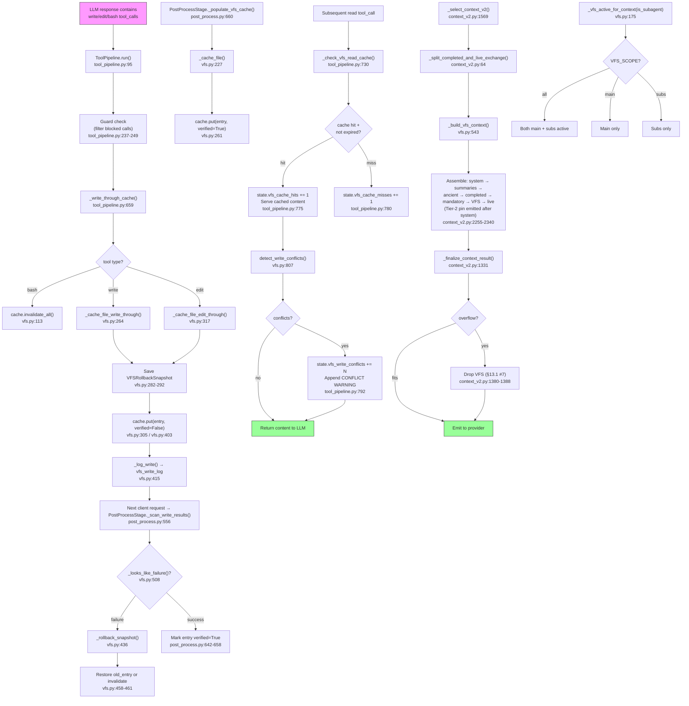

# Deep Dive 06 — VFS Lifecycle

## Overview

The Virtual Filesystem (VFS) layer provides workspace-scoped LRU caching of
file contents across agents, enabling instant read-cache hits, write-through
cache updates on write/edit tool calls, conflict detection when multiple agents
modify the same file, and rollback snapshots that restore cache state when a
client-side write fails. The shared VFS roots live in `proxy.state` (workspace
caches, write log, rollback snapshots, Tier-2 instruction maps, scan state, and
observability counters). The cache/log/snapshot/Tier-2 containers are
coordinated by lock #9 (`vfs_lock`); VFSCache methods require that lock, but not
every counter update currently takes it (notably the conflict-counter increment
at `tool_pipeline.py:792`). The layer interacts with the request pipeline at
three points: **PostProcessStage** scans write/edit results to confirm or
rollback snapshots (sub-method #2) and caches read results (sub-method #5);
**ToolPipeline** intercepts read tool calls for cache hits and performs
write-through before the client executes writes; and **Context V2** injects a
VFS context block into the prompt at the cache-safe-tail position (after
completed history, before the live user exchange) so that VFS mutations never
invalidate the provider's cached prefix. Workspace scoping via
`PROXY_VFS_SCOPE` gates which agent types (main, subs, or both) participate in
request-facing VFS operations and prompt emission.

---

## Architecture Diagram



---

## Step-by-Step Walkthrough

### 1. Write/Edit Tool Call Detected (ToolPipeline)

When the upstream LLM returns a response containing `write`, `edit`, or `bash`
tool calls, `ToolPipeline.run()` (`tool_pipeline.py:95`) parses them and runs
the guard chain. Guard-blocked calls are filtered out BEFORE write-through
(`tool_pipeline.py:237-249`) to prevent cache poisoning (M3-1 invariant).

### 2. Write-Through Cache Update

`_write_through_cache()` (`tool_pipeline.py:659`) processes calls in order:
bash first (invalidate all entries for the workspace), then write, then edit.
This ordering prevents a bash invalidation from wiping a write that landed in
the same batch.

- **bash**: acquires `vfs_lock`, calls `cache.invalidate_all()` (`vfs.py:113`).
- **write**: calls `_cache_file_write_through()` (`vfs.py:264`) which computes
  the SHA-256 hash, saves a rollback snapshot, and puts a `verified=False`
  entry into the cache.
- **edit**: calls `_cache_file_edit_through()` (`vfs.py:317`) using a
  three-phase approach: (1) extract old content under lock, (2) compute hash
  outside lock, (3) re-acquire lock with staleness check before `cache.put()`.

### 3. Rollback Snapshot Saved

Before updating the cache, both write-through and edit-through save a
`VFSRollbackSnapshot` (`vfs.py:48`) keyed by `tool_call_id` into
`state.vfs_rollback_snapshots` (`vfs.py:282-292`, `vfs.py:379-390`). If the
snapshot store exceeds `VFS_ROLLBACK_MAX=100` (`state.py:342`), the oldest
snapshot is discarded via `_rollback_oldest_snapshot()` (`vfs.py:491`). The
snapshot cap of 100 is rarely hit because `_scan_write_results`
(`post_process.py:556`, consumes via `state.vfs_rollback_snapshots.pop`
at `post_process.py:615` on the next request from the client) and
`_rollback_stale_snapshots` (`vfs.py:464`, `VFS_ROLLBACK_TIMEOUT=60s` at
`state.py:341`) consume snapshots quickly. The cap exists as a defensive
backstop against burst tool-call traffic in a single session window.

### 4. Write Logged

`_log_write()` (`vfs.py:415`) appends a `VFSWriteRecord` (`vfs.py:36`) to the
bounded `state.vfs_write_log` (max 10000 entries, `state.py:337`). This log
powers conflict detection.

### 5. PostProcess Confirms or Rolls Back

On the NEXT request from the client, the tool result arrives in the message
history. `PostProcessStage._scan_write_results()` (`post_process.py:556`,
sub-method #2) scans new messages for write/edit tool results:

- Calls `_rollback_stale_snapshots()` (`vfs.py:464`) to clean up snapshots
  older than `VFS_ROLLBACK_TIMEOUT=60s` (`state.py:341`).
- For each result, pops the matching snapshot and runs
  `_looks_like_failure()` (`vfs.py:508`) — a heuristic that checks the first
  200 chars for error patterns (short-circuits on known success prefixes).
- **Failure**: calls `_rollback_snapshot()` (`vfs.py:436`) which restores the
  old entry or invalidates the path. Also removes the phantom write record
  from the log (`post_process.py:625-633`).
- **Success**: marks the cache entry `verified=True` by constructing a new
  `VFSEntry` with the confirmed flag (`post_process.py:642-658`).

### 6. Read Results Populate Cache

`PostProcessStage._populate_vfs_cache()` (`post_process.py:660`, sub-method #5)
scans ALL messages for `read` tool results. For each result with non-empty
content, no offset/limit (full reads only), and a non-blocklisted path, it
calls `_cache_file()` (`vfs.py:227`) which stores a `verified=True` entry
(reads come from disk, so they're always verified).

### 7. Read-Cache Hit on Subsequent Requests

When a later request triggers a `read` tool call, `ToolPipeline.run()` checks
the VFS cache via `_check_vfs_read_cache()` (`tool_pipeline.py:730`):

- Gates on `_vfs_active_for_context()` and tool name == "read".
- Skips blocklisted paths and partial reads (offset/limit).
- Under `vfs_lock`: looks up the normalized path in the workspace cache.
  If found and not expired (`VFS_TTL_SECONDS`, default 60s, `state.py:345`),
  increments `state.vfs_cache_hits`, records the reader, and returns content.
- Appends an unverified-write warning if `entry.verified == False`
  (`tool_pipeline.py:785-786`).
- Runs `detect_write_conflicts()` (`vfs.py:807`) — checks `vfs_write_log` for
  writes by OTHER agents to the same path within 120s. If found, increments
  `state.vfs_write_conflicts` and appends a CONFLICT WARNING to the content
  (`tool_pipeline.py:789-809`).

On cache hit, the tool call is annotated `from_cache=True` and moved to
`memory_calls` so the read-once guard in `MemoryToolGuard` bypasses the count
(M3-2 invariant, `tool_pipeline.py:177-196`).

### 8. Cache-Safe-Tail Placement in Context Window

During context assembly, `_select_context_v2()` (`context_v2.py:1569`) builds
the VFS context block and places it at the cache-safe-tail position. See the
dedicated section below.

### 9. Workspace Scoping

Request-facing VFS entry points gate on `_vfs_active_for_context(is_subagent)`
(`vfs.py:175`) which checks `state.VFS_ENABLED` and `state.VFS_SCOPE`:

- `"all"` (default): both main and sub-agents participate.
- `"subs"`: only sub-agents; main-agent calls return early.
- `"main"`: only main agents; sub-agent calls return early.

Invalid env values fall back to `"all"` with a WARNING log (`state.py:351-353`).

---

## Cache-Safe-Tail Placement (US-127)

### The Contract

The VFS context block is placed AFTER all completed retained history and
BEFORE the current live user-led exchange:

```text
primary system
Tier-2 instruction pin (if present)
summaries
ancient history
completed retained conversation
─── VFS CONTEXT ───          ← cache-safe-tail position
current live user-led exchange
```

This is defined in the internal cache-safe tail specification (§1, §6)
and implemented in `context_v2.py`.

### Why This Position

VFS content changes on every write/edit/cache-expiration. Placing it before
completed history (the old position) invalidated the entire provider-side
prefix cache (potentially 70K+ tokens). The tail position means VFS mutations
only invalidate the VFS block itself and the live exchange after it — the
completed history prefix remains byte-identical across requests (AC-9).

### Implementation

1. **Splitter**: `_split_completed_and_live_exchange()` (`context_v2.py:64`)
   deep-copies messages, groups them into units via `_group_message_units()`,
   finds the most recent user unit, walks backward over consecutive users, and
   returns `(completed_history, live_exchange)`. Never splits an
   assistant/tool atomic unit.

2. **Builder**: `_build_vfs_context()` (`vfs.py:543`) resolves the workspace
   via `resolve_inherited_workspace()`, snapshots cache entries under
   `vfs_lock`, filters by TTL, sorts by path (deterministic output for
   byte-identical content, AC-10), and renders a budget-constrained system
   message. Budget is 5% of `model_safe_tokens` (`context_v2.py:2134`).

3. **Assembly** (normal path, `context_v2.py:2255-2340`):
   ```
   sys_msg → summaries → ancient → completed_history → mandatory_history → VFS → live_exchange
   ```
   VFS is appended only if `non_vfs_total + vfs_tokens <= model_safe_tokens`
   (`context_v2.py:2331`). Otherwise it's excluded with a WARNING log.

4. **Fast path** (fresh session, `context_v2.py:1888-1957`): consults real VFS
   state before returning. If VFS is warm and fits, assembles
   `system → completed → VFS → live`. If VFS doesn't fit, omits it and
   preserves the fast return (no chain-state initialization).

5. **Finalizer** (`_finalize_context_result`, `context_v2.py:1331`): if the
   assembled candidate overflows `model_safe_tokens`, the FIRST recovery step
   is dropping the VFS message by object identity (`context_v2.py:1380-1388`).
   This implements §13.1 priority #7 / AC-15: "Omit VFS rather than splitting
   or truncating the active live exchange."

### What Gets Dropped on Trim

The current implementation has two distinct budget phases. Before assembly,
`_trim_completed_history_to_budget()` (`context_v2.py:246-292`) drops whole
completed message units when the discretionary history budget is exceeded; its
current ordering is by unit size, not a guaranteed oldest-first policy. The
universal finalizer (`context_v2.py:1331-1566`) then preserves system/tool
schema accounting and mandatory `_sub_agent_return` messages, drops optional
VFS first, and content-trims eligible user/tool strings only as a last resort.
Tier-2 pins, summaries, and ancient content are re-emitted/measured rather than
being a finalizer drop step. The VFS drop is **intentional, not a bug**: the
finalizer removes it by object identity (`message is optional_vfs_message`),
then retries the fit check.

### Sub-Agent Inherited VFS

Sub-agents receive a different block via `_build_vfs_inherited_context()`
(`vfs.py:637`), placed by `_build_subagent_context()` (`context_v2.py:295`).
The block is intended as inherited/parent context, but the current renderer
actually lists recent workspace cache entries and workspace writes; it does not
filter every row to the direct parent's session. It is gated by
`_vfs_active_for_context(True)`. Its placement is unchanged by US-127 (§14).

---

## Write-Through and Conflict Detection

### How vfs_caches Works

`state.vfs_caches` (`state.py:333`) is an `OrderedDict[str, VFSCache]` mapping
workspace IDs to per-workspace LRU caches. The outer dict enforces
`VFS_MAX_WORKSPACES=20` (`state.py:349`) with LRU eviction of entire
workspaces (`vfs.py:215-217`). Each `VFSCache` (`vfs.py:63`) holds up to
`VFS_MAX_ENTRIES=500` (`state.py:346`) entries, each capped at
`VFS_MAX_ENTRY_BYTES=1MB` (`state.py:347`).

Entries are `VFSEntry` frozen dataclasses (`vfs.py:21`) with:
- `path`: normalized absolute path
- `content`: file content
- `content_hash`: SHA-256 hex digest
- `verified`: False for write-through (unconfirmed), True after result confirms
- `cached_by`: session_id of the populating agent
- `workspace_id`: scope key

### What Triggers a Conflict

`detect_write_conflicts()` (`vfs.py:807`) scans `state.vfs_write_log` for
records where:
- Same path
- Same workspace
- Different agent (`record.agent_id != reader_agent_id`)
- Within `since_seconds=120.0` (2 minutes)

When conflicts are found, `state.vfs_write_conflicts` is incremented
(`tool_pipeline.py:792`) and a `[VFS CONFLICT WARNING]` is appended to the
cached content showing the last 5 conflicting writes with age and hash
(`tool_pipeline.py:793-809`).

### Rollback Snapshots

`VFSRollbackSnapshot` (`vfs.py:48`) captures:
- `old_entry`: the pre-write cache entry (None if file was new)
- `new_hash`: hash of the write-through content
- `tool_call_id`: for matching with the client's tool result
- `parent_snapshot_id`: tracks edit chains (R4C-003)

Rollback cascades: if another write superseded the snapshot's `new_hash`,
`_rollback_snapshot()` (`vfs.py:436`) finds dependent snapshots (children with
`parent_snapshot_id == snapshot.tool_call_id`), invalidates the path, and
removes the dependents (`vfs.py:448-456`).

Stale snapshots (older than `VFS_ROLLBACK_TIMEOUT=60s`) are rolled back by
`_rollback_stale_snapshots()` (`vfs.py:464`), called at the start of every
`_scan_write_results()` invocation. The function pops stale IDs under lock,
then processes rollbacks OUTSIDE the lock to avoid deadlock (vfs_lock is not
reentrant).

---

## Workspace Scoping

### PROXY_VFS_SCOPE Env Var

Defined at `state.py:350`:

```python
VFS_SCOPE = os.environ.get("PROXY_VFS_SCOPE", "all")  # "all" | "subs" | "main"
if VFS_SCOPE not in ("all", "subs", "main"):
    logger.warning("Invalid PROXY_VFS_SCOPE=%r, defaulting to 'all'", VFS_SCOPE)
    VFS_SCOPE = "all"
```

### The Gate Predicate

`_vfs_active_for_context(is_subagent)` (`vfs.py:175`) is the single-source
predicate used by ALL VFS entry points:

```python
def _vfs_active_for_context(is_subagent: bool) -> bool:
    if not state.VFS_ENABLED:
        return False
    if state.VFS_SCOPE == "subs" and not is_subagent:
        return False
    if state.VFS_SCOPE == "main" and is_subagent:
        return False
    return True
```

### Scope Matrix (US-057)

| `PROXY_VFS_SCOPE` | Main VFS | Sub-Agent Inherited VFS |
|---|---|---|
| `all` | enabled | enabled |
| `main` | enabled | disabled |
| `subs` | disabled | enabled |
| VFS disabled | disabled | disabled |
Request-facing cache, read, write-through, population, and prompt-emission
paths gate on `_vfs_active_for_context(is_subagent)`; low-level rollback,
logging, and cache helpers receive an already-resolved workspace and do not all
repeat the predicate. In particular, `_scan_write_results()` performs stale
snapshot cleanup before its scope gate. A scope change takes effect for later
predicate checks when the in-process `state.VFS_SCOPE` changes; changing the
environment variable alone does not reload the module.


### Workspace Resolution

Request-facing VFS paths resolve the workspace via
`resolve_inherited_workspace(session_id, client_hint=...)` from
`proxy.workspace_state`. Low-level cache/write/rollback helpers receive the
resolved `workspace_id` as an argument rather than resolving it themselves.
The resolver supports:
- Session-level active workspace (authoritative)
- Client-hint fallback (when no session mapping exists)
- Parent-agent tree inheritance (for sub-agents)

Workspaces are global (v5 model) — the workspace_id is a bare name, not
prefixed with session_id.

---

## Key Invariants

1. **VFS never bleeds into the live-user zone.** The splitter
   (`_split_completed_and_live_exchange`) guarantees VFS is inserted BEFORE
   the entire live exchange. No synthetic message may appear inside an
   assistant/tool atomic unit (AC-4).

2. **Lock #9 protects shared VFS containers.** `vfs_lock` (`state.py:108`,
   position #9 in the hierarchy) guards `vfs_caches`, `vfs_write_log`,
   `vfs_rollback_snapshots`, and the Tier-2 instruction maps. All `VFSCache`
   methods MUST be called while holding this lock (`vfs.py:6`). Observability
   counters are not uniformly mutated under #9; the current conflict-counter
   increment is outside the lock at `tool_pipeline.py:792`.

3. **Byte-identical content across requests for same workspace.** The VFS
   builder sorts entries by path (`vfs.py:574`) and uses deterministic
   rendering. Unchanged VFS state produces byte-identical VFS content despite
   elapsed time and LRU access reordering (AC-10).

4. **A VFS-only workspace switch replaces only the VFS block.** When the
   active workspace changes, the VFS builder resolves a different cache. The
   completed-history prefix before VFS remains unchanged for that VFS-only
   change (AC-12, spec §12); workspace-scoped Tier-2 pins or other context
   inputs may independently change earlier messages.

5. **Write-through entries start unverified.** `verified=False` until
   `_scan_write_results()` confirms the client-side write succeeded. Unverified
   content served from cache carries a warning annotation.

6. **Guard-blocked writes never reach VFS.** The `non_blocked_calls` filter
   (`tool_pipeline.py:237-249`) runs BEFORE `_write_through_cache()` to prevent
   cross-agent cache poisoning (M3-1).

7. **VFS drop on trim is intentional.** The finalizer drops VFS by object
   identity as the first overflow recovery step. This is §13.1 #7 / AC-15,
   not a bug.

---

## Landmines

### Lock Ordering

`vfs_lock` is position #9. It must NEVER be held while acquiring a
lower-numbered lock (#0-#8). In practice, VFS code acquires #9 alone (leaf
pattern) — the three-phase edit-through (`vfs.py:317`) explicitly releases
the lock between phases to compute the hash outside the critical section.
`_rollback_stale_snapshots()` (`vfs.py:464`) pops stale IDs under lock, then
processes rollbacks OUTSIDE the lock because `_rollback_snapshot()` re-acquires
#9 (the lock is NOT reentrant).

### Shallow Copy Aliasing

`VFSEntry` is a frozen dataclass — safe from mutation. But
`_build_vfs_context()` returns a plain dict message that is appended to the
assembly list. The finalizer removes it by **object identity**
(`message is optional_vfs_message`). If any code path deep-copies the message
list without preserving the original VFS dict reference, the identity-based
drop will fail silently and the finalizer will fall through to content-trim
or raise.

### VFS Drop on Trim Is Intentional

When the context overflows, VFS is the first thing dropped. Engineers
investigating "why is VFS missing from the upstream request?" should check
the WARNING log at `context_v2.py:2334-2338` (budget pressure exclusion) or
the finalizer's VFS-drop path (`context_v2.py:1380-1388`). This is working
as designed per §13.1 #7.

### Scope Env Invalid Values

`PROXY_VFS_SCOPE` with an unrecognized value (e.g., `"both"`, `"none"`,
`"ALL"`) logs a WARNING and falls back to `"all"` (`state.py:351-353`). This
is a startup-time check — the value is read once at module load from the
environment variable and never re-read automatically.

**Landmine**: production code has no setter function for `VFS_SCOPE`, but
`proxy.state.VFS_SCOPE` is a plain module-level string variable
(`state.py:350`) that can be reassigned directly — e.g.,
`import proxy.state; proxy.state.VFS_SCOPE = "subs"`. The test suite uses
`monkeypatch.setattr(state, "VFS_SCOPE", ...)` 25 times across unit and
integration tests. Such a reassignment takes effect on the next predicate
call (e.g., `_vfs_active_for_context`) without a module reload.

### Rollback Snapshot Key Collisions

Snapshots are keyed by raw `tool_call_id`. If two concurrent requests produce
the same `tool_call_id` (rare but possible with client-generated IDs), one
snapshot overwrites the other. The spec (§24 addendum) documents this as a
known out-of-scope defect requiring collision-safe ID generation at ingress.

### `_cache_file()` Lacks Re-Acquire Staleness Check

`_cache_file()` (`vfs.py:227`) computes the hash outside the lock (slow path)
then re-acquires the lock to write. Between the two lock acquisitions, a
concurrent write-through could have updated the entry. The read-populate then
overwrites with stale content. The spec (§24 addendum) documents this as a
known race requiring a CAS-write pattern.

### Bash Invalidation Does Not Supersede Snapshots

A `bash` tool call invalidates all cache entries for the workspace, but does
NOT clear pending rollback snapshots. A later failed write can resurrect
state via `_rollback_snapshot()` after the broad invalidation. Documented as
a known out-of-scope defect in the spec addendum.

---

## Cross-References

- **[Deep Dive 02 — Context V2 Internals](./02-context-v2.md)**: Context V2
  places VFS in the window. The splitter, assembly, fast-path, and finalizer
  are all Context V2 machinery. VFS is one of the optional blocks that
  `_finalize_context_result` can drop.

- **[Deep Dive 03 — Tool Result Handling](./03-tool-result-handling.md)**:
  ToolPipeline's `_check_vfs_read_cache()` and `_write_through_cache()` are
  the read-cache and write-through entry points. The guard chain (M3-1 filter)
  and read-once bypass (M3-2) are tool pipeline invariants.

- **Topic 08 — Workspace Model**: The workspace determines VFS scope.
  `resolve_inherited_workspace()` from `proxy.workspace_state` is the single
  source for workspace resolution. The v5 global-catalog model means
  workspace_id is a bare name shared across sessions (US-116 cross-session
  VFS sharing is intentional).

- **`src/proxy/AGENTS.md` §VFS** (line 248): "VFS scope is env-driven.
  `PROXY_VFS_SCOPE` = `"all"` (default) | `"subs"` | `"main"`. Invalid values
  log WARNING and fall back to `"all"`."

- **`src/proxy/AGENTS.md` Lock hierarchy** (line 76): `#9 vfs_lock
  (state.py:108)`.

- **Internal documentation — main-agent VFS cache-safe tail spec**: The full US-127 spec
  (Status: Implemented, 2026-07-16). Covers placement rules (§6), provider
  contracts (§7), prefix-cache semantics (§8), budget contract (§13), scope
  contract (§11), and workspace resolution (§12).
