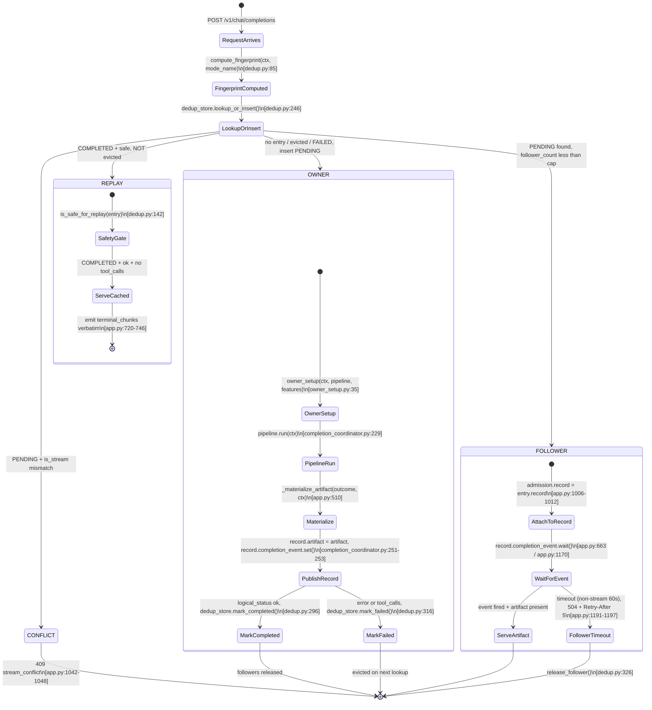

# 07 — Dedup & Completion Coordination

ChoriProx transparently deduplicates retried `POST /v1/chat/completions`
requests without requiring any client change, header, or plugin. When a client
re-sends the same body (same session, model, mode, workspace), the proxy
computes an HMAC-SHA256 fingerprint and atomically admits the request as one of
four kinds: **OWNER** (runs the full 9-stage pipeline), **FOLLOWER** (attaches
to an in-flight owner's `CompletionRecord` and waits on the same
`completion_event`), **REPLAY** (serves a cached artifact with zero pipeline
execution), or **CONFLICT** (stream-mode mismatch → 409). The system is built
on two modules — `proxy/dedup.py` (fingerprint + keyed store) and
`proxy/completion_coordinator.py` (bounded admission + worker pool) — wired
together in `app.py`'s chat-completions route.

---

## State Diagram



---

## Step-by-Step Walkthrough

### 1. Request arrives and fingerprint is computed

The chat-completions route (`app.py:933`) enters the dedup section after
`parse_request` has validated the body and built `RequestContext`. The active
mode name is resolved from the agent registry (`app.py:951-958`) to prevent
mode collisions (same body in different modes produces different responses).

`compute_fingerprint(ctx, mode_name)` (`dedup.py:85`) builds a payload dict
containing `session_id`, `client_hint`, `model`, `workspace_name`,
`is_subagent`, `mode`, and the full body (with `stream` stripped — line 97).
The payload is serialized via `canonical_json` (`dedup.py:69`: sorted keys,
compact separators, UTF-8, no NaN) and HMAC-SHA256 signed. The digest is
truncated to 32 hex chars (`dedup.py:109`).

### 2. Atomic lookup-or-insert

`dedup_store.lookup_or_insert(fingerprint, record_factory, is_stream)`
(`dedup.py:246`) acquires lock #14 and performs the admission decision under a
single lock hold:

| Existing entry state | Condition | Result |
|---|---|---|
| None / evicted | — | Insert PENDING → `(entry, OWNER)` |
| PENDING | `is_stream` matches, `follower_count < cap` | Increment count → `(entry, FOLLOWER)` |
| PENDING | `is_stream` mismatch | `(entry, CONFLICT)` |
| PENDING | `follower_count >= cap` | Raise `FollowerCapExceeded` |
| COMPLETED | `is_safe_for_replay(entry)` is True | LRU bump, NOT evicted → `(entry, REPLAY)` |
| COMPLETED | unsafe (tool calls, error, missing artifact) | Evict + new PENDING → `(entry, OWNER)` |
| FAILED | — | Evict + new PENDING → `(entry, OWNER)` |

(`dedup.py:258-294`)

### 3. OWNER path — streaming

The route calls `admit(pipeline, ctx, ...)` (`app.py:1095`,
`completion_coordinator.py:262`) which:

1. **Phase 1 (DECIDE):** under the coordinator's leaf `_lock`
   (`completion_coordinator.py:327-333`), checks `_shutdown` and
   `_pending < MAX_CONCURRENT_COMPLETIONS`. Raises
   `CompletionCapacityError` → 503 if at capacity.
2. **Phase 2 (MUTATE):** acquires the semaphore non-blocking
   (`completion_coordinator.py:336`), increments `_pending`, submits
   `_run_completion` to the `ThreadPoolExecutor`.

The worker (`_run_completion`, `completion_coordinator.py:179`):
- Runs `on_owner_start()` → `owner_setup(ctx, pipeline, _FEATURES)`
  (`owner_setup.py:35`): resets `ToolCallTracker`, activates inherited
  workspace, sets `DispatchStage._features` on the shared singleton.
- Calls `pipeline.run(ctx)` (line 229) — the full 9-stage pipeline.
- In `finally`: calls `materialize(outcome, ctx)` →
  `_materialize_artifact` (`app.py:510`) which renders terminal SSE chunks
  ONCE and detects tool calls (lines 572-584). Publishes `record.artifact`,
  sets `record.state = COMPLETED`, then calls `record.completion_event.set()`
  LAST (line 253) — the happens-before barrier.
- After `event.set()`: calls `on_completed()` which invokes
  `dedup_store.mark_completed(fp, artifact)` if `logical_status == "ok"`
  (`app.py:990-995`), or `mark_failed(fp)` otherwise.

### 4. OWNER path — non-streaming

The route calls `owner_setup` + `pipeline.run(ctx)` synchronously
(`app.py:1206-1207`). On success, it builds a `CompletionArtifact` with
`body=final_response` and `terminal_chunks=()` (`app.py:1222-1228`), stores it
on the record, and sets `completion_event` in a `finally` block (line 1255) so
followers never hang. The store is updated after the event fires
(`app.py:1263-1270`): `mark_completed` for ok artifacts without tool calls,
`mark_failed` otherwise.

### 5. FOLLOWER path — streaming

The follower skips `admit()` entirely. It receives the owner's
`CompletionRecord` from the dedup entry (`app.py:1006-1012`) and enters
`_keepalive_stream(ctx, record, on_follower_exit=_release_follower)`
(`app.py:1087-1088`). The generator yields `": connected\n\n"` immediately,
then polls `record.completion_event.wait(timeout=heartbeat_interval)` in a loop
(`app.py:663`). When the event fires, it emits
`record.artifact.terminal_chunks` verbatim. On `GeneratorExit` (client
disconnect), `on_follower_exit` calls `dedup_store.release_follower(fp)`
(`dedup.py:326`) to free the follower slot.

### 6. FOLLOWER path — non-streaming

The follower blocks on `record.completion_event.wait(timeout=60)`
(`app.py:1170`, env `PROXY_DEDUP_NONSTREAM_FOLLOWER_TIMEOUT`). If the event
fires and `record.artifact.body` is present, it returns the JSON body directly
(`app.py:1172`). On timeout, it releases the follower slot and returns
`504 + Retry-After: 5` (`app.py:1191-1197`).

### 7. REPLAY path

For streaming: `_replay_stream(ctx, artifact)` (`app.py:720`) yields
`": connected\n\n"` then `artifact.terminal_chunks` verbatim — no heartbeat,
no backstop, no rendering. The response carries `X-ChoriProx-Replay: hit`
(`app.py:1134`).

For non-streaming: the route reads `artifact.body` and returns it via
`jsonify` with the same replay header (`app.py:1151-1161`).

### 8. CONFLICT path

A PENDING entry with mismatched `is_stream` returns 409 with
`code: "stream_conflict"` (`app.py:1042-1048`). No pipeline execution, no
follower attachment.

---

## Fingerprint Computation

**Function:** `compute_fingerprint(ctx, mode_name)` — `dedup.py:85`

**Inputs to the HMAC-SHA256 payload:**

| Field | Source | Purpose |
|---|---|---|
| `session_id` | `ctx.session_id` | Scope per session |
| `client_hint` | `ctx.client_hint` | Distinguish opencode vs kilocode |
| `model` | `ctx.model_name` | Different models → different responses |
| `workspace_name` | `ctx.workspace_name` | Workspace-scoped context |
| `is_subagent` | `ctx.is_subagent` | Sub-agents get different treatment |
| `mode` | `mode_name` param | Prevents mode collisions (CP4-3) |
| `body` | `ctx.body` minus `stream` key | Full validated request content |

The body used is `ctx.body` (immutable after `parse_request`), NOT
`ctx.llama_body` (which is mutated by `ProviderCompatStage`) — `dedup.py:95`.

**Canonical serialization:** `canonical_json` (`dedup.py:69`) —
`json.dumps(sort_keys=True, separators=(",",":"), ensure_ascii=False,
allow_nan=False).encode("utf-8")`.

**Secret fallback chain** (`dedup.py:52-61`):
1. `PROXY_IDEMPOTENCY_SECRET` env var (UTF-8 encoded)
2. `PROXY_SESSION_SECRET` env var (UTF-8 encoded)
3. `os.urandom(32)` — process-local random (stable within process, not across restarts)

**Truncation:** `digest[:32]` — 32 hex chars (128 bits) — `dedup.py:109`.

**Logging:** only the first 8 chars appear in debug logs (e.g.,
`app.py:972`: `_dedup_fingerprint[:8]`). The full fingerprint is never logged.

---

## The Replay Safety Gate

**Function:** `is_safe_for_replay(entry)` — `dedup.py:142`

A pure, total, fail-closed predicate. Returns `True` only when ALL of:

1. `entry.state is DedupState.COMPLETED` (line 149)
2. `entry.artifact is not None` (line 152)
3. `artifact.logical_status == "ok"` (line 154)
4. `artifact.has_tool_calls is False` (line 156)

Any exception → `False` (line 159). Any uncertainty → `False`.

**Why tool calls are never replayed:** a response containing `tool_calls` or
`function_call` requires live pipeline processing — the tool pipeline
(`ToolPipeline.run()`) intercepts these, executes memory tools locally, and
re-queries the LLM. Replaying a stale tool-call response would skip execution
and deliver an already-consumed tool invocation to the client.

**Why errors are never replayed:** `logical_status` values other than `"ok"`
(`"stage_abort"`, `"backend_error"`, `"error"`) represent transient failures.
Caching them would poison subsequent retries — the client retries precisely
because the first attempt failed.

**Detection:** `_materialize_artifact` (`app.py:572-584`) scans every choice
for `message.tool_calls`, `message.function_call`, or
`finish_reason in ("tool_calls", "function_call")`. If any choice matches,
`has_tool_calls=True` is set on the artifact.

---

## CompletionArtifact

**Definition:** `completion_coordinator.py:110` — frozen dataclass.

```python
@dataclass(frozen=True)
class CompletionArtifact:
    terminal_chunks: tuple       # SSE strings for streaming (verbatim delivery)
    logical_status: str          # "ok" | "stage_abort" | "backend_error" | "error"
    original_request_id: str     # provenance
    content_type: str = "text/event-stream"
    wire_status: int = 200
    has_tool_calls: bool = False # gates replay safety
    body: Optional[dict] = None  # JSON response for non-streaming
```

**Dual-purpose design:**
- **Streaming:** `terminal_chunks` holds the fully-rendered SSE strings
  including exactly one `data: [DONE]\n\n` terminator. Delivery emits these
  verbatim — it never renders (`app.py:622-625`).
- **Non-streaming:** `body` carries the JSON response dict;
  `terminal_chunks` is an empty tuple (`app.py:1222-1223`).

**Materialized ONCE** by the completion worker (`_materialize_artifact`,
`app.py:510`) with frozen `id`/`created` fields — the byte-identity foundation
that CP4 replay depends on. The artifact is immutable after construction
(`frozen=True`).

**`logical_status` values and their source** (`app.py:527-592`):

| Status | Condition | Replayable? |
|---|---|---|
| `"ok"` | `outcome["result"]` is a dict, no errors | Yes (if no tool calls) |
| `"stage_abort"` | `outcome["stage_abort"]` is not None | No |
| `"backend_error"` | `outcome["backend_error"]` is not None | No |
| `"error"` | `outcome["error"]` is not None | No |

---

## Key Invariants

1. **Transparent — no client change.** No new header, no plugin, no client
   SDK modification. The fingerprint is derived entirely from what the client
   already sends. (`dedup.py:1-5`, `AGENTS.md:92-93`)

2. **Owner-only mutations.** `owner_setup` (`owner_setup.py:35`) fires ONLY
   for OWNER — never for FOLLOWER, REPLAY, or CONFLICT. This includes
   `ToolCallTracker.reset_instance`, workspace activation, and
   `DispatchStage._features` reset. (`app.py:1097`, `app.py:1206`)

3. **One worker, one pipeline.** FOLLOWER and REPLAY never call `admit()` or
   `pipeline.run()`. The upstream LLM is contacted exactly once per
   fingerprint per PENDING epoch. (`AGENTS.md:148-149`)

4. **PENDING never evicted by LRU.** TTL starts at COMPLETED
   (`dedup.py:228-231`). PENDING entries survive until the owner completes or
   fails. The `pending_max_age_seconds` cap (default 600s) is a crash guard
   only (`dedup.py:235-239`). `_evict_lru_completed` explicitly skips PENDING
   entries (`dedup.py:380`).

5. **Exact replay = stored artifact.** The replay path emits
   `artifact.terminal_chunks` verbatim (`app.py:733`) or returns
   `artifact.body` directly (`app.py:1153`). Never re-renders via
   `stream_response`. Byte-identical delivery.

6. **Lock #14 is a leaf.** `dedup_lock` (`state.py:233`) is never held while
   waiting on `completion_event`, running pipeline stages, or yielding SSE.
   The store's public methods acquire and release the lock internally; callers
   never hold it across I/O. (`AGENTS.md:155-156`, `state.py:228-232`)

7. **completion_event.set() is LAST.** The worker assigns `outcome`,
   `artifact`, `state`, and `completed_at` BEFORE calling `event.set()`
   (`completion_coordinator.py:242-253`). A woken subscriber observes a
   fully-populated record without a lock — the happens-before guarantee.

8. **Dedup never breaks the request.** The entire dedup section is wrapped in
   `except Exception` (`app.py:1049-1054`). If fingerprint computation or
   store access fails, the request proceeds without dedup (OWNER path, no
   store entry).

---

## Landmines

### Lock #14 must not be held during pipeline / SSE / wait

`dedup_lock` guards only the `OrderedDict` inside `DedupStore`. All public
methods (`lookup_or_insert`, `mark_completed`, `mark_failed`,
`release_follower`) acquire and release it internally. If any code path held
#14 while calling `completion_event.wait()`, `pipeline.run()`, or yielding
from an SSE generator, it would deadlock or starve all concurrent dedup
operations. The lock is position #14 (the leaf) in the 15-position hierarchy
— it must never be acquired while holding any other numbered lock.

### Retry storm break: mark_failed → evicted

When the owner fails (exception, `StageAbort`, capacity rejection), the entry
is marked FAILED (`dedup.py:316`). The NEXT `lookup_or_insert` call for the
same fingerprint evicts the FAILED entry and creates a fresh PENDING owner
(`dedup.py:283-294`). This breaks retry storms: a failed request does not
absorb followers for 600s; the next retry gets a clean shot.

Capacity rejection (`CompletionCapacityError`) also marks the entry FAILED
(`app.py:1107-1111`) so followers don't attach to a record that will never
complete.

### Follower timeout: 504 + Retry-After: 5

Non-streaming followers block with a configurable timeout
(`PROXY_DEDUP_NONSTREAM_FOLLOWER_TIMEOUT`, default 60s, `app.py:1169`). On
timeout, the follower releases its slot via `release_follower` and returns
HTTP 504 with `Retry-After: 5` (`app.py:1191-1197`). The client should retry
after 5 seconds — by then the owner has likely completed and the retry will
hit the REPLAY path.

Streaming followers use the heartbeat loop (`app.py:662-664`) with a backstop:
if the worker Future is done but the event never fired (cancelled worker), the
stream terminates with a canonical error (`app.py:673-674`).

### Fingerprint never logged in full

All log statements truncate to 8 chars: `_dedup_fingerprint[:8]`
(`app.py:972`, `app.py:1000`, `app.py:1015`, `app.py:1029`, `app.py:1037`,
`app.py:1189`). The full 32-char fingerprint is an HMAC digest that could
theoretically be used to probe the store; logging it in full would leak it to
log aggregators.

### FollowerCapExceeded → 503

When a PENDING key reaches `max_followers_per_key` (default 16,
`dedup.py:194`), `lookup_or_insert` raises `FollowerCapExceeded`
(`dedup.py:276`). The route catches this and returns 503 with
`code: "dedup_follower_cap"` and `Retry-After: 1` (`app.py:969-981`). This
prevents unbounded memory growth from a single hot fingerprint.

### Non-stream on_completed is inline, not a hook

For streaming, the `on_completed` hook runs in the worker's `finally` after
`event.set()` (`completion_coordinator.py:254-258`). For non-streaming, the
store update happens synchronously in the route AFTER `completion_event.set()`
fires in the `finally` block (`app.py:1260-1273`). The ordering is the same
(record published → store updated), but the mechanism differs.

---

## Cross-References

- **Topic 04 (SSE / Upstream Transport):** the upstream LLM is contacted ONLY
  for OWNER requests. FOLLOWER and REPLAY never reach `UpstreamStage` or
  `call_upstream`. The `_keepalive_stream` generator (the SSE delivery path)
  is a pure subscriber to the owner's `CompletionRecord` — it never renders,
  only emits pre-materialized chunks.

- **Topic 05 (Canary / Sub-Agent Ingress):** the fingerprint includes
  `is_subagent` (`dedup.py:103`), so a main-agent request and a sub-agent
  request with identical bodies produce different fingerprints. The mode name
  (which may be inherited via canary) is also included, preventing a sub-agent
  in ticket mode from colliding with a main agent in default mode.

- **Topic 10 (Lock Hierarchy):** `dedup_lock` is position #14
  (`state.py:233`), the leaf of the 15-position hierarchy. It is constructed
  via `make_lock(14, "dedup_lock", threading.Lock)` and passed to
  `DedupStore(lock=dedup_lock)` at `state.py:236`. The coordinator's internal
  `_lock` (`completion_coordinator.py:174`) is a separate documented leaf that
  never acquires any of the 14 numbered locks.
