# Deep-Dive 08 — Workspace System

> **Topic 8 of 10** (per [`docs/_analysis/ARCHITECTURE_DECOMPOSITION.md`](../ARCHITECTURE_DECOMPOSITION.md) §7).
> Scope: `src/proxy/workspace_state.py` (495 LOC) + `src/memory/workspace_persistence.py`
> (276 LOC) + `src/commands/workspace_commands.py` (110 LOC) + `src/skills/workspace.py`
> (501 LOC) + the workspace block in `src/proxy/state.py` (lock #6 + `workspace_store`
> singleton) + the canary/VFS consumers that read workspace state.

---

## 1. Overview

The workspace system is the proxy's mechanism for scoping tasks, bugs, VFS caches,
and sub-agent inheritance to a named "project context" (e.g. `feature-x`). It is
unusual in ChoriProx because it **cross-cuts four packages**: `proxy/` owns the
in-memory `WorkspaceStateStore` and lock #6, `memory/` owns the Neo4j persistence
layer, `commands/` owns the `^^workspace` / `^^ws` user-facing dispatch, and
`skills/` owns the `WorkspaceSkill` parser/handler. The single most important fact
about this subsystem is that **workspace MODE was never built** (US-066): the
original code scaffolded a full skill mode (`on_activate`, `get_tool_filter`,
`get_system_prompt`, a `proxy_workspace` tool) but that scaffold was dead code and
was deleted. What remains is a **parser-only, direct-command** surface — every
`^^workspace <subcommand>` is an atomic one-shot local state mutation with **no LLM
round-trip, no system prompt, and no tool filter**. Consequently `WorkspaceSkill`
is **deliberately NOT registered** in the `SkillRegistry`; `^^workspace` is a
COMMAND (in `COMMAND_REGISTRY`), not a skill. The v5 data model is a **global
catalog**: workspaces are bare-named proxy-level objects (`:Workspace` nodes keyed
on bare name, not `session_id:workspace`), visible to all sessions, with per-session
last-used tracking via `:Session` nodes and `[:LAST_USED_WORKSPACE]` edges.

---

## 2. Cross-Package Wiring Diagram

```mermaid
flowchart TD
    U["User types: ^^workspace foo"] --> RD["run_dispatch()<br/>dispatch.py:523"]
    RD --> TC["try_command (priority 4)<br/>dispatch.py:134"]
    TC --> CC["CommandContext(raw_text, session_id,<br/>client_hint) — Bug #7<br/>dispatch.py:178-182"]
    CC --> DC["dispatch_command(ctx)<br/>commands/__init__.py:72"]
    DC --> CW["cmd_workspace / cmd_workspace_alias<br/>workspace_commands.py:101 / 107"]
    CW --> DW["_dispatch_workspace(ctx, args)<br/>workspace_commands.py:58"]
    DW --> PS["WorkspaceSkill.parse_subcommand()<br/>workspace.py:134"]
    PS --> DS["_dispatch_subcommand()<br/>→ ('switch', 'foo')<br/>workspace.py:184 / 211"]
    DS --> HD["WorkspaceSkill.handle_direct()<br/>workspace.py:213"]
    HD --> HS["_handle_switch(ctx, 'foo')<br/>workspace.py:273"]
    HS --> GC["get_global_catalog()<br/>(Neo4j fetch OUTSIDE lock)<br/>workspace_state.py:260"]
    GC --> ACT["workspace_store.activate()<br/>workspace.py:316 → workspace_state.py:45"]

    subgraph LOCK6["lock #6 — active_workspace_lock (RLock) — state.py:512"]
        ACT --> MUT["update _active / _recent / _client_active<br/>workspace_state.py:64-78"]
        MUT --> CAP["capture persist_payload INSIDE lock<br/>workspace_state.py:80-87"]
    end

    CAP --> FIRE["fire persist OUTSIDE lock<br/>workspace_state.py:90-103"]
    FIRE --> PW["_persist_workspace(name, session_id)<br/>workspace_persistence.py:35"]
    PW --> N4J["Neo4j MERGE<br/>:Workspace + :Session +<br/>[:LAST_USED_WORKSPACE]<br/>workspace_persistence.py:53-60"]

    %% ===== Sub-agent inheritance path =====
    ACT -. "later, at response time" .-> ITC["inject_task_canaries()<br/>mode.py:539"]
    ITC --> GIS["get_inheritance_state()<br/>workspace.py:468 (pure data)<br/>ticket_skill.py:741 / work_skill.py:402"]
    GIS --> CARRY["canary carries workspace_name<br/>mode.py:601 (swarm) / 687 (legacy)"]
    CARRY --> SUB["sub-agent CLI forks →<br/>POST /v1/chat/completions"]
    SUB --> PR["parse_request →<br/>detect_subagent_ingress()<br/>canary.py:870"]
    PR --> IFP["_ingress_from_parse()<br/>workspace → inherited_skill=None<br/>canary.py:852 / 864-865"]
    IFP --> OS["owner_setup.activate_inherited_workspace()<br/>owner_setup.py:13"]
    OS --> SA["workspace_store.set_active()<br/>owner_setup.py:25 → workspace_state.py:219"]
    SA --> RIW["resolve_inherited_workspace()<br/>workspace_state.py:401"]
    RIW --> CHILD["child agent resolves workspace"]
    CHILD --> VFS["VFS scoping by workspace_id<br/>vfs.py:558-559"]
    CHILD --> PP["PostProcess workspace_id<br/>post_process.py:723-727"]
```



---

## 3. Step-by-Step Walkthrough

Each step maps to a diagram node. File:line references are grep-verified.

### Direct-command path (`^^workspace foo`)

1. **`run_dispatch()`** — `src/proxy/pipeline/dispatch.py:523`. DispatchStage (stage 2)
   iterates `_DISPATCH_HANDLERS` in priority order.
2. **`try_command` (priority 4)** — `dispatch.py:134`. The handler map is
   `{1: try_enhancer, 2: try_skill_activation, 4: try_command}` (`dispatch.py:515-520`).
   `^^workspace` is not a registered skill, so `try_skill_activation` (priority 2)
   does not claim it; `try_command` does.
3. **Build `CommandContext` with `client_hint`** — `dispatch.py:178-182`. **Bug #7**:
   `client_hint` is threaded off `RequestContext` (type-validated to a string at
   `dispatch.py:175-176`) so that `^^ws <name>` populates `workspace_store._client_active`,
   not just session-level state.
4. **`dispatch_command(ctx)`** — `src/commands/__init__.py:72`. Looks up the handler in
   `COMMAND_REGISTRY` under `_registry_lock` (`__init__.py:26`, `75`).
5. **`cmd_workspace` / `cmd_workspace_alias`** — `src/commands/workspace_commands.py:101`
   and `:107`. Both are registered via `@register("^^workspace", _HELP_TEXT)` /
   `@register("^^ws", _HELP_TEXT)` and both delegate to `_dispatch_workspace`.
6. **`_dispatch_workspace(ctx, args)`** — `workspace_commands.py:58`. Builds a minimal
   `SkillRequestContext` via `_build_skill_ctx` (`:37-55`) carrying `session_id` +
   `client_hint`, then calls `parse_subcommand` on the shared `_WORKSPACE_SKILL`
   instance (`:28`).
7. **`WorkspaceSkill.parse_subcommand()`** — `src/skills/workspace.py:134`. Normalizes
   text, matches the `^^workspace` trigger or the `^^ws` alias (`_parser_aliases`,
   `:114`), strips the trigger, and routes to `_dispatch_subcommand`.
8. **`_dispatch_subcommand()`** — `workspace.py:184`. A bare name that is not a known
   subcommand falls through to `return (_SUBCMD_SWITCH, stripped)` (`:211`) → yields
   `("switch", "foo")`.
9. **`WorkspaceSkill.handle_direct()`** — `workspace.py:213`. Routes `action == "switch"`
   to `_handle_switch(ctx, arg)` (`:231-232`).
10. **`_handle_switch()`** — `workspace.py:273`. Validates the name
    (`_is_valid_workspace_name`, `:72`), then fetches the global catalog **before**
    taking the lock (`:305` — see Landmines), then does the read-check-write under
    `workspace_store.lock` (`:307`).
11. **`get_global_catalog()`** — `src/proxy/workspace_state.py:260`. Cache hit returns
    under a short lock hold (`:274-278`); a miss fetches from Neo4j **outside** the lock
    (`:282-283`) and compare-and-sets under the lock (`:287-294`).
12. **`workspace_store.activate()`** — `workspace.py:316` calls
    `src/proxy/workspace_state.py:45`. (Note: the command path uses `activate()`, not
    `set_active()` — both share the identical persist-outside-lock pattern; `set_active()`
    is the sub-agent owner path, step 22.)
13. **Under lock #6** — `activate()` updates `_active`, `_recent` (MRU), `_last_access`,
    and `_client_active` (`workspace_state.py:64-78`), then captures `persist_payload`
    **inside** the lock (`:80-87`).
14. **Fire persist OUTSIDE the lock** — `workspace_state.py:90-103`. The in-memory
    activation always lands first; Neo4j failures never block activation. Includes a
    lazy rewire (`:94-96`) that imports `create_persist_callback` if `_persist` is None
    (handles Neo4j coming online after module load).
15. **`_persist_workspace(name, session_id)`** — `src/memory/workspace_persistence.py:35`.
16. **Neo4j MERGE** — `workspace_persistence.py:53-60`. One Cypher writes `:Workspace`,
    `:Session`, and `(s)-[:LAST_USED_WORKSPACE]->(w)`.

### Sub-agent inheritance path (canary carries workspace)

17. **`inject_task_canaries()`** — `src/proxy/mode.py:539`. At response time, when the
    parent's LLM emits `task` tool calls.
18. **`get_inheritance_state()`** — for the active skill (`ticket_skill.py:741` /
    `work_skill.py:402`) or the workspace-only case. `WorkspaceSkill.get_inheritance_state`
    (`workspace.py:468`) is **pure data** — it reads `workspace_store.get_active` and
    returns `{"workspace_name": ws, "workspace_id": ws}` with no mode activation.
19. **Canary carries `workspace_name`** — `mode.py:601` (swarm path,
    `state = {"workspace_name": active_ws}`) or `mode.py:687` (legacy MAIN path,
    `[[__SUBAGENT__:WORKSPACE:<name>:<sig>]]`). When there is no active skill and the
    workspace is `default`, a bare `[[__SUBAGENT__]]` is emitted instead (`mode.py:689`).
20. **Sub-agent forks and POSTs back** — the canary sits at position 0 of the first user
    message.
21. **`detect_subagent_ingress()`** — `src/proxy/canary.py:870`, called from
    `request_parse.py:187-196`. `_ingress_from_parse` (`canary.py:852`) maps a verified
    WORKSPACE canary to `(False, None, workspace_name, None)` — **`inherited_skill` is
    `None`, never the string `"workspace"`** (`canary.py:864-865`). `result.workspace_name`
    is set at `canary.py:942` and flows into `RequestContext.workspace_name`
    (`request_parse.py:225`; field at `types.py:136`).
22. **`owner_setup.activate_inherited_workspace()`** — `src/proxy/owner_setup.py:13`.
    Owner-only, runs immediately before `pipeline.run`. Validates via `make_workspace_id`
    (`state.py:535`) then calls **`workspace_store.set_active()`** (`owner_setup.py:25` →
    `workspace_state.py:219`). This is the path that uses `set_active` (vs. the command
    path's `activate`).
23. **`resolve_inherited_workspace()`** — `src/proxy/workspace_state.py:401`. Consumers
    call this to resolve a session's workspace, walking the `parent_agent_id` chain to the
    root when the session's own workspace is `default` (`:426-441`).
24. **Child agent gets the workspace** — the resolved `workspace_id` scopes:
    - **VFS caches** — `src/proxy/vfs.py:558-559`, caches keyed by `workspace_id` (`:563`).
    - **PostProcess** — `src/proxy/pipeline/post_process.py:723-727`.
    - **Tool pipeline** — `src/proxy/tool_pipeline/tool_pipeline.py:819-820`.
    - **Context V2** — `src/proxy/context_v2.py:1210-1211`, `1278-1289`.

---

## 4. `WorkspaceStateStore`

Defined at `src/proxy/workspace_state.py:20`. The module docstring (`:1-6`) states the
load-bearing contract: the lock passed to `__init__` **MUST** be the same object as
`state.py`'s `active_workspace_lock` to preserve lock-ordering position #6.

### Internal state (`__init__`, `workspace_state.py:27-42`)

| Field | Line | Purpose |
|---|---|---|
| `_lock` | 29 | The shared RLock (lock #6). |
| `_active: dict[str, str]` | 30 | `session_id → active workspace name`. |
| `_recent: dict[str, list[str]]` | 31 | `session_id → MRU list` (capped at `MAX_RECENT_WORKSPACES = 10`, `:16`). |
| `_last_access: dict[str, float]` | 32 | `session_id → timestamp` (drives stale-session GC). |
| `_client_active: dict[str, str]` | 33 | `client_hint → workspace` — client-level mapping for cross-session persistence (Bug #7). |
| `_persist` | 36 | `callable(workspace_name, session_id) \| None` — the Neo4j callback. v5 signature is bare name + audit session. |
| `_recovery_fn` | 37 | `callable(session_id) \| None` — wired post-construction (see §5). |
| `_recovered_sessions: set[str]` | 38 | Sessions where lazy recovery already succeeded (prevents re-recovery loops). |
| `_catalog_cache: list[str]` | 41 | Global workspace catalog cache. |
| `_catalog_cache_ts: float` | 42 | Cache timestamp (TTL `CATALOG_CACHE_TTL_SECONDS = 300`, `:17`). |

`DEFAULT_WORKSPACE = "default"` is at `:15`.

### `set_active` vs `activate`

Both methods are near-identical and both fire the persist callback **outside** the lock:

- **`activate(session_id, workspace, client_hint="")`** — `:45-105`. Returns
  `(old_active, updated_recent)`. Used by the `^^workspace` command path
  (`skills/workspace.py:316`, `:353`).
- **`set_active(session_id, workspace, client_hint="")`** — `:219-258`. Returns
  `old` only. Used by the sub-agent owner path (`owner_setup.py:25`) and the debug
  harness (`devtools/debug_session.py:728`, `:783`).

The shared pattern (shown for `activate`, `:63-103`):

1. Acquire `_lock`.
2. Read `old = _active.get(session_id, DEFAULT_WORKSPACE)`; write `_active[session_id] = workspace`;
   touch `_last_access`.
3. Update the MRU `_recent` (remove-if-present, insert at 0, truncate to 10).
4. If `client_hint` and workspace ≠ default, set `_client_active[client_hint] = workspace`.
5. If `_persist` is set and workspace ≠ default, capture `persist_payload = (workspace, session_id)`
   **inside** the lock and invalidate the catalog cache if the name is new (`:84-86`).
6. **Release the lock.**
7. Fire `self._persist(*persist_payload)` outside the lock, wrapped in try/except — failures
   only log a warning (`:99-103`). The lazy rewire at `:94-96` imports
   `create_persist_callback` if `_persist` is None.

### `get_active` (`workspace_state.py:130-184`)

Three-tier resolution:

1. **Session-level** — `_active.get(session_id)`; return immediately if present (`:147-149`).
2. **Client-level fallback** — if `client_hint` is set and `_client_active` has a workspace,
   **propagate it to session level** (write `_active`, touch `_last_access`, update MRU) and
   return it (`:152-164`).
3. **Cold session** — default to `DEFAULT_WORKSPACE` (`:167`), then attempt **lazy recovery**
   outside the lock (`:173-182`): if `_recovery_fn` is set and the session has not already
   been recovered, call it; re-read `_active` under the lock. A failed recovery does **not**
   mark `_recovered_sessions`, so the next call retries.

### Other operations

- **`deactivate(session_id, client_hint="")`** — `:107-128`. Pops `_active`/`_recent`/`_last_access`,
  clears `_client_active[client_hint]`. Deliberately does **not** discard from
  `_recovered_sessions` (`:114-117`) — otherwise the next `get_active` would re-recover from
  Neo4j and defeat a `^^workspace leave`.
- **`try_recover(session_id, active, recent)`** — `:186-205`. Atomic check-and-set used by
  Neo4j recovery; returns False if the session was already populated (a concurrent
  `activate()` won). Marks `_recovered_sessions` atomically with the write.
- **`get_global_catalog()`** — `:260-294`. See §5 and the BUG #12 note in the docstring
  (`:266-272`): the Neo4j round-trip is outside the lock so other sessions are not blocked.
- **`forget(session_id, workspace)`** — `:326-336`. Removes from MRU only; does not touch `_active`.
- **`pop_session(session_id)`** — `:338-345`. Removes all state for a session (used by GC).
- **`get_stale_sessions(ttl_seconds)`** — `:347-350`. Drives `cleanup_stale_workspaces`
  (`state.py:557`).
- **`lock` property** — `:368-371`. Exposes the RLock for callers needing custom compound
  operations (e.g. the TOCTOU fixes in `skills/workspace.py`).

### Singleton wiring (`state.py:512-529`)

```python
active_workspace_lock = make_lock(6, "active_workspace_lock", threading.RLock)  # state.py:512
_persist_cb = create_persist_callback()                                          # state.py:520 (None if Neo4j down)
workspace_store = init_workspace_store(active_workspace_lock, persist_callback=_persist_cb)  # state.py:523
workspace_store._recovery_fn = create_recovery_fn(workspace_store)              # state.py:524 (post-construction)
```

`init_workspace_store` is at `workspace_state.py:377-382`. The backward-compat aliases
`active_workspaces` / `recent_workspaces` / `session_last_access` (`state.py:527-529`)
point directly at the store's internal dicts for tests.

---

## 5. Neo4j Persistence (`memory/workspace_persistence.py`)

The v5 global model is stated in the module docstring (`:1-9`):

- `:Workspace` nodes keyed on **bare name** (no `session_id`).
- `:Session` nodes track which session last activated which workspace.
- Persist writes `:Workspace`, `:Session`, and `[:LAST_USED_WORKSPACE]` in one Cypher.
- Recovery loads the global catalog + per-session last-used.
- Cleanup deletes `:Session` + edges but **NEVER** `:Workspace` (global; may be used by
  other sessions).

All Neo4j access goes through `_get_executor()` (`:29-32`) →
`memory.query_executor.get_shared_executor_from_env()` (the single shared driver).

### `_persist_workspace(workspace_name, session_id)` (`:35-73`)

One `execute_write` (`:51-68`) performs three MERGEs:

```cypher
MERGE (w:Workspace {workspace_id: $workspace_id})
ON CREATE SET w.name = $name, w.created_at = datetime(), w.created_by_session = $session_id
SET w.last_active_at = datetime()
WITH w, $session_id AS sid
MERGE (s:Session {id: sid})
MERGE (s)-[r:LAST_USED_WORKSPACE]->(w)
SET r.last_used_at = datetime()
```

`created_by_session` is audit-only. All persist operations are fire-and-forget; failures
log a warning and never raise (`:69-73`).

### `create_persist_callback()` (`:200-208`)

Returns `_persist_workspace` if the executor is available, else `None`. This is what
`state.py:520` calls at module load. The callback signature is `(workspace_name, session_id)`.

### `recover_workspaces(workspace_store, session_id)` (`:76-133`)

The lazy-recovery function (bound via `create_recovery_fn`, `:274-276`, wired at
`state.py:524`). Three steps:

1. Load the bounded global catalog (`CATALOG_QUERY`, `:20-26`, `LIMIT 100`) and populate
   the store's catalog cache via `set_catalog_cache` (`:104`; store method at
   `workspace_state.py:296-300`). Ensures `"default"` is always present (`:101-103`).
2. Look up the session's `[:LAST_USED_WORKSPACE]` target (`:107-119`).
3. Atomically apply via `workspace_store.try_recover(session_id, active, catalog)` (`:129`).

### Catalog + cleanup

- **`get_global_catalog(executor=None, limit=100)`** — `:177-197`. Returns all `:Workspace`
  names sorted by `last_active_at DESC`, filtering compound IDs from un-migrated data;
  always includes `"default"`. Called by `WorkspaceStateStore.get_global_catalog`
  (`workspace_state.py:282`).
- **`cleanup_neo4j_sessions(session_ids)`** — `:136-174`. Batch-deletes `:Session` nodes +
  edges in `CLEANUP_BATCH_SIZE = 1000` (`:17`) chunks. Must run **outside**
  `AgentRegistry._lock` (#0) and `active_workspace_lock` (#6) (`:139`). Never touches
  `:Workspace`.
- **`cleanup_empty_workspaces(protect)`** — `:222-271`. Deletes `:Workspace` nodes with no
  live `:Task` and no `:Bug` (via `CLEANUP_QUERY`, `:211-219`), protecting `default` and the
  caller's active workspace. Invoked by `^^workspace cleanup` (`skills/workspace.py:392-417`).

---

## 6. `WorkspaceSkill` Subcommands (`skills/workspace.py`)

`WorkspaceSkill` (`:81`) extends `BaseSkill` but provides only the minimum identity fields
(`name = "workspace"` `:99`, `trigger = "^^workspace"` `:100`, `description` `:105`) plus a
separate `_parser_aliases = ("^^ws",)` field (`:114`). The alias is kept out of the
`SkillDefinition.aliases` field because that field's validator rejects the `^^`-prefix form;
since the skill is never registered, the parser-only `_parser_aliases` is sufficient.

### Subcommand table

> ⚠️ **Drift** — `src/skills/AGENTS.md` (§"Subcommands") and the task brief list **8**
> subcommands and omit `cleanup`. The code implements **9**: `cleanup` is a live subcommand
> (`_SUBCMD_CLEANUP` at `workspace.py:65`, dispatched at `:208-209`, handled by
> `_handle_cleanup` at `:392-417`, and documented in the `^^workspace help` text at `:445`).
> The table below reflects the code. **The table has 10 rows because the bare `^^workspace`
> and `^^workspace status` both map to the same `status` action** (9 unique action verbs,
> 10 trigger forms).

| Subcommand | Action | Handler | Behavior |
|---|---|---|---|
| `^^workspace` (bare) | `status` | `_show_status` (`:419`) | Show current workspace. |
| `^^workspace <name>` | `switch` | `_handle_switch` (`:273`) | Switch to an **existing** workspace; does NOT auto-create. Typo-guard + suggest `create`. |
| `^^workspace create <name>` | `create` | `_handle_create` (`:338`) | Create + switch; bypasses typo guard. |
| `^^workspace forget <name>` | `forget` | `_handle_forget` (`:358`) | Remove from MRU; refuses if it is the active workspace. |
| `^^workspace cleanup` | `cleanup` | `_handle_cleanup` (`:392`) | Delete empty workspaces (no tasks/bugs) from the global catalog. |
| `^^workspace recent` | `recent` | `_show_recent` (`:425`) | List per-session MRU. |
| `^^workspace list` | `list` | `_show_list` (`:456`) | List the global catalog. |
| `^^workspace status` | `status` | `_show_status` (`:419`) | Show current workspace. |
| `^^workspace leave` | `leave` | `_handle_leave` (`:247`) | Deactivate; return to `default`. |
| `^^workspace help` | `help` | `_show_help` (`:438`) | Usage text. |

The `switch` action is the **fallback** in `_dispatch_subcommand`: any stripped remainder
that is not a recognized keyword becomes `(_SUBCMD_SWITCH, stripped)` (`:211`).

### Name validation (`:52-78`)

```python
_WORKSPACE_NAME_PATTERN = re.compile(r"^[a-zA-Z0-9][a-zA-Z0-9-]*$")   # :52
_MAX_WORKSPACE_NAME_LENGTH = 64                                        # :53
_RESERVED_WORKSPACE_NAMES = {"leave", "default", "recent", "help",     # :54
    "list", "status", "admin", "system", "all", "create", "forget", "cleanup"}
```

`_is_valid_workspace_name` (`:72-78`) rejects empty/oversized names, reserved keywords, and
anything not matching the pattern. Names are lower-cased before validation in the handlers
(e.g. `_handle_switch` `:288`).

### Typo-guard fuzzy matching

`_FUZZY_MATCH_CUTOFF = 0.7` (`:69`). In `_handle_switch`, when the target name is not found,
`difflib.get_close_matches(normalized, list(existing), n=3, cutoff=_FUZZY_MATCH_CUTOFF)`
(`:320`) suggests near-matches ("Did you mean: …?") before telling the user to
`^^workspace create <name>` (`:331-336`). Per the comment (`:66-68`), 0.7 catches
single-char insert/delete/substitute typos and transpositions for names of length 4–15.
`^^workspace create` deliberately bypasses this guard (`:339`).

### `parse_subcommand` (`:134-182`)

Two paths: a **fast path** (`:143-159`) that matches the trigger/alias prefix directly, and
a **slow path** (`:161-182`) that strips CLI-framework environment tags via
`extract_command_text` and retries (size-guarded at 2048 chars, `:162`). A bare trigger
returns `("status", "")` (`:157-158`).

---

## 7. Key Invariants

1. **Workspace mode was NEVER built (US-066).** `^^workspace <name>` is a local state
   mutation handled in `handle_direct()`. There is no system prompt, no tool filter, no LLM
   round-trip. The module docstring (`workspace.py:1-28`) lists exactly what was removed:
   `get_tool_filter`, `get_system_prompt`, `on_activate`, `on_deactivate`,
   `should_deactivate`, `_deactivate_workspace`, `get_canary`. The remaining
   `on_activate`/`on_deactivate`/`should_deactivate` are no-op stubs (`:484-501`).
2. **`WorkspaceSkill` is NOT in `SkillRegistry`.** `populate_builtins` registers only
   `(TicketSkill, WorkSkill)` (`skill_registry.py:415`). `TRUSTED_BUILTIN_SKILLS =
   frozenset({"ticket", "work"})` (`skill_definition.py:287`) — `workspace` was removed
   (R2-Issue 3, option (b)).
3. **`^^workspace` is a COMMAND, not a skill.** It lives in `COMMAND_REGISTRY` via
   `@register` (`workspace_commands.py:101`, `:107`), imported as a side effect at
   `commands/__init__.py:262`. It appears ONLY in the Commands section of `^^help`, never
   the Skills section.
4. **`get_inheritance_state` is pure data (no mode).** `workspace.py:468-478` reads
   `workspace_store.get_active` and returns `{"workspace_name": ws, "workspace_id": ws}`.
   No activation, no LLM.
5. **Lock #6 protects all workspace state.** Every read/write of `_active`/`_recent`/
   `_last_access`/`_client_active`/catalog cache goes through `self._lock`
   (`workspace_state.py:29`), which IS `state.active_workspace_lock` (`state.py:512`).
   The store's `lock` property (`:368-371`) lets handlers build TOCTOU-safe compound ops.
6. **WORKSPACE canary sets `inherited_skill = None`** — never the string `"workspace"`
   (`canary.py:864-865`).
7. **Persist fires OUTSIDE the lock; activation lands first.** Neo4j failures never block
   workspace activation (`workspace_state.py:53-55`, `:89-103`).
8. **v5 workspaces are global (bare-named).** `workspace_id == workspace_name`; no
   `session_id:` prefix (`workspace_state.py:34-35`, `state.py:535-554`).

---

## 8. Landmines

- **Don't add mode code to `WorkspaceSkill`.** No `get_tool_filter`, no `get_system_prompt`,
  no real `on_activate`. If a future feature needs a genuine workspace mode, build it fresh
  — do not resurrect the deleted scaffold (`workspace.py:25-27`). Registering it in
  `populate_builtins` would re-introduce the deliberately-removed skill-mode activation path
  (`workspace_commands.py:3-7`).
- **`client_hint` threading (Bug #7).** `^^ws <name>` only populates
  `workspace_store._client_active` if `client_hint` is threaded all the way from
  `RequestContext` → `CommandContext` (`dispatch.py:171-182`) → `SkillRequestContext`
  (`workspace_commands.py:41-53`). Dropping it anywhere silently degrades cross-session
  workspace persistence to session-only.
- **`_find_parent_workspace` race (no lock #0 held).** `memory/tools/proxy_ticket.py:34`
  scans `_registry._agents` directly (`:52-56`) **without** acquiring `AgentRegistry._lock`
  (#0). Snapshot inconsistency is possible during heavy sub-agent spawning. This is the
  legacy fallback for when the SKILL canary format does not carry `workspace_name`.
- **`workspace_store._persist` is neutralized in tests.** The autouse fixture
  `_isolate_workspace_neo4j` (`tests/conftest.py:574-604`) sets
  `state.workspace_store._persist = None` (`:599`) and patches `create_persist_callback →
  None` (`:600-602`) so test activations never MERGE into the shared production Neo4j. This
  is the structural guard against the `2753fbe`-class leak that polluted prod with 230 test
  workspace nodes. Do not remove it to "fix" skipped persistence assertions; exercise
  `_persist_workspace` directly with a mocked executor instead.
- **Fetch the catalog BEFORE taking lock #6 in `_handle_switch`.** `get_global_catalog`
  does its Neo4j round-trip outside its own lock internally, but that release is a no-op when
  the caller already holds the RLock — so fetching under the outer lock would block ALL
  sessions (`workspace.py:296-305`).
- **`deactivate` must NOT clear `_recovered_sessions`.** If it did, the next `get_active`
  would re-recover from Neo4j and undo a `^^workspace leave` (`workspace_state.py:114-117`).
- **`make_workspace_id` validates against Cypher injection** (`state.py:535-554`). The
  sub-agent owner path runs inherited `workspace_name` through it before `set_active`
  (`owner_setup.py:22-23`); an invalid name is rejected with a warning, not activated.

---

## 9. Cross-References

- **[Deep-Dive 05 — Canary / Sub-Agent Ingress](./05-canary-subagent-ingress.md)** — the
  canary carries `workspace_name`. `WorkspaceSkill.get_inheritance_state`
  (`workspace.py:468`) supplies the pure-data state; `mode.py:601`/`:687` embed it in the
  SKILL/WORKSPACE canary; `canary.py:864-865` parses a WORKSPACE canary to
  `inherited_skill=None` + `workspace_name`.
- **[Deep-Dive 06 — VFS Lifecycle](./06-vfs-lifecycle.md)** — VFS caches are scoped by
  `workspace_id` resolved via `resolve_inherited_workspace` (`vfs.py:558-559`, caches keyed
  at `:563`). PostProcess resolves the same workspace for write-scan/cache-populate
  (`post_process.py:723-727`).
- **[Deep-Dive 09 — Skill Activation / Mode Lifecycle](./09-skill-activation-mode-lifecycle.md)** —
  the skill system **explicitly excludes** workspace from the registry: `populate_builtins`
  registers only `(TicketSkill, WorkSkill)` (`skill_registry.py:415`), and
  `TRUSTED_BUILTIN_SKILLS = {"ticket", "work"}` (`skill_definition.py:287`). `^^workspace`
  is routed through `COMMAND_REGISTRY`, not `SkillDispatcher`.
- **`src/proxy/AGENTS.md`** — lock hierarchy (#6 = `active_workspace_lock`) and the
  `workspace_store` singleton entry.
- **`src/commands/AGENTS.md`** — `^^workspace` / `^^ws` command registration and the Bug #7
  `client_hint` invariant.
- **`src/skills/AGENTS.md`** — `WorkspaceSkill` parser-only contract (note the subcommand
  table drift in §6 above).
- **`docs/specs/workspace-rework-v5.md`** — the v5 global-catalog model that supersedes the
  per-session v4 isolation.
