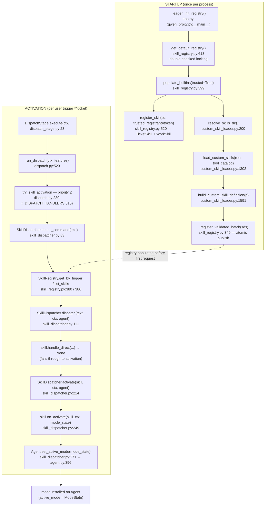
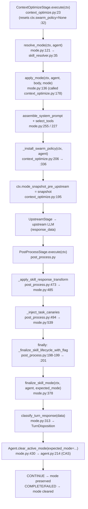

# Deep-Dive 09 — Skill Activation / Mode Lifecycle

> **Topic 9 of 10** (per [`docs/_analysis/ARCHITECTURE_DECOMPOSITION.md`](../ARCHITECTURE_DECOMPOSITION.md) §9).
> Scope: `src/proxy/mode.py` (741 LOC) + `src/proxy/skill_dispatcher.py` (283 LOC) +
> `src/proxy/skill_resolver.py` (167 LOC) + `src/proxy/skill_guard.py` (133 LOC) +
> `src/proxy/skills/custom_skill_loader.py` (1,663 LOC) + `src/proxy/skills/skill_registry.py` (688 LOC) +
> the trust-gate types in `src/proxy/skills/skill_definition.py` + the mode API in
> `src/proxy/agent/agent.py` + the two wiring stages (`ContextOptimizeStage`, `PostProcessStage`).

---

## 1. Overview

A *skill* in ChoriProx is a frozen `SkillDefinition` (identity + tool filters +
ten optional behavior callbacks) registered in a process-wide singleton
`SkillRegistry`. The lifecycle has two halves. **Activation** is dispatch-time:
a user trigger such as `^^ticket` is matched by `SkillDispatcher.detect_command`,
routed through `SkillDispatcher.dispatch` → `SkillDispatcher.activate`, and
installed onto the session's `Agent` via the atomic `Agent.set_active_mode`
(a CAS swap under the per-instance `_mode_lock`, lock #7). **Per-request mode
application** then runs inside `ContextOptimizeStage`: `resolve_mode` picks the
operating `Mode` (DEFAULT / SKILL / SUBAGENT / SKILL_SUBAGENT), and `apply_mode`
injects the skill system prompt and tool filter into the upstream body. On the
way back, `PostProcessStage` runs three split ops — `apply_skill_response_transform`,
`inject_task_canaries`, and `finalize_skill_mode` — the last of which classifies
the turn via the single-source `classify_turn_response` and **compare-and-clears**
the active mode in a `finally` block so finalization always runs. Registration is
protected by an unforgeable `TrustToken` confused-deputy gate; user-defined JSON
skills are loaded once at startup through a strict-schema, atomic-publication
loader that rejects the entire configuration on any single invalid file.

---

## 2. Cross-Package Wiring

Two diagrams. **2a** is the activation + startup path; **2b** is the per-request
path. Every arrow corresponds to a real function call (verified in §3).

### 2a. Startup publication + trigger activation



### 2b. Per-request mode application + finalization



---

## 3. Step-by-Step Walkthrough

Node IDs match the diagrams above.

### Startup publication (diagram 2a, left)

1. **S1 — `_eager_init_registry()`** (called from `qwen_proxy.py:__main__`, defined in
   `src/proxy/app.py`). Constructs the registry singleton at process boot, *before*
   `init_db()`. On `SkillRegistryConfigurationError` the CLI logs the diagnostic list
   and `sys.exit(1)` (operator-actionable failure — see `src/proxy/skills/AGENTS.md`
   §"Eager startup wiring").
2. **S2 — `get_default_registry()`** (`skill_registry.py:613`). Double-checked locking on
   `_registry_init_lock` (`skill_registry.py:227`): fast path returns `_default_registry`
   (`skill_registry.py:201`) if non-None; otherwise acquires the lock, re-checks, builds
   via `_skill_registry_new__` (`skill_registry.py:233`), calls `populate_builtins`, and
   publishes to `_default_registry` (`skill_registry.py:642`). Publication happens *after*
   population, so concurrent readers see either `None` or a fully-populated registry.
3. **S3 — `populate_builtins(trusted=True)`** (`skill_registry.py:399`). Iterates
   `(TicketSkill, WorkSkill)` (`skill_registry.py:415`); `WorkspaceSkill` is deliberately
   **not** registered (see §8 landmine + topic 8).
4. **S4 — `register_skill(sd, trusted_registrant=TrustToken.for_trusted_caller())`**
   (`skill_registry.py:520`, called at `skill_registry.py:421-423`). The `SkillDefinition`
   is built under `_held_trust_token(...)` (`skill_registry.py:419`) because the name
   (`ticket`/`work`) is in `TRUSTED_BUILTIN_SKILLS`. See §4 for the trust gate.
5. **S5 — `resolve_skills_dir()`** (`custom_skill_loader.py:200`). Resolves `PROXY_SKILLS_DIR`
   by *membership in `os.environ`* (not truthiness): unset → default `<repo>/skills`;
   empty string → disabled (`root=None`); set → that path, fatal if missing/not-a-dir.
6. **S6 — `load_custom_skills(root, tool_catalog, source=...)`** (`custom_skill_loader.py:1302`,
   called at `skill_registry.py:428`). Discovers + parses + validates every JSON file.
   `root is None` → disabled status, no work (`custom_skill_loader.py:1326`). See §5.
7. **S7 — `build_custom_skill_definition(p)`** (`custom_skill_loader.py:1591`, called at
   `skill_registry.py:448-450`). Converts each `ParsedCustomSkill` to a `SkillDefinition`,
   wiring the default direct-dispatch callbacks (`_default_*`).
8. **S8 — `_register_validated_batch(sds)`** (`skill_registry.py:349`, called at
   `skill_registry.py:451`). Acquires `self._lock` **once**, writes every definition into
   `_inner` + `_trigger_map`, then rebuilds the `_skills` `MappingProxyType` snapshot
   exactly once (`skill_registry.py:366-368`) — readers never observe a torn write.

### Trigger activation (diagram 2a, right)

9. **A1 — `DispatchStage.execute(ctx)`** (`dispatch_stage.py:23`). Stage 2 of the pipeline.
   Reads `self._features` (reset per request by `owner_setup`).
10. **A2 — `run_dispatch(ctx, features)`** (`dispatch.py:523`, called at `dispatch_stage.py:44`).
    Returns early `None` unless the last message is a user-role message (`dispatch.py:530-535`).
11. **A3 — `try_skill_activation` (priority 2)** (`dispatch.py:230`). The
    `_DISPATCH_HANDLERS` map (`dispatch.py:515-520`) is `{1: try_enhancer, 2: try_skill_activation,
    4: try_command}`; the loop iterates `sorted(...)` (`dispatch.py:537`). Priority 1
    (`try_enhancer`, `dispatch.py:67`) is **dead** — `ProxyFeatures` has no `enhancer_enabled`
    field, so its gate (`dispatch.py:80`) always returns `None`. Sub-agents never activate
    skills (`dispatch.py:238`).
12. **A4 — `SkillDispatcher.detect_command(text)`** (`skill_dispatcher.py:83`). Normalizes
    zero-width chars, sorts candidates by trigger length DESC (longer triggers win), and
    matches only on exact equality or `trigger + " "` (`skill_dispatcher.py:104`) — so
    `^^workspace foo` cannot match `^^work`.
13. **A5 — registry lookup.** `detect_command` consults `registry.list_skills()`
    (`skill_dispatcher.py:95` → `skill_registry.py:386`); trigger-keyed lookups use
    `get_by_trigger` (`skill_registry.py:380`).
14. **A6 — `SkillDispatcher.dispatch(text, ctx, agent)`** (`skill_dispatcher.py:111`,
    called at `dispatch.py:294`). Builds a `SkillRequestContext`, calls
    `skill.parse_subcommand(text)` (`skill_dispatcher.py:144`).
15. **A7 — `skill.handle_direct(...)`** (`skill_dispatcher.py:160`). For an activation-style
    command (e.g. `^^work <hash>` or natural-language `^^ticket`) it returns `None`, so the
    dispatcher falls through to activation. A non-`None` return short-circuits with
    `DispatchResult(handled=True)` (`skill_dispatcher.py:163-171`).
16. **A8 — `SkillDispatcher.activate(skill, ctx, agent, ...)`** (`skill_dispatcher.py:214`,
    called at `skill_dispatcher.py:187`). Builds a `ModeState` (`skill_dispatcher.py:239-245`).
17. **A9 — `skill.on_activate(skill_ctx, mode_state)`** (`skill_dispatcher.py:249`). Runs
    **first**; `ValueError`/`PermissionError` re-raise (security/policy), any other exception
    sets `activation_failed=True` and **blocks** the mode install (`skill_dispatcher.py:253-259`).
    This closes the pre-spec fail-open privilege-escalation window.
18. **A10 — `Agent.set_active_mode(mode_state)`** (`skill_dispatcher.py:271` →
    `agent.py:396`). Atomic CAS swap under `_mode_lock` (lock #7). Only reached when
    `activation_failed` is False (`skill_dispatcher.py:266`).
19. **A11 — mode installed.** `dispatch()` snapshots the just-installed mode
    (`skill_dispatcher.py:204`) and returns `DispatchResult(has_rewrite=True, expected_mode=installed_mode)`.
    The `expected_mode` is the **rollback anchor**: on a downstream rewrite failure,
    `DispatchStage` calls `agent.clear_active_mode(expected_mode=result.expected_mode)`
    (`dispatch_stage.py:94-96`) to undo the install.

### Per-request application + finalization (diagram 2b)

20. **P1 — `ContextOptimizeStage.execute(ctx)`** (`context_optimize.py:23`). Stage 5, CRITICAL.
    Resets `ctx.swarm_policy = None` at the top (`context_optimize.py:32`) so a prior request's
    policy never leaks forward.
21. **P2 — `resolve_mode(ctx, agent)`** (`mode.py:121`, called at `context_optimize.py:172`).
    A thin wrapper that delegates to `skill_resolver.resolve_mode(ctx, agent, registry)`
    (`mode.py:126-129`) and maps the returned string to the `Mode` enum (`mode.py:106-116`).
    The resolver clears stale (TTL-expired) modes — firing `on_deactivate` and
    `clear_active_mode` in two separate try blocks (`skill_resolver.py:54-82`) — then resolves
    DEFAULT/SKILL for main agents and SUBAGENT/SKILL_SUBAGENT for sub-agents (see §6 + topic 5).
22. **P3 — `apply_mode(ctx, agent, body, mode)`** (`mode.py:136`, called at
    `context_optimize.py:178`). Propagates the exact `ModeState` identity it used onto
    `ctx._mode_snapshot_propagated_from_apply_mode` (`mode.py:188`) to close a TOCTOU window.
    **Fail-closed** (`mode.py:195-202`): if the active skill is absent from the registry, raises
    `ActiveSkillUnavailable` (`mode.py:71`) → caller maps to HTTP 409 `skill_state_conflict`.
23. **P4 — prompt + tool injection.** `select_tools(agent, ctx, body, registry)` (`mode.py:227`)
    applies the skill tool filter; `assemble_system_prompt(...)` (`mode.py:255`) builds the
    system prompt, merged into `body["messages"][0]` (`mode.py:257-261`). Any callback exception
    is wrapped as `SkillRuntimeError` (`mode.py:88`, raised at `mode.py:310`) → HTTP 500
    `skill_runtime_error`. `ContextLimitError` propagates unchanged for HTTP 413 (`mode.py:295-298`).
24. **P5 — `_install_swarm_policy(ctx, agent)`** (`context_optimize.py:206` → `:336`). Runs
    **after** `apply_mode` succeeds. Reads `SkillDefinition.subagents` via `snapshot_mode()`
    and, for a non-subagent with a valid `SubagentPolicy`, sets `ctx.swarm_policy`
    (`context_optimize.py:387`); sub-agents are forced to `None` (`context_optimize.py:357-359`).
    **The swarm policy is installed here, in ContextOptimizeStage — not in PostProcess** (see §7).
25. **P6 — snapshot capture.** `ctx.mode_snapshot_pre_upstream` is set from the propagated
    snapshot (`context_optimize.py:190-195`), *after* `apply_mode` succeeds and *before* upstream
    runs. This is the CAS anchor that `finalize_skill_mode` compares against.
26. **P7 — UpstreamStage** (Stage 8) calls the upstream LLM; the parsed completion lands in
    `ctx.response_data`.
27. **P8 — `PostProcessStage.execute(ctx)`** (Stage 9). Reads `expected_mode` from
    `ctx.mode_snapshot_pre_upstream` (`post_process.py:77-78`).
28. **P9 — `_apply_skill_response_transform(ctx)`** (`post_process.py:473` → `mode.py:485`).
    Pure data transform: calls the active skill's `post_process()` callback; a missing skill or
    a raising callback returns the response unchanged (soft hook, not a correctness gate).
29. **P10 — `_inject_task_canaries(ctx)`** (`post_process.py:494` → `mode.py:539`). The **swarm
    boundary**: consults `ctx.swarm_policy` (set at P5). Three mutually exclusive paths — universal
    no-nesting reject for sub-agents (`mode.py:574-579`), swarm-parent strict canary
    (`mode.py:586-652`), and legacy main (`mode.py:654-696`). `StageAbort` from swarm rejection is
    re-raised; see topic 5.
30. **P11 — `finally: _finalize_skill_lifecycle_with_flag(ctx, expected_mode)`**
    (`post_process.py:198-199` → `:201`). Runs **unconditionally** on every exit path (normal,
    malformed-response abort, tool-interception early return, sync error). Sets
    `ctx.skill_lifecycle_finalized = True` (`post_process.py:213-214`).
31. **P12 — `finalize_skill_mode(ctx, agent, expected_mode)`** (`mode.py:378`, called at
    `post_process.py:548`). If `ctx.response_data is None` (no completed turn — preflight/deferred
    upstream) returns False without clearing (`mode.py:412-416`). If `expected_mode is None` returns
    False to avoid bypassing the CAS (`mode.py:425-426`).
32. **P13 — `classify_turn_response(data)`** (`mode.py:313`, called at `mode.py:427`). The
    single-source classifier — see §6.
33. **P14 — `Agent.clear_active_mode(expected_mode=...)`** (`mode.py:430` → `agent.py:214`).
    On CONTINUE the mode is preserved (`mode.py:428-429`); on COMPLETE/FAILED the CAS runs:
    `clear_active_mode` only clears if `self.active_mode is expected_mode` (identity check,
    `agent.py:231-232`). A concurrent replacement (Request B installed a newer mode) makes the CAS
    no-op and returns False, so B's mode survives (`agent.py:226-228`).

---

## 4. TrustToken Gate

Registration of a trusted builtin name is protected by **two stacked gates** that both defend the
same trust boundary.

### Gate 1 — construction-time (`_held_trust_token`)

`SkillDefinition.__post_init__` reads a thread-local (`_trust_token_local`, `skill_definition.py:276`).
A trusted name (one in `TRUSTED_BUILTIN_SKILLS`) can only be *constructed* while a TRUSTED token is
held via the `_held_trust_token` context manager (`skill_definition.py:363`). `populate_builtins`
wraps the build accordingly (`skill_registry.py:419`).

### Gate 2 — registration-time (`register_skill`)

`register_skill(sd, trusted_registrant=...)` (`skill_registry.py:520`) rejects a
`TRUSTED_BUILTIN_SKILLS` name when `trusted_registrant.is_trusted` is False
(`skill_registry.py:577-581`). The legacy `register()` path runs the same gate keyed off the *actual*
caller module via `inspect.stack()[1].frame.f_globals['__name__']` against `TRUSTED_TRUST_CALLERS`
(`skill_registry.py:476-492`) — **not** a self-asserted argument.

### Why self-assertion is impossible

`TrustToken` (`skill_definition.py:85`) is unforgeable:

- The only way to obtain a TRUSTED instance is `TrustToken.for_trusted_caller()`
  (`skill_definition.py:166`). Passing `trusted_registrant=True` is a `bool → TrustToken` type
  mismatch (`TypeError`), not a bypass.
- `for_trusted_caller()` inspects the call stack and requires the caller's module `__name__` ∈
  `TRUSTED_TRUST_CALLERS` (`skill_definition.py:189-193`).
- **Confused-deputy defense** (`skill_definition.py:201-207`): for production callers the immediate
  caller's function name (`co_name`) must also be in `_TRUSTED_CALL_SITES`
  (`skill_definition.py:66`). A wrapper defined inside a trusted module but with an unlisted function
  name is rejected — it cannot mint a token on behalf of an untrusted caller. Test modules are exempt
  via `_is_exempt_from_callsite_check` (`skill_definition.py:71`).
- **Synthetic-frame defense** (`skill_definition.py:214-223`): the caller module's `__file__` must
  match `f_code.co_filename`, defeating `exec(code, fake_globals)`.
- `_verified` is immutable post-construction (`skill_definition.py:229-239`), so
  `TrustToken.UNTRUSTED._verified = True` raises `AttributeError`.

### The trusted sets

- **`TRUSTED_TRUST_CALLERS`** (`skill_registry.py:35-50`) — the modules allowed to mint tokens /
  re-register builtins. Adding a module here **expands the trust boundary** and is a
  security-relevant change requiring review.
- **`_TRUSTED_CALL_SITES = frozenset({"populate_builtins"})`** (`skill_definition.py:66`) — the only
  production entry-point function allowed to mint tokens.
- **`TRUSTED_BUILTIN_SKILLS = frozenset({"ticket", "work"})`** (`skill_definition.py:287`) — the names
  reserved for builtins. `workspace` is **removed** from this set (workspace routing is parser-only,
  not a registered skill — see topic 8). `is_trusted_skill(name)` (`skill_definition.py:290`) is the
  public lookup; security-critical sites import it directly (e.g. `skill_guard.py:25`).

`SkillRegistrationError` (`skill_definition.py:310`) subclasses `PermissionError`, so existing
`except PermissionError` blocks keep working.

---

## 5. Custom JSON Skill Loading

Implemented in `custom_skill_loader.py`; invoked once at startup from `populate_builtins`
(`skill_registry.py:426-451`). **No hot-reload** — restart the proxy to pick up changes.

### Atomic publication (one invalid → nothing published)

`load_custom_skills` (`custom_skill_loader.py:1302`) accumulates *all* per-file issues, and
`populate_builtins` raises `SkillRegistryConfigurationError` (`custom_skill_loader.py:155`, a
`RuntimeError`) if any exist (`skill_registry.py:436-443`) — **before** any registration. Only when
every file parses cleanly does `_register_validated_batch` (`skill_registry.py:349`) publish the whole
set under a single lock acquisition. There is no partial-publication path. A missing *default*
`<repo>/skills` directory is healthy (builtins only, `custom_skill_loader.py:1344-1367`); a missing
*env-set* directory is fatal (`custom_skill_loader.py:1370-1373`).

### Strict schema (unknown key → whole skill rejected)

`ALLOWED_TOP_LEVEL_KEYS` (`custom_skill_loader.py:76-88`) is the closed set: `name`, `trigger`,
`description`, `prompt`, `prompt_file`, `tool_whitelist`, `aliases`, `ttl_seconds`, `subagents`.
`_check_unknown_keys` (`custom_skill_loader.py:882`) rejects the **entire skill** on any unrecognized
top-level key (code `unknown_field`) — this is the first check after object-shape validation
(`custom_skill_loader.py:1059-1061`). Silent field stripping is what created Phase 1's drift, so it is
deliberately fail-closed. `description` is **required** (`_check_description`,
`custom_skill_loader.py:307`). Inputs are strict-UTF-8 with BOM rejection (`_decode_strict_utf8`,
`custom_skill_loader.py:896`).

### Three-state `tool_whitelist`

The `SkillDefinition.allowed_tool_names` field is genuinely three-valued (`None` /
`frozenset()` / non-empty `frozenset`). **But the custom-skill loader does not produce all three** —
see the drift callout below.

| Value (on `SkillDefinition.allowed_tool_names`) | Meaning |
|---|---|
| `None` | No tool filter — LLM sees the union of client-allowed tools. Reserved for trusted Python builtins (TicketSkill/WorkSkill). |
| `frozenset()` (empty) | LLM sees **zero** tools (pure-text / pure-routing skill). |
| non-empty `frozenset` | LLM sees exactly those tools (subject to `PERMANENTLY_DENIED_FOR_CUSTOM`). |

> ⚠️ **Drift** — `src/proxy/skills/AGENTS.md` §"Three-state tool policy" documents the *omitted*
> (`None`) case as "No tool filter — WARNING logged at load," implying a custom skill may omit
> `tool_whitelist`. **The code disagrees.** `_check_tool_whitelist` (`custom_skill_loader.py:510-518`)
> rejects `raw is None` outright with code `tool_whitelist_missing` ("tool_whitelist is required and
> must be a non-empty list … missing list falls open to allow-all"), and `parse_custom_skill_file`
> asserts `data["tool_whitelist"]` is a `list` (`custom_skill_loader.py:1227`). The
> `tool_pipeline/AGENTS.md` landmine note matches the code: omitting `tool_whitelist` is a **hard load
> reject**, `[]` means deny-all, and the `None`/unrestricted sentinel is reserved for trusted builtins
> and never produced by the loader. Treat the loader as authoritative.

### `PERMANENTLY_DENIED_FOR_CUSTOM` and `CONDITIONALLY_ADMITTED_FOR_CUSTOM`

Two frozen constants split the parent-tool admission decision (`custom_skill_loader.py:55-61`):

```python
PERMANENTLY_DENIED_FOR_CUSTOM   = frozenset({"proxy_ticket", "proxy_work"})
CONDITIONALLY_ADMITTED_FOR_CUSTOM = frozenset({"task"})
```

Inside `_check_tool_whitelist` (`custom_skill_loader.py:491`):

- `proxy_ticket` / `proxy_work` → always rejected (code `tool_whitelist_denied`,
  `custom_skill_loader.py:556-565`). These are reserved for trusted builtins and are *also* enforced
  at runtime by the CAT-3 gate (§6 / `skill_guard.py:89`).
- `task` → admitted **only** when the same JSON object declares a `subagents` block
  (`custom_skill_loader.py:566-581`). Without it, code `swarm_subagents_missing`. With it, a
  provisional pass that skips the unknown-tool check; final admission is decided by the nested-policy
  parse (`_parse_subagent_policy`, `custom_skill_loader.py:657`) plus the outer gate
  `_check_swarm_outer` (`custom_skill_loader.py:868-878`), which requires
  `PROXY_ENABLE_CUSTOM_SKILL_SUBAGENTS == "1"` **and** a non-empty `PROXY_SESSION_SECRET`.
- The contradiction check rejects a `subagents` block whose parent whitelist lacks `task`
  (`custom_skill_loader.py:1260-1270`, code `swarm_parent_task_missing`).

Child sub-agent tools are gated separately by `SWARM_CHILD_FORBIDDEN =
frozenset({"task", "question", "proxy_ticket", "proxy_work"})` (`custom_skill_loader.py:642-644`) —
the universal no-nesting rule. A provisional `task` admission becomes final only after the whole
`subagents` policy, deployment flag, signing secret, and full configuration validate; there is no
second whitelist parser or runtime-only exception.

---

## 6. Per-Turn Deactivation Contract

### `should_deactivate → finish_reason == "stop"`

The builtin contract is "the mode clears when the model emits `finish_reason == 'stop'`":

- `TicketSkill.should_deactivate` returns `finish_reason == "stop"` (`ticket_skill.py:831-851`).
- `BaseSkill.should_deactivate` (`skill_definition.py:1139-1159`) is the inherited default: returns
  False (CONTINUE) for `tool_calls`/`length`, True otherwise.
- Custom JSON skills wire `_default_should_deactivate` (`custom_skill_loader.py:1542-1562`) with the
  same mapping.

> ⚠️ **Drift** — `should_deactivate` is **defined and wired into `SkillDefinition` but has zero
> runtime call sites.** A grep of `src/` for `.should_deactivate(` finds no callers; it is only
> assigned (`skill_definition.py:1365-1366`) and defined. The *operative* per-turn classifier is
> `classify_turn_response` (`mode.py:313`), invoked from `finalize_skill_mode` (`mode.py:427`). The
> `should_deactivate` callbacks mirror that classifier (their docstrings say so —
> `skill_definition.py:1146`, `custom_skill_loader.py:1550`) but are not on the live path.

> ⚠️ **Drift** — `src/skills/AGENTS.md` attributes `should_deactivate → finish_reason == "stop"` to
> **WorkSkill**, but `work_skill.py` defines **no** `should_deactivate` (grep confirms). WorkSkill
> inherits the `BaseSkill` default (`skill_definition.py:1139`), which clears on `stop`,
> `content_filter`, `None`, and any unknown reason — subtly broader than TicketSkill's explicit
> `== "stop"` override (`ticket_skill.py:851`).

### `finalize_skill_mode` CAS in `finally`

`PostProcessStage.execute` calls `_finalize_skill_lifecycle_with_flag` in a `finally` block
(`post_process.py:198-199`), so finalization runs on **every** exit path — normal response,
malformed-response abort, tool-interception early return, sync error, transform error
(`post_process.py:526-535`). It delegates to `finalize_skill_mode` (`mode.py:378`), which:

1. Returns False (preserve) if `ctx.response_data is None` — no completed turn (`mode.py:412-416`).
2. Returns False (preserve) if `expected_mode is None` — passing `None` into `clear_active_mode`
   would bypass the CAS identity check and unconditionally clear a concurrent request's mode
   (`mode.py:425-426`).
3. Otherwise classifies the turn and, on COMPLETE/FAILED, calls
   `agent.clear_active_mode(expected_mode=expected_mode)` (`mode.py:430`).

### `TurnDisposition` (`mode.py:50-64`)

The classifier returns one of **three** dispositions:

| Disposition | Trigger | Effect on mode |
|---|---|---|
| `CONTINUE` | non-empty `message.tool_calls` list (`mode.py:366-367`); or `finish_reason` ∈ {`tool_calls`, `length`} (`mode.py:370-371`) | preserved |
| `COMPLETE` | `finish_reason == "stop"` (`mode.py:368-369`); or `finish_reason is None` (`mode.py:372-373`) | cleared |
| `FAILED` | non-dict/empty/malformed choices (`mode.py:342-349`); `content_filter` (`mode.py:359-360`, checked *before* tool_calls); any other non-null reason (`mode.py:375`) | cleared |

> ⚠️ **Note** — there is **no `PARTIAL` member** of `TurnDisposition` (the enum is exactly
> `CONTINUE`/`COMPLETE`/`FAILED`, `mode.py:62-64`). `PARTIAL` is a *tool-loop closure* state belonging
> to topic 3 (tool result handling), not a turn disposition. Tool-calls-first ordering matters: a
> response carrying client-executable tool calls is CONTINUE even if a provider (e.g. MiniMax) emits a
> contradictory `finish_reason == "stop"` (`mode.py:362-367`).

### Downstream disconnect does NOT clear mode

`PostProcessStage` is the **sole** authority on the keep/clear decision (ticket 199ece93 §4). A
downstream client disconnect does not clear the mode — the completion thread runs PostProcess to
completion regardless. This is echoed in `TicketSkill.should_deactivate`'s docstring
(`ticket_skill.py:836-838`) and `src/skills/AGENTS.md` §"Lifecycle".

---

## 7. Key Invariants

1. **`SkillRegistry` is a singleton (double-checked locking).** `_default_registry`
   (`skill_registry.py:201`) under `_registry_init_lock` (`skill_registry.py:227`);
   `get_default_registry()` (`skill_registry.py:613`) checks → locks → re-checks → builds via
   `_skill_registry_new__` (`skill_registry.py:233`) → publishes *after* `populate_builtins`. The thin
   `__new__` shim (`skill_registry.py:250`) returns the cached singleton so legacy `SkillRegistry()`
   callsites keep working; the `__init__` guard (`skill_registry.py:290-306`) prevents the dataclass
   `__init__` from clobbering populated state.
2. **`SkillDefinition` is frozen.** Whole-attribute reassignment raises `FrozenInstanceError`;
   `skill_state` is threaded via `object.__setattr__` + `MappingProxyType` (e.g. `agent.py:93`,
   `skill_dispatcher.py:267-269`).
3. **Custom publication is atomic.** Either every valid JSON skill is registered
   (`_register_validated_batch`, `skill_registry.py:349`) or none are
   (`SkillRegistryConfigurationError`, `skill_registry.py:436-443`). One `_skills` snapshot rebuild per
   batch — no torn writes.
4. **CAS compare-and-clear.** `clear_active_mode(expected_mode=...)` clears only on identity match
   (`agent.py:231-232`); a concurrent replacement makes it no-op and return False. The
   `expected_mode` anchor is captured *before* upstream (`context_optimize.py:190-195`) and propagated
   from `apply_mode` (`mode.py:188`) to avoid a second atomic read re-opening the TOCTOU window.
5. **Lifecycle finalization always runs.** `_finalize_skill_lifecycle_with_flag` is in `execute()`'s
   `finally` (`post_process.py:198-199`); a separate `finalize_skill_mode_on_exception`
   (`mode.py:433`) covers the CRITICAL-stage-raises path where PostProcess never runs. The two are
   disjoint; CAS idempotency is the defense-in-depth backstop.
6. **Swarm policy is installed by ContextOptimizeStage, not PostProcess.** `_install_swarm_policy`
   (`context_optimize.py:336`) writes `ctx.swarm_policy` after `apply_mode` succeeds and resets it to
   `None` at stage entry (`context_optimize.py:32`); PostProcess's `_inject_task_canaries`
   (`post_process.py:494`) only *reads* it.
7. **`on_activate` runs before the mode install, fail-closed.** Both `SkillDispatcher.activate`
   (`skill_dispatcher.py:246-280`) and `_activate_skill` (`agent.py:39-107`) block `set_active_mode`
   when `on_activate` raises a non-security exception. `_inherit_skill` (`agent.py:110`) skips
   `on_activate` entirely for sub-agent inheritance.
8. **TrustToken is unforgeable.** Stack-inspected module + function-name + `__file__` checks
   (`skill_definition.py:166-224`); `_verified` immutable (`skill_definition.py:229-239`).

---

## 8. Landmines

- **Adding to `TRUSTED_TRUST_CALLERS` (`skill_registry.py:35-50`) is security-relevant.** It expands
  the trust boundary — any module listed can mint TRUSTED tokens and re-register `ticket`/`work`.
  Adding to `_TRUSTED_CALL_SITES` (`skill_definition.py:66`) is equally sensitive: each new production
  entry-point function that mints tokens must be enumerated, and a wrapper inside a trusted module is
  blocked unless listed (confused-deputy defense).
- **Three-state `tool_whitelist` confusion.** `None`/empty/non-empty are distinct on
  `SkillDefinition.allowed_tool_names`, but the **loader rejects an omitted `tool_whitelist`**
  (`custom_skill_loader.py:510-518`) — the `None` "no filter" state is reserved for trusted builtins
  and is never produced for a JSON skill. The old "empty list = allow all" Phase 1 semantics are gone:
  `[]` means **zero tools**. See the §5 drift callout.
- **Unknown JSON key rejects the whole skill** (`_check_unknown_keys`,
  `custom_skill_loader.py:882`). A single typo'd top-level field fails the *entire* custom
  configuration (atomic startup). This is intentional.
- **`workspace` is NOT registered.** `populate_builtins` registers only `(TicketSkill, WorkSkill)`
  (`skill_registry.py:415`); `WorkspaceSkill` is parser-only direct commands and `workspace` is absent
  from `TRUSTED_BUILTIN_SKILLS` (`skill_definition.py:287`). Workspace mode was never built (US-066) —
  see topic 8. Don't add mode-related code to `WorkspaceSkill`.
- **TTL is a backstop, not the primary deactivation.** `ttl_seconds` (default 300) only guards
  sessions that never reach a terminal `finish_reason`; the per-turn `classify_turn_response` →
  `finalize_skill_mode` path clears the mode first on `stop`. Stale-mode clearing in `resolve_mode`
  (`skill_resolver.py:54-82`) is the TTL-driven safety net. Orphaned work sessions are swept by the 24h
  `cleanup_stale_sessions` job, not by mode TTL.
- **`should_deactivate` is dead at runtime.** It is wired but never called (§6 drift). The live
  classifier is `classify_turn_response` (`mode.py:313`). Don't "fix" deactivation by editing
  `should_deactivate` — change the classifier.
- **`expected_mode=None` bypasses the CAS.** `finalize_skill_mode` deliberately returns False on a
  None anchor (`mode.py:425-426`); never pass `None` expecting an unconditional clear — it would clobber
  a concurrent request's freshly-installed mode.
- **`detect_command` matches on `trigger + " "`**, not bare `startswith`
  (`skill_dispatcher.py:104`) — so `^^workspace foo` cannot accidentally match `^^work`. Longer
  triggers are tried first (`skill_dispatcher.py:96-100`).

---

## 9. Cross-References

- **[Topic 5 — Canary / sub-agent ingress](./05-canary-subagent-ingress.md):** the canary is what
  *carries* skill inheritance to a sub-agent. `inject_task_canaries` (`mode.py:539`) signs and embeds
  the marker at response time; on the next request `parse_canary` sets `ctx.inherited_skill`, which
  `skill_resolver.resolve_mode` (`skill_resolver.py:121-163`) reads to resolve `SKILL_SUBAGENT` and call
  `_inherit_skill` (`agent.py:110`). The swarm-parent strict canary (`build_swarm_skill_canary`) is the
  Path B branch at `mode.py:586-652`.
- **[Topic 3 — Tool result handling](./03-tool-result-handling.md):** the `MemoryToolGuard` chain uses
  the active mode for tool filtering. `_check_hierarchy` delegates to
  `check_sub_agent_proxy_access` (`skill_guard.py:35`), which snapshots the mode (`skill_guard.py:73`),
  looks up the skill, and applies the CAT-3 trust gate (`skill_guard.py:89`) + capability table
  (`skill_guard.py:97-101`). `SkillDefinition.allowed_tool_names` / `sub_agent_tool_filter` drive the
  guard's mode-allowlist check. (Note: topic 3's `PARTIAL` closure state is distinct from this topic's
  `TurnDisposition`.)
- **[Topic 8 — Workspace system](../../specs/workspace-rework-v5.md):** workspace is
  **explicitly excluded** from the registry — `WorkspaceSkill` is never registered
  (`skill_registry.py:415`), `workspace` is not in `TRUSTED_BUILTIN_SKILLS`
  (`skill_definition.py:287`), and `^^workspace` is dispatched as a *command*
  (`commands/workspace_commands.py`), not a skill. Workspace propagation rides the WORKSPACE canary
  (`inherited_skill=None`) and `ctx.workspace_name`, never skill activation
  (`skill_resolver.py:124-129`).
- **`src/proxy/skills/AGENTS.md`** — SkillRegistry singleton, TrustToken gate, custom JSON loader
  contract (with the §5 drift noted above).
- **`src/skills/AGENTS.md`** — TicketSkill / WorkSkill / WorkspaceSkill concrete classes (with the §6
  WorkSkill `should_deactivate` drift noted above).
- **`src/proxy/agent/AGENTS.md`** — `Agent` mode API (`set_active_mode` / `clear_active_mode` /
  `snapshot_mode`), lock #7 (`Agent._mode_lock`), `_activate_skill` / `_inherit_skill`.
- **Internal documentation** — the spec of record for §7.4 (turn classifier) /
  §7.5 (post-process split) and the strict-schema loader contract.
