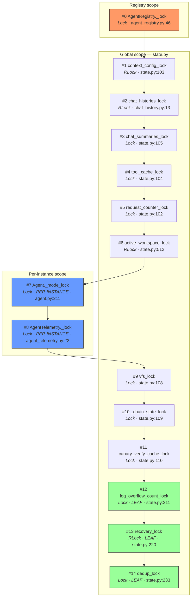

# 10 — Lock Hierarchy & State Management

ChoriProx's concurrency backbone is a 15-position lock hierarchy (#0–#14)
defined across `proxy/state.py`, `proxy/agent/agent_registry.py`,
`proxy/agent/agent.py`, and `proxy/pipeline/agent_telemetry.py`, with runtime
enforcement available via `proxy/lock_ordering.py`. All shared mutable state
— locks, counters, dicts, rate limiters, singletons — lives at module level in
`proxy/state.py` (705 LOC). Violations of the ascending-acquisition rule caused
**8+ adversarial-review-round deadlocks**, making this the single most
battle-tested invariant in the codebase. The hierarchy is complemented by a
strict import pattern (`import proxy.state as state`; never named imports for
counters), an auto-discovering rate-limiter reset, and a singleton discipline
that prevents split-state bugs.

---

## Layered Hierarchy Diagram



**Reading the diagram:** Arrows point from coarser (lower number) to finer
(higher number). A thread holding any lock may only acquire locks **below** it
(higher position numbers). Leaves (#12, #13, #14) never acquire any other lock.
Per-instance locks (#7, #8) are allocated per `Agent` object — they are NOT
globals in `state.py`.

---

## Step-by-Step Lock Walkthrough

### Position #0 — `AgentRegistry._lock` (coarsest)

| Attribute | Value |
|---|---|
| **File:Line** | `src/proxy/agent/agent_registry.py:46` |
| **Type** | `threading.Lock` (via `make_lock(0, ...)`) |
| **Scope** | Global singleton (`registry = AgentRegistry()` at line 546) |
| **Protects** | `_agents`, `_agents_by_id`, `_lru`, `_children`, `_in_flight_requests`, `_gol_query_log` |
| **Acquired by** | `request_scope()` (line 70), `get_or_load()`, `cleanup_stale_workspaces()` (state.py:582), `eviction_coordinator.py:52` |
| **May legally acquire** | #1–#14 (any higher lock) |

The coarsest lock. `RequestPipeline.run()` wraps the entire stage loop in
`request_scope(session_id)` which briefly acquires #0 to increment/decrement
`_in_flight_requests`. The `eviction_coordinator` acquires #0 AFTER releasing
#2 (`chat_histories_lock`) — see `eviction_coordinator.py:18-23`.

### Position #1 — `context_config_lock`

| Attribute | Value |
|---|---|
| **File:Line** | `src/proxy/state.py:103` |
| **Type** | `threading.RLock` |
| **Protects** | Context configuration reads/writes |
| **May legally acquire** | #2–#14 |

RLock because context resolution may re-enter.

### Position #2 — `chat_histories_lock`

| Attribute | Value |
|---|---|
| **File:Line** | `src/proxy/chat_history.py:13` |
| **Type** | `threading.RLock` |
| **Protects** | `chat_histories` dict, `_chat_histories_lru` OrderedDict |
| **Acquired by** | `ChatHistoryCache` methods, PostProcessStage history sync |
| **May legally acquire** | #3–#14 |

RLock because `ChatHistoryCache` read-through to SQLite may re-enter. The
`eviction_coordinator` explicitly releases #2 BEFORE acquiring #0
(`eviction_coordinator.py:18-23, 35-36`).

### Position #3 — `chat_summaries_lock`

| Attribute | Value |
|---|---|
| **File:Line** | `src/proxy/state.py:105` |
| **Type** | `threading.Lock` |
| **Protects** | `chat_summaries` dict |
| **May legally acquire** | #4–#14 |

### Position #4 — `tool_cache_lock`

| Attribute | Value |
|---|---|
| **File:Line** | `src/proxy/state.py:104` |
| **Type** | `threading.Lock` |
| **Protects** | `tool_cache` OrderedDict, `tool_cache_size`, `tool_cache_hits`, `tool_cache_misses` |
| **May legally acquire** | #5–#14 |

### Position #5 — `request_counter_lock`

| Attribute | Value |
|---|---|
| **File:Line** | `src/proxy/state.py:102` |
| **Type** | `threading.Lock` |
| **Protects** | `request_counter`, `request_id` |
| **Acquired by** | `CleanupStage` (increments counter, triggers periodic cleanup every 100 requests) |
| **May legally acquire** | #6–#14 |

### Position #6 — `active_workspace_lock`

| Attribute | Value |
|---|---|
| **File:Line** | `src/proxy/state.py:512` |
| **Type** | `threading.RLock` |
| **Protects** | `workspace_store._active`, `workspace_store._recent`, `workspace_store._last_access` |
| **Acquired by** | `WorkspaceStateStore` methods (workspace_state.py:29 stores the reference) |
| **May legally acquire** | #7–#14 |

RLock because workspace compound operations (set-active + persist) re-enter.
The `WorkspaceStateStore` constructor receives this lock object from state.py
— it MUST be the same object (`workspace_state.py:4, 23`).

### Position #7 — `Agent._mode_lock` (per-instance)

| Attribute | Value |
|---|---|
| **File:Line** | `src/proxy/agent/agent.py:211` (allocated in `__post_init__`) |
| **Type** | `threading.Lock` (via `make_lock(7, "Agent._mode_lock", threading.Lock)`) |
| **Scope** | **Per-Agent instance** — NOT a global |
| **Protects** | `agent.active_mode`, `agent._ticket_mode_ts` |
| **Acquired by** | `snapshot_mode()` (line 326), `set_active_mode()` (line 396), `clear_active_mode()` (line 214), `is_mode_expired()` (line 354), `get_mode_name()` (line 344) |
| **May legally acquire** | #8–#14 |

**Do NOT add a `_MODE_LOCK` global to `state.py`.** This was a recurring bug
proposal. Each Agent instance has its own lock so 100 concurrent sessions are
not serialized on one mutex.

### Position #8 — `AgentTelemetry._lock` (per-instance)

| Attribute | Value |
|---|---|
| **File:Line** | `src/proxy/pipeline/agent_telemetry.py:22` |
| **Type** | `threading.Lock` (via `make_lock(8, "AgentTelemetry._lock", threading.Lock)`) |
| **Scope** | **Per-Agent instance** (lives on `Agent.telemetry`) |
| **Protects** | Motivator threshold tracking (50/75/90% context-usage triggers) |
| **May legally acquire** | #9–#14 |

### Position #9 — `vfs_lock`

| Attribute | Value |
|---|---|
| **File:Line** | `src/proxy/state.py:108` |
| **Type** | `threading.Lock` |
| **Protects** | `vfs_caches`, `vfs_write_log`, `vfs_rollback_snapshots`, `instruction_files_by_workspace`, `_last_scanned_by_tool_call` |
| **Acquired by** | VFS read/write/rollback paths, `get_instruction_files()` (state.py:412), `record_instruction_file()` (caller holds) |
| **May legally acquire** | #10–#14 |

### Position #10 — `_chain_state_lock`

| Attribute | Value |
|---|---|
| **File:Line** | `src/proxy/state.py:109` |
| **Type** | `threading.Lock` |
| **Protects** | `_chain_state` OrderedDict (V2 chain-hash state per `(session_id, model_name)`) |
| **Acquired by** | `context_v2.py` (snapshot → release → CAS pattern), `invalidate_chain_state_for_session()` (state.py:505) |
| **May legally acquire** | #11–#14 |

The canonical access pattern is a two-phase protocol: acquire #10, snapshot +
`move_to_end`, release for I/O, re-acquire for CAS check + write + eviction
(state.py:455-469 documents this inline).

### Position #11 — `canary_verify_cache_lock`

| Attribute | Value |
|---|---|
| **File:Line** | `src/proxy/state.py:110` |
| **Type** | `threading.Lock` |
| **Protects** | `canary_verify_cache` OrderedDict (max 4096 entries, TTL 3600s) |
| **May legally acquire** | #12–#14 |

Keeps long-running sub-agents (>5 min) from losing ticket mode when the HMAC
freshness window expires.

### Position #12 — `log_overflow_count_lock` (LEAF)

| Attribute | Value |
|---|---|
| **File:Line** | `src/proxy/state.py:211` |
| **Type** | `threading.Lock` |
| **Protects** | `log_overflow_count` integer |
| **Acquired by** | `bump_log_overflow()` (state.py:239-242) |
| **May legally acquire** | **NONE** — leaf lock |

### Position #13 — `recovery_lock` (LEAF, RLock)

| Attribute | Value |
|---|---|
| **File:Line** | `src/proxy/state.py:220` |
| **Type** | `threading.RLock` |
| **Protects** | SQLite corruption-recovery serialization |
| **Acquired by** | `memory.db_recovery.recover_corrupt_db()` (db_recovery.py:633), `memory.db_pool` inline-recovery path (db_pool.py:2157-2186) |
| **May legally acquire** | **NONE** — leaf lock |

RLock because the recovery body calls `ensure_db_integrity()` from inside
`recover_corrupt_db()`, re-entering the lock. The former `recovery_in_progress`
flag was REMOVED (CRIT-3 fix, state.py:221-226) — it permanently disabled
auto-heal after the first successful recovery.

### Position #14 — `dedup_lock` (LEAF)

| Attribute | Value |
|---|---|
| **File:Line** | `src/proxy/state.py:233` |
| **Type** | `threading.Lock` |
| **Protects** | `DedupStore._store` OrderedDict (keyed completion map) |
| **Acquired by** | `DedupStore` methods internally (dedup.py:211, 258, 298, 318, 333, 347, 357) |
| **May legally acquire** | **NONE** — leaf lock |

The store is constructed with this lock at state.py:236:
`dedup_store = DedupStore(lock=dedup_lock)`. Lock #14 is never held while
waiting on `completion_event`, running pipeline stages, or yielding SSE.

---

## The `make_lock` Factory

**File:** `src/proxy/lock_ordering.py` (149 LOC)

```python
def make_lock(
    position: int,
    name: str,
    lock_type: type = threading.RLock,
    enabled: Optional[bool] = None,
) -> Union[threading.Lock, OrderedLock]:
```

### Production mode (default)

Returns `lock_type()` — a plain `threading.Lock` or `threading.RLock` with
zero overhead. The position and name are discarded at construction time.

### Debug mode (`PROXY_DEBUG_LOCK_ORDERING=1`)

Returns an `OrderedLock(position, name)` wrapper (line 38) that:

1. Maintains a per-thread `held_locks` list via `threading.local()` (line 35).
2. On every `acquire()`, checks that no lock with a **higher** position number
   is currently held by this thread (line 75: `if self._position < highest_held_pos`).
3. Raises `RuntimeError` immediately on violation (line 85-88) instead of
   silently deadlocking.
4. Supports re-entrancy: same-position acquisition skips the ordering check
   (line 71: `is_reentrant = any(p == self._position ...)`).
5. Uses an internal `threading.RLock` regardless of the requested `lock_type`,
   so debug mode always provides RLock semantics.

### Why per-instance locks (#7, #8) are NOT in `state.py`

`Agent._mode_lock` and `AgentTelemetry._lock` are allocated per object via
`make_lock(7, ...)` and `make_lock(8, ...)` in their respective constructors.
They cannot be module-level globals because:

- There are up to 100 concurrent Agent instances (LRU cache).
- A single global mode lock would serialize ALL sessions.
- The lock ordering guarantee still holds: each per-instance lock has a fixed
  **position** in the hierarchy, and the `OrderedLock` debug wrapper enforces
  ordering regardless of which instance owns the lock.

> **Drift note:** `lock_ordering.py:4` references "state.py:86-93" for the
> lock definitions. The actual definitions are at state.py:102-110, 211, 220,
> 233, 512. The comment is stale from a prior refactor.

---

## The `proxy.state` Mutation Pattern

### Why `import proxy.state as state` is mandatory

Python's `from proxy.state import tool_cache_size` binds the **current integer
value** to a local name. Reassigning (`tool_cache_size += 1`) creates a new
local binding — the module-level counter is unchanged. This is the
**named-import shadow bug** and it is silent.

```python
# CORRECT — mutates the module-level object
import proxy.state as state
state.tool_cache_size += 1

# WRONG — creates a LOCAL variable; module-level unchanged
from proxy.state import tool_cache_size
tool_cache_size += 1  # BUG: no effect on shared state
```

For mutable collections (dicts, lists), `from proxy.state import chat_summaries`
is safe for **mutation** (`.clear()`, `[key] = val`) because the reference is
shared — but reassignment (`chat_summaries = {}`) breaks. The convention is:
always use the module reference for consistency.

### Full counter list (all require module-reference mutation)

| Counter | Line | Guard lock |
|---|---|---|
| `request_counter` | 320 | `request_counter_lock` (#5) |
| `tool_cache_size` | 324 | `tool_cache_lock` (#4) |
| `tool_cache_hits` | 325 | `tool_cache_lock` (#4) |
| `tool_cache_misses` | 326 | `tool_cache_lock` (#4) |
| `param_modifications` | 642 | `param_mod_lock` (unnumbered) |
| `param_drops` | 643 | `param_mod_lock` |
| `param_clamps` | 644 | `param_mod_lock` |
| `param_injects` | 645 | `param_mod_lock` |
| `vfs_cache_hits` | 427 | `vfs_lock` (#9) |
| `vfs_cache_misses` | 428 | `vfs_lock` (#9) |
| `vfs_write_conflicts` | 429 | **outside `vfs_lock`** (mutated at `tool_pipeline.py:792`) |
| `log_overflow_count` | 210 | `log_overflow_count_lock` (#12) |

**Note on `vfs_write_conflicts`:** Only the VFS cache/log/snapshot containers (`vfs_caches`, `vfs_write_log`, `vfs_rollback_snapshots`) are guarded by `vfs_lock` (#9). The `vfs_write_conflicts` counter is incremented at `src/proxy/tool_pipeline/tool_pipeline.py:792` without acquiring `vfs_lock` — it sits outside the `with state.vfs_lock:` block (which closes at line 781) and runs in the post-conflict-detection path. This matches the doc 06 invariant: "Observability counters are not uniformly mutated under #9" (`06-vfs-lifecycle.md:405-410`).

### `AppState` — immutable configuration only

Defined at state.py:670-695. A `@dataclass` holding ONLY startup-time constants:

```python
@dataclass
class AppState:
    llama_url: str = "http://localhost:7777/v1/chat/completions"
    max_response_tokens: int = 1200
    cleanup_interval: int = 100
    session_ttl: int = 28800
    max_tool_cache_size: int = 100
    max_model_cache_size: int = 100
    max_message_content_size: int = 100 * 1024
    max_total_content_size: int = 500 * 1024
    summary_max_tokens: int = 2000
    enable_token_calculation: bool = True
    test_mode: bool = False
```

`AppState` does NOT wrap or re-create any mutable state. This prevents the
split-state bug where an `AppState` instance creates NEW dicts/locks that
diverge from the module-level ones.

### Non-hierarchy locks in `state.py`

Three locks exist in state.py that are NOT part of the 15-position hierarchy:

| Lock | Line | Type | Purpose |
|---|---|---|---|
| `param_mod_lock` | 106 | `threading.Lock()` | Guards param modification counters |
| `param_mod_log_lock` | 107 | `threading.RLock()` | Rate-limits param-modification log messages |
| `_cleanup_lock` | 532 | `threading.Lock()` | Guards `_last_cleanup_time` check-and-set (workspace cleanup rate limit) |

These are safe because they never interact with hierarchy locks — they are
acquired and released in isolation.

---

## Rate Limiters

All 8 limiters are defined at `state.py:131-143` as module-level
`RateLimiter` instances (class at `rate_limiter.py:30`).

| Limiter | Limit | Window | Persist | Notes |
|---|---|---|---|---|
| `command_rate_limiter` | 500 | 60s | yes | `^^` command dispatch gate |
| `enhancer_rate_limiter` | 500 | 60s | yes | `^^imp` gate (DEAD path — never checked) |
| `escalation_rate_limiter` | 5 | 3600s | **no** | ticket→work sub-agent escalation (B-5 mitigation) |
| `skill_rate_limiter` | 1000 | 60s | yes | Skill activation |
| `skill_ip_rate_limiter` | 3000 | 60s | yes | Per-IP skill gate |
| `task_rate_limiter` | 2000 | 60s | yes | `task` tool sub-agent spawning |
| `chat_rate_limiter` | 1000 | 60s | yes | `/v1/chat/completions` |
| `admin_rate_limiter` | 1000 | 60s | yes | `/v1/models`, `/health`, debug endpoints |

### Auto-discovery via `reset_all_rate_limiters()`

Defined at state.py:146-174. Iterates `dir(sys.modules[__name__])`, finds every
`RateLimiter` instance, and calls `.reset()`. Three call sites delegate to it:

1. `src/devtools/debug_session.py:_reset_all_shared_state`
2. `tests/integration/conftest.py:_reset_all_shared_state`
3. `tests/conftest.py:reset_rate_limiters` (autouse fixture)

**Future-drift guard:** asserts each limiter has a non-empty `_name` (line 169).
A limiter without a name would be silently unreachable from
`DebugSession.rate_limit_status()`.

`load_all_rate_limiter_state()` (state.py:177-207) mirrors the same
auto-discover pattern for startup hydration from SQLite. Called once by
`proxy.app.initialize_proxy_at_startup` AFTER `memory.sync.init_db` creates
the schema.

### Interim-limits warning

Commit `872964c` raised limits 50-100x from the HANDOVER_2026_06_04 values
(60/min). **Do NOT tighten back** without first implementing per-account rate
limiting. The current per-session/per-IP bucketing conflates all local
sub-agent traffic into one bucket — tightening would cause self-DoS.

---

## Singletons

| Singleton | Location | Lock | Notes |
|---|---|---|---|
| `_HTTP_SESSION` | `state.py:667` | None (thread-safe by design) | One `requests.Session()` shared across all requests; per-request auth via `headers=` param |
| `_chain_state` | `state.py:470` | `_chain_state_lock` (#10) | OrderedDict keyed on `(session_id, model_name)`; max 100 entries (env `PROXY_V2_CHAIN_STATE_MAX_ENTRIES`) |
| `canary_verify_cache` | `state.py:701` | `canary_verify_cache_lock` (#11) | OrderedDict; max 4096 entries; TTL 3600s |
| `neo4j_circuit_breaker` | `state.py:657` | Internal (CircuitBreaker._lock) | `CircuitBreaker(failure_threshold=3, recovery_timeout_seconds=30.0, name="neo4j")` |
| `ToolRegistry` | `tool_pipeline/tool_registry.py:154` | None (read-only after init) | Module-level `registry = ToolRegistry()`; 30 tools registered at import |
| `SkillRegistry` | `skills/skill_registry.py:201` | `_lock` (per-instance RLock, line 246) + `_registry_init_lock` (module Lock, line 227) | Double-checked locking singleton; `_registry_init_lock` is NOT in the 15-position hierarchy |
| `AgentRegistry` | `agent/agent_registry.py:546` | `_lock` (#0) | `registry = AgentRegistry()` module-level singleton |
| `workspace_store` | `state.py:523` | `active_workspace_lock` (#6) | `WorkspaceStateStore` instance; receives #6 lock at construction |
| `DedupStore` | `state.py:236` | `dedup_lock` (#14) | `dedup_store = DedupStore(lock=dedup_lock)` |

**Rule:** Always acquire a singleton's lock through `proxy.state` or the
owning module's public API. Never create a local `Lock()` for shared state.

---

## Key Invariants

1. **Ascending order only.** If you hold lock #N, you may only acquire #M where
   M > N. Never acquire a lower-numbered lock while holding a higher one.

2. **#7 and #8 are per-instance.** They are NOT globals in `state.py`. Each
   `Agent` object allocates its own `_mode_lock` via `make_lock(7, ...)` in
   `__post_init__`. Do NOT add a `_MODE_LOCK` global.

3. **#12, #13, #14 are leaves.** They NEVER acquire any other lock. Code holding
   a leaf lock must not call into any path that acquires another hierarchy lock.

4. **`AppState` is immutable config.** All mutable state (locks, dicts, counters)
   lives at module level in `state.py`, not in `AppState`.

5. **All mutable state at module level.** `state.py` is the ONLY module that
   defines shared locks/dicts/counters. Other modules import references.

6. **`reset_all_rate_limiters()` auto-discovers.** Adding a new `RateLimiter`
   to `state.py` automatically includes it in reset/load/discovery — no
   registration step needed. The `_name` drift guard ensures reachability.

7. **`_chain_state` max 100 entries.** LRU eviction via `popitem(last=False)`
   inside the #10 critical section. Env-tunable via
   `PROXY_V2_CHAIN_STATE_MAX_ENTRIES` (clamped to >= 1).

8. **`recovery_lock` has no companion flag.** The `recovery_in_progress` flag
   was removed (CRIT-3). Serialization is provided solely by the RLock; the
   recovery body is idempotent on a healthy db.

---

## Landmines

### 1. The 8+ deadlock history

Lock-ordering violations caused 8+ adversarial-review-round deadlocks. The
canonical failure mode: thread A holds #7 (`_mode_lock`) and waits for #0
(`AgentRegistry._lock`), while thread B holds #0 and waits for #7. The fix is
always: release the higher lock before acquiring the lower one, or restructure
to acquire in ascending order. The `eviction_coordinator.py` pattern (release
#2, then acquire #0) is the canonical example of doing this correctly.

### 2. Don't add `_MODE_LOCK` global to `state.py`

This was a recurring bug proposal. A global mode lock would serialize all 100
concurrent sessions. The per-instance design is intentional and correct.

### 3. Named-import shadow bug

```python
from proxy.state import tool_cache_size
tool_cache_size += 1  # SILENT BUG: local rebinding, module unchanged
```

This is invisible in unit tests (single-threaded, one request). It manifests in
production as counters that never increment, caches that never report hits, and
cleanup that never triggers.

### 4. Rate-limiter self-DoS

Per-session / per-IP bucketing conflates all local sub-agent traffic into one
bucket. A parent agent spawning 3 sub-agents via `task` burns 4x the expected
quota against `task_rate_limiter`. Tightening limits without per-account
bucketing would cause the proxy to rate-limit itself.

### 5. `_chain_state` max 100 entries

Under heavy multi-model load, entries evict. The next request for an evicted
session takes the cold path (fresh DB read). This is correct but expensive.
The cap is env-tunable (`PROXY_V2_CHAIN_STATE_MAX_ENTRIES`) but defaults to
100 for memory safety.

### 6. `PROXY_DEBUG_LOCK_ORDERING` is a self-DoS knob

The env var enables `OrderedLock` wrappers that add per-acquire overhead and
convert ordering violations from silent deadlocks to loud `RuntimeError`s.
Never enable in production — it is a debug/test tool only. Similarly,
`PROXY_TIER2_TEST_RACE` (state.py:397) injects a 20ms sleep inside `vfs_lock`
critical sections for fault injection.

### 7. `_registry_init_lock` is NOT in the hierarchy

The `SkillRegistry` singleton-init lock (`skill_registry.py:227`) is acquired
BEFORE any per-instance or per-request lock. It is held during
`populate_builtins()` file I/O. It does not interact with the 15-position
hierarchy and must not be assigned a position.

---

## Cross-References

| Topic | Connection |
|---|---|
| [07 — Dedup & Completion Coordination](./07-dedup-completion-coordination.md) | Lock #14 (`dedup_lock`) guards the `DedupStore`; leaf-lock discipline ensures #14 is never held while waiting on `completion_event` |
| [09 — Skill Activation Lifecycle](./09-skill-activation-lifecycle.md) | Lock #0 (`AgentRegistry._lock`) is acquired during skill activation for agent lookup; `request_scope` wraps the pipeline |
| [06 — VFS Lifecycle](./06-vfs-lifecycle.md) | Lock #9 (`vfs_lock`) guards all VFS caches, write log, rollback snapshots, and the Tier-2 instruction file map |
| [01 — SOTA Sync](./01-sota-sync.md) | Background pools (`_sync_pool`, `_summary_pool`) interact with lock #10 (`_chain_state_lock`) via `invalidate_chain_state_for_session()` after sync completes |

---

## Appendix: Lock Ordering Comment Block (state.py:294-315)

The canonical ordering reference lives inline in `state.py`:

```
# 0. AgentRegistry._lock          <- coarsest
# 1. context_config_lock
# 2. chat_histories_lock          <- RLock (re-entrant via ChatHistoryCache)
# 3. chat_summaries_lock
# 4. tool_cache_lock
# 5. request_counter_lock
# 6. active_workspace_lock        <- workspace state only
# 7. Agent._mode_lock             <- per-agent
# 8. AgentTelemetry._lock         <- per-agent
# 9. vfs_lock
# 10. _chain_state_lock
# 11. canary_verify_cache_lock
# 12. log_overflow_count_lock     <- leaf
# 13. recovery_lock               <- RLock, leaf
# 14. dedup_lock                  <- leaf
```

> **Drift note:** The state.py:219 comment references "AGENTS.md Lock ordering
> (positions #0–#13)" — this predates the addition of position #14. The
> authoritative table in the root `AGENTS.md` and `src/proxy/AGENTS.md` both
> list all 15 positions (#0–#14) correctly.
